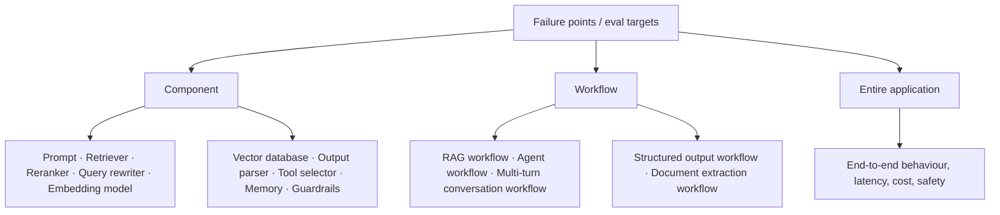
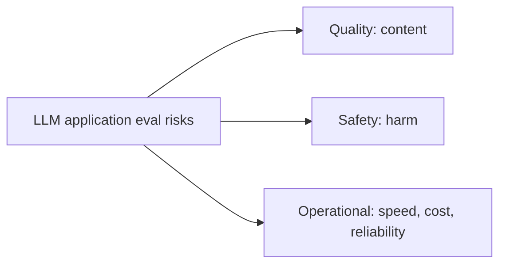
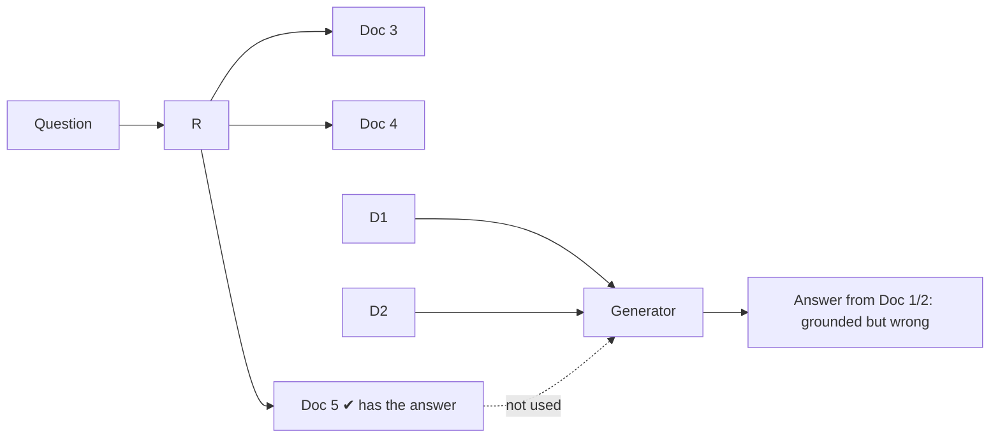
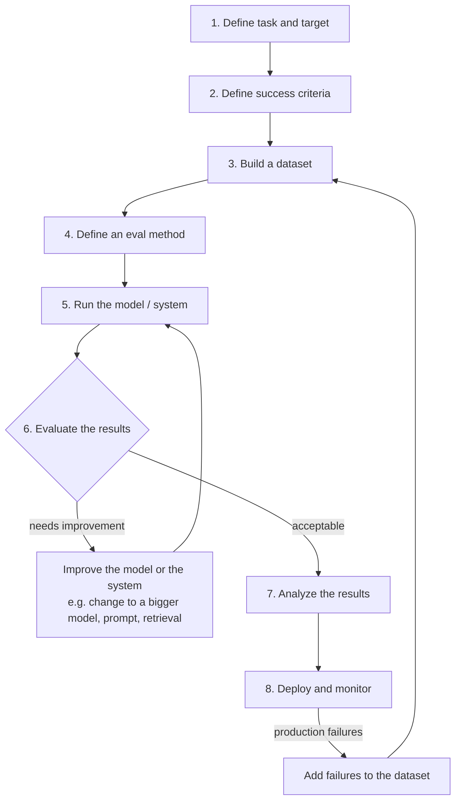
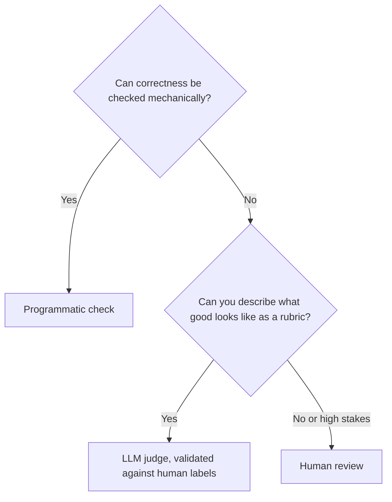
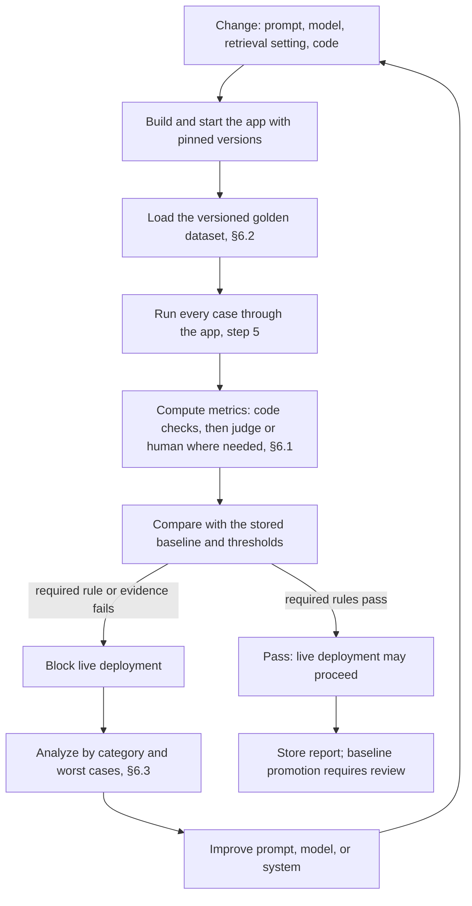
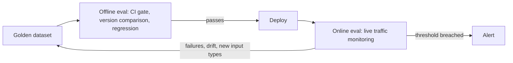

# Enterprise Knowledge Assistant — Evaluation (Evals) Developer Guide

|                 |                                                                                                                                                                                                                                                                                                                                                                                                             |
| --------------- | ----------------------------------------------------------------------------------------------------------------------------------------------------------------------------------------------------------------------------------------------------------------------------------------------------------------------------------------------------------------------------------------------------------- |
| **Document ID** | EKA-EVAL-GUIDE-001                                                                                                                                                                                                                                                                                                                                                                                          |
| **Status**      | Draft for review — explanatory guide, not an approved requirement                                                                                                                                                                                                                                                                                                                                           |
| **Audience**    | Developers, QA, product owners, reviewers                                                                                                                                                                                                                                                                                                                                                                   |
| **Source**      | Evaluation practice for LLM applications, analyzed against the current EKA code and specifications                                                                                                                                                                                                                                                                                                          |
| **Related**     | [Feature specification 011](../specs/011-evaluation-pipeline/spec.md), [plan](../specs/011-evaluation-pipeline/plan.md), [tasks](../specs/011-evaluation-pipeline/tasks.md), [backend evaluation README](../../enterprise-knowledge-assistant-backend/evaluation/README.md), [foundation spec](../specs/001-project-foundation/spec.md) (AC-13), [DEC-007 / DEC-010](./implementation/product-decisions.md) |

> **How to read this page.** Sections 1–6 explain evals in general (what, why, types, risks, the 8-step process). Sections 7–10 map those ideas to EKA: what already exists, what is missing, and what is proposed. Anything labelled **Proposal** is not approved. Numeric targets quoted here are _proposals from the foundation specification_, not release gates.

> **New to this? Start here.** An **eval** is a way of checking, with a fixed list of test questions and clear marking rules, whether an AI assistant is doing a good job — much like marking an exam. You ask the assistant many questions, compare its answers with what a good answer looks like, and turn the result into numbers and notes that help you decide: _ship it, fix it, or keep the old version_. Every section below starts with a short "In plain words" line for readers who prefer the simple version.

### Plain-English cheat sheet

| Term                                | In plain words                                                                              | Everyday comparison                                      |
| ----------------------------------- | ------------------------------------------------------------------------------------------- | -------------------------------------------------------- |
| **Eval**                            | A repeatable check of how good the assistant is.                                            | An exam with an answer key and marking scheme.           |
| **RAG**                             | The assistant first looks up passages in your documents, then writes an answer from them.   | An open-book exam: find the page, then write the answer. |
| **Retriever**                       | The part that finds the right passages.                                                     | The student flipping to the right page.                  |
| **Generator**                       | The part that writes the answer from those passages.                                        | The student writing the answer.                          |
| **Chunk**                           | A small piece of a document (a few paragraphs) stored for searching.                        | One index card from a long book.                         |
| **Top K**                           | The first K passages the retriever returns (K = 5 means five).                              | The five pages the student bookmarked.                   |
| **Recall@K**                        | "Of the pages that hold the answer, how many did we find in the top K?"                     | Found 1 of the 2 pages you needed = 0.5.                 |
| **MRR**                             | "How close to the top was the first right page?"                                            | A right page at position 1 is better than at position 5. |
| **Grounded / faithful**             | Everything the answer says can be found in the passages it was given.                       | "Show your sources" — no outside guesses.                |
| **Hallucination**                   | The assistant states something that is not in the documents, as if it were true.            | Confidently making up a page number.                     |
| **Abstain / insufficient evidence** | The assistant says it cannot find the answer instead of guessing.                           | "I don't know — it's not in the book."                   |
| **Citation**                        | A pointer to the passage an answer came from.                                               | A footnote.                                              |
| **Golden dataset**                  | The fixed list of test questions plus the correct evidence, checked by people.              | The exam paper with its answer key.                      |
| **Rubric**                          | A written scale that says what a 1, 3, or 5 means.                                          | A marking scheme.                                        |
| **LLM judge**                       | Another AI that marks the answers using a rubric.                                           | A teaching assistant marking papers.                     |
| **Baseline**                        | The last accepted set of results, used for comparison.                                      | Last term's marks.                                       |
| **Regression**                      | Something that used to work and now breaks.                                                 | A student who passed before and now fails.               |
| **Drift**                           | Real questions or documents change over time, so old tests stop matching reality.           | An exam that no longer covers what is taught.            |
| **Offline / online eval**           | Offline = tested before release on a fixed set. Online = watched after release on real use. | Mock exam vs. watching how students do in real work.     |
| **p95 latency**                     | The time that 95 out of 100 requests finish within.                                         | "Almost everyone is served within 1.5 seconds."          |

## Contents

1. [What is an eval?](#1-what-is-an-eval)
2. [Types of evals: Model evals vs Application evals](#2-types-of-evals)
3. [What an application eval can target](#3-what-an-application-eval-can-target)
4. [Risk categories](#4-risk-categories)
5. [Why component evals are not enough (RAG failure points)](#5-why-component-evals-are-not-enough)
6. [The 8-step eval pipeline](#6-the-8-step-eval-pipeline) — includes eval methods (§6.1) with the kinds of human evaluation (§6.1.2) and an all-types summary (§6.1.3), reference-based vs reference-free evals (§6.1.4), building a golden dataset (§6.2), analyzing results (§6.3), offline versus online evals (§6.4) including the step-by-step offline eval pipeline, and building an online eval pipeline (§6.5)
7. [Where EKA is today](#7-where-eka-is-today)
8. [Mapping EKA to the eval taxonomy](#8-mapping-eka-to-the-eval-taxonomy)
9. [Proposed EKA eval pipeline](#9-proposed-eka-eval-pipeline), including the owner-provided [custom candidate-model evaluation workflow](#98-custom-candidate-model-evaluation-workflow-owner-provided-proposal), the [cross-level regression suite](#99-cross-level-regression-suite-proposal), the [initial baseline and experiment tracking proposal](#910-initial-baseline-and-experiment-tracking-proposal), and the [live deployment regression gate](#911-live-deployment-regression-gate)
10. [Guardrails specific to EKA](#10-guardrails-specific-to-eka)
11. [Glossary and FAQ](#11-glossary-and-faq)

---

## 1. What is an eval?

> **In plain words:** an eval is the whole "how will we test this assistant?" plan — what we test, what counts as good, which questions we use, who or what does the marking, and when we do it. A single score is only one piece of that plan.

An **eval is not just a metric. An eval is the complete testing setup** for an LLM-powered system. It answers six questions:

| #   | Question                           | EKA example                                                                                                                                             |
| --- | ---------------------------------- | ------------------------------------------------------------------------------------------------------------------------------------------------------- |
| 1   | **What are we evaluating?**        | The question-answering path in the app (find passages → check there is enough evidence → write the answer → cite sources) through `/api/v1/chat/query`. |
| 2   | **What does "good" mean?**         | Answers come from the retrieved passages, citations are real, it honestly says "not enough evidence" when that is the case, and it replies fast enough. |
| 3   | **What test cases are we using?**  | A fixed, versioned list of test questions with restricted access, each paired with the passages that should answer it.                                  |
| 4   | **How are we judging the output?** | Automatic checks by code, review by people, and (proposal) an AI judge whose marking has first been checked against people.                             |
| 5   | **When are we running it?**        | Before each release, after changing the prompt (the instructions given to the AI), the model, or the similarity cut-off, and on a regular schedule.     |
| 6   | **Which tool are we using?**       | The test script in the backend repository (`evaluation/evaluate.mjs`).                                                                                  |

**The goal is not just a score.** The goal is to answer practical decisions:

- Can this model be used for this particular task or application?
- Is the system good enough to ship?
- Did prompt v2 improve over prompt v1?
- Is the answer based on the passages the assistant found?
- Is the agent completing the task correctly? _(EKA has no agent workflow in the MVP.)_
- Is the chatbot safe for real users?
- Is the response time under control?

> **Rule of thumb:** if an eval run cannot change a decision (ship / don't ship / keep prompt v1 / switch model), it is a report, not an eval.

---

## 2. Types of evals

There are two types. Both are LLM evals, but they answer different questions and are owned by different people.

> **In plain words:** a _model eval_ asks "how smart is this AI in general?" (like testing a new engine on a test bench). An _application eval_ asks "does **our product** work for **our users**?" (like test-driving the finished car). We focus on the second.

### 2.1 Model evals

**Evaluate the model itself — its general capabilities.** Typical capabilities:

| Capability               | Question                                 |
| ------------------------ | ---------------------------------------- |
| Reasoning                | Can it reason?                           |
| Knowledge                | Can it answer knowledge-based questions? |
| Maths                    | Can it solve maths problems?             |
| Coding                   | Can it write code?                       |
| Instruction following    | Can it follow instructions?              |
| Long context             | Can it follow long documents?            |
| Multimodal understanding | Can it understand images?                |
| Tool use                 | Can it use tools?                        |

Model abilities are usually measured with **public benchmarks** — shared, standard tests that anyone can run. Well-known examples are MMLU (general knowledge), GSM8K (maths word problems), and HumanEval (coding).

There are two common ways to evaluate models:

| Type | What it evaluates | When it is useful |
|---|---|---|
| **Benchmark evals** | A model's general capabilities on a shared dataset and scoring method, such as general knowledge, maths, or coding. | Shortlisting models using results that can be compared across published benchmark runs, while checking that the test setup is comparable. |
| **Custom model evals** | Candidate models on a task-specific dataset and criteria chosen for a particular organization or use case. | Checking which model best fits the real task, using the same cases and evaluation method for each candidate. |

For EKA, the proposed custom workflow evaluates candidates on EKA tasks using a fixed golden dataset and application flow; it therefore measures the model **as configured within EKA**, not the model in isolation. Keep prompts, retrieval settings, corpus, and other variables fixed or record changes, and treat this workflow as a proposal pending the decisions in [§9.8](#98-custom-candidate-model-evaluation-workflow-owner-provided-proposal) and [spec 011 OI-14](../specs/011-evaluation-pipeline/spec.md#open-items). Custom EKA evaluations complement rather than replace the application evals in §2.2.

**Who owns it:** public benchmark evaluations are commonly run by model labs or benchmark researchers. Application teams usually read those results to shortlist candidates, then can run their own custom evaluations for their specific tasks.

#### 2.1.1 Why AI engineers need model evals

> **In plain words:** before building on a model, you want to know how good it is, and you want to compare it with the others on equal terms. Model evals give you that.

| # | Reason | What it means in plain words | Where it shows up in EKA |
|---|---|---|---|
| 1 | **Compare different models fairly** | Run the same tests, in the same way, on every model. Only then do the scores mean something when set side by side. | Choosing between Ollama and OpenAI for chat and for embeddings (DEC-002). |
| 2 | **Track whether newer models are actually improving** | A newer model is not automatically a better one. Measure before and after instead of trusting the version number. | A provider releases a new version, or you swap `gpt-4o-mini` for another model. |
| 3 | **Decide whether a model is safe for release** | Check for harmful, biased, or easily tricked behaviour before real users see it. This gives a clear go or no-go. | Part of the safety risk category in §4. |
| 4 | **Build-versus-buy decisions** | Decide whether to pay for a hosted model (buy) or run an open model yourself (build). The scores, cost, speed and privacy needs give the evidence. | Hosted OpenAI versus a self-hosted Ollama model. |
| 5 | **Know what a model can and cannot do** | A model that is weak at following instructions or reading long text will struggle in a RAG app, whatever else you build. | Early check on instruction following and long-context ability. |
| 6 | **Separate "weak model" from "weak app"** | When an answer is bad, model results help you tell whether the model is the problem or your retrieval or prompt is. | Debugging a poor answer before changing retrieval settings. |

Limits to keep in mind:

- **Benchmarks wear out.** Some well-known tests get "solved" (models reach top scores) within a year or so, so a high score says less over time.
- **A high score is not proof of real ability.** A model can score well by using shortcuts it picked up from its training data.
- **Test setup matters.** The wording of the prompt and the answer format can change the result noticeably.
- **A public score is not your result.** A model can top a public benchmark and still answer badly on your own documents. That is why EKA also needs application evals (§2.2).

Short version: model evals tell you which engine to pick; application evals (the rest of this guide) tell you whether the whole car works on your road.

#### 2.1.2 The core capabilities of a model (how to read a benchmark report)

> **In plain words:** a benchmark report is a school report card for a model, with one grade per subject. To read it, you first need to know what each subject is, what it tests, and why anyone cares. This section explains the eight subjects. These capabilities describe general-purpose large language models (LLMs), not one particular application.

Every public benchmark falls under one of these eight capability domains. When you see a score in a model's report, first ask "which domain is this?", then read the matching part below.

| # | Capability domain | One-line meaning | Benchmark names you may see (examples) | Likely importance for EKA* |
|---|---|---|---|---|
| 1 | Knowledge and reasoning | How much the model knows, and whether it can think through several steps to a correct conclusion | MMLU, GPQA | High: answers must be sensible even when evidence is combined |
| 2 | Coding and software engineering | Whether the model writes code that actually works and can handle real software projects | HumanEval, SWE-bench | Low for answering questions; high only if the team uses the model to write code |
| 3 | Mathematics | Whether the model gets numbers and symbols exactly right | GSM8K, MATH, AIME | Medium: matters for questions that involve figures in documents |
| 4 | Long context | Whether the model can really use very long inputs | Needle-in-a-haystack tests, RULER | High: EKA puts many retrieved passages into one prompt |
| 5 | Vision and multimodal | Whether the model understands images, charts, forms and screens along with text | MMMU, ChartQA, DocVQA | Low for now: scanned documents and OCR are deferred (P5 in [the implementation backlog](implementation/Implementation_Backlog_v2.md)) |
| 6 | Agentic and tool use | Whether the model can take actions, not just write text | BrowseComp, OSWorld, tau-bench | Low for now: EKA does not run autonomous agents (out of MVP scope) |
| 7 | Safety and alignment | Whether the model can be trusted to behave responsibly | Refusal and jailbreak test suites | High: see the safety category in §4 |
| 8 | Instruction following | Whether the model does exactly what it was asked, no more and no less | IFEval | High: EKA relies on the model obeying "answer only from the evidence" and "cite sources" |

\*The importance column is guidance for reading reports, not an approved decision. Benchmark names change over time, so treat the examples as pointers rather than a fixed list.

##### 1. Knowledge and reasoning

- **What it measures:** how much factual knowledge the model learned during training, and whether it can connect several pieces of information and reason through them to the right conclusion.
- **What comes under it:**
  - *Factual recall across subjects.* Does the model know facts from biology, physics, chemistry, history, law, medicine, economics, philosophy and more? This is the most basic test of what the model has learned.
  - *Multi-step logical reasoning.* Can the model combine several facts in the right order? Instead of answering from one fact, it must follow a chain of reasoning to reach the final answer.
- **Why AI labs test it separately:** this domain is the usual stand-in for the question "how intelligent is this model?". It is also the capability the media and the public talk about most, so labs must show their models match or beat competitors on well-known knowledge and reasoning tests.
- **Where it matters in real life:** analysing research papers, answering complex customer questions, writing technically accurate documents, and assisting professionals in law, medicine, science and finance.

##### 2. Coding and software engineering

- **What it measures:** whether the model can write code that actually works, and whether it can operate inside real software projects with large codebases, many files, development tools, repositories and complex workflows.
- **What comes under it:**
  - *Writing single functions.* Turn a plain-language instruction into a function that handles edge cases, checks its inputs and follows the required interface.
  - *Fixing real bugs in existing code.* Given a real GitHub issue and an existing repository, find the root cause and produce a correct fix without breaking other parts of the software.
  - *Changes across many files and long tasks.* Edit several files, understand how parts of the system depend on each other, and do work such as refactoring or adding features.
  - *Command line and system administration.* Complete multi-step terminal tasks such as installing packages, configuring servers, running diagnostic commands and combining tools.
  - *Calling APIs and functions.* Make correct API calls with the right parameters, handle errors, and process the results properly.
- **Why AI labs test it separately:** better coding directly improves developer productivity and creates business value. Developers are also an important customer group and a major source of revenue, so labs compete hard on coding benchmarks.
- **Where it matters in real life:** code generation, debugging, code review, CI/CD automation, software maintenance and general software engineering. Coding tests often show some of the biggest gaps between leading and weaker models.

##### 3. Mathematics

- **What it measures:** whether the model can do accurate symbolic and numerical reasoning. Maths is a handy test because the final answer is usually simply right or wrong. A response cannot succeed just by sounding convincing.
- **What comes under it (from easy to very hard):**
  - *School-level maths.* Multi-step word problems: turn the words into maths and do the calculations in the right order.
  - *Competition-level problems.* Problems from contests such as AIME, which may need creative reasoning, counting methods, geometry, number theory and pattern spotting.
  - *University and postgraduate maths.* Advanced topics such as real analysis, abstract algebra, topology, probability theory and differential equations, which may need long chains of reasoning.
  - *Research-level maths.* Problems near the edge of current research, where even expert mathematicians may need days to reach a solution.
- **Why AI labs test it separately:** maths is one of the cleanest tests of real reasoning. There is little room for an answer that sounds plausible but is wrong, so it shows whether the model can reason formally and verifiably instead of only matching patterns.
- **Where it matters in real life:** scientific computing, financial modelling, engineering simulations, data analysis, and any application that needs precise numerical results.

##### 4. Long context

- **What it measures:** whether the model can effectively use information from very long inputs, sometimes hundreds of thousands of tokens. (A token is a small piece of text, roughly a short word or part of a word.)
- **What comes under it:**
  - *Finding one fact in a long text.* Locate a single piece of information hidden somewhere inside a very long document.
  - *Following the same thing across distant mentions.* Track one person, entity, idea or rule across several mentions that are far apart in a document or conversation.
  - *Combining information across a long text.* Summarise, count, compare or spot patterns using information spread across a large amount of text.
  - *Understanding a code repository.* Move through a large codebase, understand how files relate, and reason about dependencies across files.
- **Why AI labs test it separately:** the size of the "context window" (how much text the model can take in at once) has become a marketing number: 128K, then 200K, then 1M tokens. But a large advertised window does not guarantee the model can use all of it well. Labs therefore need to show their models genuinely use the capacity they claim.
- **Where it matters in real life:** reviewing legal contracts, analysing academic papers, maintaining large codebases, handling long customer-support conversations, and working with large collections of documents.

##### 5. Vision and multimodal

- **What it measures:** whether the model can understand and reason about visual information together with text. ("Multimodal" means more than one kind of input, such as text plus images.)
- **What comes under it:**
  - *Charts and graphs.* Read axes, legends, data points and trends. The model may need to pull out exact values and also explain what the chart means overall.
  - *Documents and forms.* Process scanned documents, invoices, tables and forms. The model must understand not only the words but also how they are laid out on the page.
  - *Computer and phone screens.* Recognise buttons, menus, dialog boxes, input fields and the current state of an application.
- **Why AI labs test it separately:** vision lets models do tasks that text-only systems cannot. It enables new uses, and it has become an important area where leading models can stand out now that many text benchmarks are close to being "solved".

##### 6. Agentic and tool use

- **What it measures:** whether the model can take actions instead of only producing text. An agentic model may browse the internet, call APIs, handle files, run code, operate software and finish complex multi-step tasks. To succeed it must plan its actions, choose the right tools, keep track of progress, and recover when something goes wrong. This is widely seen as one of the next big frontiers of AI evaluation.
- **What comes under it:**
  - *Web browsing and persistent research.* Move across many websites, follow links, search, and combine findings from many online sources. Some tasks may need dozens or even hundreds of pages.
  - *Calling tools and APIs.* Pick the right function, pass valid parameters, handle responses, chain calls together, and recover from errors.
  - *Using a computer.* Operate real applications by looking at the screen: clicking, typing and moving between word processors, spreadsheets, email clients and file managers.
  - *Planning multi-step tasks.* Break a big goal into smaller steps, finish them in the right order, check results along the way, and change the plan when something fails.
- **Why AI labs test it separately:** a model may hold a lot of knowledge and still be unable to use it to finish a practical task. Agentic tests measure the difference between **what the model knows** and **what it can actually do**. That gap is still large even among leading models.
- **Where it matters in real life:** coding agents, research assistants, customer-service bots, data-entry automation, personal assistants, and any workflow where the AI must perform actions rather than simply give an answer.

##### 7. Safety and alignment

- **What it measures:** whether the model can be trusted to behave responsibly. It checks that the model refuses harmful requests, avoids deceiving people, avoids simply flattering them (sycophancy), resists attacks, and keeps following its safety principles even when a user pushes it to behave differently.
- **What comes under it:**
  - *Refusing harmful requests.* Does the model properly refuse requests about cybercrime, violence, harassment, misinformation and illegal activity? It must also not become so cautious that it refuses harmless, legitimate requests.
  - *Resisting attacks and "jailbreaks".* Does the model keep its safety rules when someone tries to get around them with prompt injection (hidden instructions inside the input), role-play, encoded instructions or other tricks?
  - *Truthfulness versus flattery.* Does the model give the correct answer even when it disagrees with what the user believes or expects? A safe, reliable model should not just tell users what they want to hear.
  - *Cybersecurity ability.* Can the model perform advanced security tasks such as cryptography, reverse engineering, digital forensics and exploitation? This matters especially for understanding potentially dangerous independent capabilities.
- **Why AI labs test it separately:** safety is both a legal and regulatory expectation and a major reputation concern.
- **Where it matters in real life:** any organisation that releases an AI model to the public must test whether its safety controls really work. It directly affects legal liability, regulatory compliance, brand reputation, user trust and responsible deployment.

##### 8. Instruction following

- **What it measures:** whether the model does exactly what the user asked, no more and no less. Instructions may cover format, length, tone, style, structure or content. A model with excellent knowledge can still be frustrating to use if it keeps ignoring simple instructions.
- **What comes under it:**
  - *Rules that a program can check.* For example: stay within a word limit, use bullet points, produce valid JSON, follow a markdown structure, or use specific section headings.
  - *Unclear or incomplete requests.* Work out what the user probably wants when the request is underspecified, ask a clarifying question when needed, and pick sensible defaults when appropriate.
- **Why AI labs test it separately:** it strongly affects whether a model feels helpful or frustrating in daily use, and it is one of the capabilities most closely tied to user satisfaction in real production systems.
- **Where it matters in real life:** almost every practical use of a language model depends on it. Examples: reports in a required format, code that follows specific style rules, structured JSON output, brand-tone requirements, and coherent multi-turn conversations.

##### How to use this when reading a benchmark report

1. **Find the domain.** Match each score to one of the eight domains above.
2. **Pick the domains that matter for your application.** A high coding score tells you little about a document question-answering assistant like EKA.
3. **Check the setup.** Note which prompt, format and settings were used, and whether the lab or an independent group ran the test (see §2.1.3 for the full list of settings to check).
4. **Compare like with like.** Only compare models on the same benchmark run the same way (reason 1 in §2.1.1).
5. **Then test on your own data.** Public scores shortlist models; EKA's own application evals (§2.2 onward) decide.

#### 2.1.3 What a benchmark is made of, and what to check when comparing models

> **In plain words:** a benchmark score is the result of a whole recipe: the questions, the way you ask them, the settings, the way you mark, and the way you add up the marks. Change any one ingredient and the same model gets a different number. So two scores only mean something side by side if the recipe was the same.

A **benchmark** is a standard test used to measure one particular model capability (one of the eight domains in §2.1.2). Every benchmark has four parts.

| Part | What it is | Plain-words example |
|---|---|---|
| 1. The dataset | The questions plus the answer key | GSM8K: a few thousand (about 8,000) school maths word problems, each paired with its correct number |
| 2. The run configuration | The full list of settings the model was run under | How the question is worded, the model's settings, how many attempts, and whether tools were allowed |
| 3. The scoring method | How an answer becomes a number | Find the answer in the model's reply, then check whether it is right |
| 4. The aggregation | How thousands of marks become one headline number | 920 correct out of 1,000 becomes "92% on GSM8K" |

##### Part 1: the dataset

The dataset is the questions plus the answer key. Example question: *"Natalia sold clips to 48 friends in April, and then she sold half as many clips in May. How many clips did she sell altogether?"* The answer key says **72** (48 in April, 24 in May, 48 + 24 = 72).

##### Part 2: the run configuration

The run configuration is the list of every setting the model was run under. It has three layers. Two models can only be compared fairly if these match.

| Layer | Setting | What it means | Why it changes the score |
|---|---|---|---|
| **a. How the question is asked** | Zero-shot versus few-shot | Do you show some worked examples first (few-shot) or none (zero-shot)? GSM8K is classically reported "8-shot", meaning 8 examples. | Examples reliably raise scores because they teach the model the expected answer format. |
| | Chain-of-thought versus direct | Do you just ask, or add something like "think step by step"? | Asked bluntly, models often blurt out a wrong number. Asked to work through it (48 in April, half is 24 in May, 48 + 24 = 72), accuracy jumps a lot. |
| **b. How the model picks its words** | Temperature | At temperature 0 ("greedy"), the model always picks the most likely next word, so results are repeatable. Above 0 it samples, so the same question can give different answers on different runs. | Most benchmarks use 0 so the result can be reproduced. A different temperature means a different (and less repeatable) score. |
| | `max_tokens` | The maximum length of the reply. Step-by-step reasoning needs room. | If the limit is too low, the model is cut off mid-reasoning, never gives its final answer, and scores zero on a question it was solving correctly. That is a **setup failure, not a capability failure**, yet the score looks identical. |
| **c. How attempts are counted, and what the model may use** | One attempt versus several | `pass@1` = one attempt. `pass@k` = k attempts, counted right if any one succeeds. `maj@k` (self-consistency) = ask k times and take the most common answer. | These give very different numbers for the same model. For example, 92% on `maj@8` might be only 85% on `pass@1`. If a report does not say which one it used, the number cannot be interpreted. |
| | Tools on or off | May the model use a helper such as a Python interpreter? | A model with a Python tool scores very differently on maths than one without. GSM8K with code execution is barely the same test as GSM8K without it. |

##### Part 3: the scoring method

Scoring is how an output becomes a number. It has two steps.

- **a. Extraction:** finding the answer inside the reply. The model does not just say "72". It says something like "Natalia sold 48 clips in April. Half of 48 is 24. So 48 + 24 = 72 clips altogether." Something must pull the 72 out. This is usually a simple pattern-matching rule (for example "take the last number" or "read what comes after ####").
  - **Watch out:** this step is fragile and rarely discussed. If the model writes "72 clips", "$72" or "seventy-two", does the rule still catch it? A brittle extractor marks a correct model as wrong.
- **b. Comparison:** deciding whether the extracted answer is right. For GSM8K that is easy: is 72 equal to the key's 72?
  - **Closed-ended** questions have one right answer, so grading is automatic and there is nothing to argue about.
  - **Open-ended** tasks such as "write a good summary" have no answer key. You need a person or an AI judge, and then the grader itself becomes a source of error and bias. Most benchmark controversy lives here (see §6.1 and §9.5).

##### Part 4: the aggregation

Aggregation turns thousands of right-or-wrong marks into one summary number, for example 920 of 1,000 becomes "92% on GSM8K". Even this step involves choices. One is a plain average versus an average weighted by subject, because a benchmark such as MMLU has 57 subjects of unequal size. Different choices give different headline numbers.

##### Checklist when comparing models on a benchmark

Before trusting a comparison, confirm that both models were scored with the same:

1. **Dataset and version.**
2. **Prompt style:** zero-shot or few-shot (and how many examples), and chain-of-thought or direct.
3. **Temperature** (ideally 0 for repeatable results).
4. **`max_tokens`** limit, large enough that reasoning is not cut off.
5. **Attempt counting:** `pass@1`, `pass@k` or `maj@k`. If the report does not say, do not rely on the number.
6. **Tools** on or off.
7. **Answer extraction** rule, and whether it handles different ways of writing the answer.
8. **Comparison method:** automatic key, person, or AI judge (and how the judge was checked).
9. **Aggregation** method: plain or weighted average.

If any of these differ or are not stated, treat the comparison as unreliable. The same checks apply to EKA's own evals: record them in the run report (§9.6) so that two runs can be compared fairly.

##### How a model benchmark is run, step by step (for future reference)

> **Scope:** EKA does not evaluate models today. This is recorded so the team knows what the work involves if it ever does, for example to choose between two AI providers.

> **In plain words:** running a benchmark is a loop. For every question in the dataset, ask the model, pull out its answer, mark it right or wrong, and keep everything. After the last question, average the marks into one headline number.

For **each item** in the dataset:

| Step | What happens | Why it matters |
|---|---|---|
| 1. Load the item | Read one question and its correct answer (the answer key). | The key is never shown to the model. |
| 2. Build the prompt | Add worked examples if the benchmark is few-shot, apply the model's chat format, and add the instructions. The result is the exact text the model will see. | Small prompt changes can move the score, so the exact prompt must be fixed and saved. |
| 3. Call the model | Send the prompt with the fixed settings (temperature, `max_tokens` and so on). For a hosted model this is a web request. For a model run on your own machine it is a direct run of the model. | Fixed settings make the run repeatable. |
| 4. Capture the raw output | Save exactly what the model wrote, without editing it. | When a score looks wrong, the raw output is the only way to tell whether the model failed or the answer-extraction step did. |
| 5. Extract the answer | A rule or small parser pulls the final answer (for example `72`) out of the model's sentences. | A fragile rule can mark a correct answer wrong. |
| 6. Grade | Compare the extracted answer with the key: 1 if it matches, 0 if not. | This is the per-item score. |
| 7. Store | Save the score together with the prompt and output that produced it. | Lets anyone re-check a single result later. |

**After the loop:** average the per-item scores into the headline number (for example 920 right out of 1,000 is 92%).

```text
results = []
for item in dataset:
    prompt = build_prompt(item, few_shot=8, template=chat_template)
    output = model.generate(prompt, temperature=0, max_tokens=...)
    pred   = extract_answer(output)        # e.g. last number in the text
    score  = (pred == item.gold)           # 1 or 0
    results.append({prompt, output, pred, item.gold, score})

accuracy = mean(r.score for r in results)
```

Worked example: a model benchmarked on GSM8K (grade-school maths word problems) goes through exactly this loop. The same loop shape also fits EKA's own evals in §9, where the "item" is a golden-dataset question and the "model call" is the whole EKA answer flow.

##### What else you must handle, and why teams use an evaluation harness

The simple loop hides practical details that a real run must also handle:

- **Extracting the final answer correctly.** The model may write "The answer is C", "C." or "Option C". All three must be read as the same answer.
- **Scoring with the benchmark's exact method.** Using a different marking rule gives a number that cannot be compared with published results.
- **Sending thousands of questions efficiently, in batches.**
- **Retrying requests that fail**, so one network error does not leave a hole in the results.
- **Handling rate limits**, so the provider does not block the run for sending too fast.

An **evaluation harness** is a ready-made system that already handles these details. It already knows:

1. Where to get the benchmark's questions (GSM8K, MMLU and so on).
2. How to format each question.
3. How to send it to the model.
4. How to extract the model's answer.
5. How to judge whether it is correct.
6. How to calculate the final benchmark score.

> **In plain words:** a benchmark is the exam paper. An evaluation harness is the whole exam-running system: the instructions, the answer-sheet format, the marking rules and the score calculation.

Tools such as **lm-evaluation-harness**, **Inspect** and **HELM** act as evaluation harnesses. Using one also helps the comparison checklist above, because everyone who uses the same harness settings gets the same prompt, extraction and scoring. EKA does not need one today. If model comparison is ever needed, check these tools before writing a new runner.

##### Why benchmark scores can be misleading

> **In plain words:** a benchmark score is only trustworthy if the test was fair, is still hard, was run the same way for every model, and was summarised honestly. Each of these can fail.

| Problem | What it means | Simple example | What to do |
|---|---|---|---|
| **Contamination** | The test questions leaked into the model's training data, so the model may have memorised them. | A student who saw the exam paper beforehand scores 95%. That shows memory, not understanding. Public benchmarks are most at risk because their questions sit online for years. | Prefer newer or private test sets, and check whether the lab reports contamination checks. |
| **Saturation** | Top models already score very high, so the test can no longer tell them apart. | Two models score 96% and 97%. The gap is often noise, and the test has stopped measuring progress. | Look at harder benchmarks, and do not read much into small gaps. |
| **Configuration gaming** | The score depends on how the run was set up (prompt style, examples, chain-of-thought, attempts, tools, temperature), so a setup can be chosen to flatter one model. | Model A is shown with `pass@8` and tools on, and is compared with Model B at `pass@1` and tools off. | Use the comparison checklist above. If the setup is not stated, do not rely on the number. |
| **Aggregation** | One headline number hides detail. | An average over subjects of unequal size can hide a weak subject, or make two different models look equal. | Ask for the per-subject or per-category results, and how the average was calculated. |

Other causes worth knowing:

- **Wrong answer keys.** A few benchmark questions have mistakes in their keys, which caps or distorts scores.
- **Answer-extraction bugs.** A correct answer is marked wrong because the rule could not read it (see the steps above).
- **Teaching to the test.** A model tuned specifically for a famous benchmark may do worse on real work.
- **Poor fit to your use case.** A public benchmark does not test your documents, your users or your permission rules. This is why EKA's own evals in §9 use EKA's own golden dataset.

A benchmark score is a useful hint for shortlisting models, never proof that a model will work well in EKA.

### 2.2 Application evals (the focus for EKA)

**Check how well an application built on a large language model (LLM) behaves and performs — either the whole system or one part inside it.**

In an application eval we do **not** ask "Can the model do this?" We ask **"Does the product work?"**

The first column lists generic questions that apply to any LLM-powered application.

> **In plain words:** think of seven everyday questions — Is it right? Did it use our documents? Can I trace every claim to a source? Is it easy to understand? Did it make things up? Is it fast enough? Is it safe?

| Generic question (any LLM app)                                | EKA equivalent                                                                                                                                       | Eval dimension              |
| ------------------------------------------------------------- | ---------------------------------------------------------------------------------------------------------------------------------------------------- | --------------------------- |
| Did it answer the user's question correctly?                  | Did it answer the user's question correctly from the uploaded documents?                                                                             | Answer correctness          |
| Did it use the provided knowledge or context properly?        | Did it use the retrieved passages and cite them?                                                                                                     | Retrieval use, citations    |
| Was the answer faithful to the retrieved or provided context? | Does every claim trace back to cited evidence?                                                                                                       | Faithfulness / groundedness |
| Was it clear and useful for its intended audience?            | Is the answer clear and useful (human usefulness rating)?                                                                                            | Usefulness                  |
| Did it avoid making up facts, rules, or policies?             | Did it avoid inventing facts when evidence is missing?                                                                                               | Hallucination / abstention  |
| Did it respond quickly enough?                                | Is the time to find passages, and the total time to answer, within the agreed limit?                                                                 | Latency                     |
| Did it stay safe?                                             | No content leaking between document collections, no obeying hidden instructions planted in documents (prompt injection), no sensitive data revealed. | Safety                      |

#### EKA application-evaluation focus

Going forward, EKA evaluation focuses on **application behavior**, with two related targets:

1. **RAG chatbot evaluation:** evaluate the current end-to-end question-answering experience and its components, including retrieval quality, evidence-grounded answers, citations, abstention, authorization, safety, and latency.
2. **Agent application evaluation:** if agent workflows are introduced, evaluate them as application workflows—not as standalone model capability benchmarks. Assess whether the complete agent reliably completes its defined task, uses tools and retrieved evidence appropriately, respects authorization and safety constraints, handles failures, and meets operational limits.

The RAG chatbot is the current application target. Agent evaluation is a future direction and does not imply that agent workflows are part of the current MVP or authorized for implementation; each workflow needs defined requirements, risks, and acceptance criteria before its evaluation is added.

### 2.3 Application's building blocks

An LLM application can be viewed as a hub with these parts (bold = the parts most evals focus on): **User Interface**, Input Handler, **Prompt Layer**, **LLM / Model**, Context / Memory, **Tools / APIs**, **Orchestrator / Workflow**, **Retrieval System**, **Embedding Model**, **Vector Database**, **Guardrails / Safety**, **Output Parser**, **Monitoring / Logging**, **Feedback Loop**.

Each of these can fail independently, and each can be an eval target (Section 3).

---

## 3. What an application eval can target

> **In plain words:** you can test one small part (the document finder), a chain of parts (find, then answer), or the whole product the way a user experiences it. Small-part tests tell you _where_ the problem is; whole-product tests tell you _whether there is_ a problem.

The "Failure Points / Target" diagram splits targets into three levels:



| Level                  | What you test                                                        | Pro                                                                       | Con                                            |
| ---------------------- | -------------------------------------------------------------------- | ------------------------------------------------------------------------- | ---------------------------------------------- |
| **Component**          | One part in isolation (e.g., the retriever against labelled chunks). | Fast, cheap, pinpoints the cause.                                         | Passing parts can still make a failing system. |
| **Workflow**           | A multi-step path (e.g., the full RAG path or document ingestion).   | Catches problems that appear when one step passes its result to the next. | Harder to attribute a failure to one step.     |
| **Entire application** | The product as a user sees it, including latency and safety.         | The only level that answers "does it work?"                               | Slowest, needs the richest dataset.            |

**Recommended practice:** evaluate all three levels; use component evals to _diagnose_ and application evals to _decide_.

---

## 4. Risk categories

LLM application risk falls into three categories. Keep them separate when designing metrics — a high quality score says nothing about safety.

> **In plain words:** there are three different ways an assistant can let you down — it can give a **bad answer** (quality), a **harmful answer** (safety), or be **too slow, too costly, or unreliable** (operational). Doing well on one says nothing about the others.

**How a person would ask each question.** Use these everyday wordings when writing a rating sheet or briefing a reviewer.

| Category        | Technical name              | How a human asks it                                                               |
| --------------- | --------------------------- | --------------------------------------------------------------------------------- |
| **Quality**     | Correctness                 | "Is the answer actually right? If I checked the document myself, would it match?" |
|                 | Relevance                   | "Did it answer what I asked, or did it wander off?"                               |
|                 | Completeness                | "I asked two things — did it answer both?"                                        |
|                 | Groundedness / faithfulness | "Can I find every claim in the passages it quoted?"                               |
|                 | Hallucination               | "Did it make anything up that isn't in the documents?"                            |
|                 | Abstention                  | "When the documents don't have the answer, did it honestly say so?"               |
|                 | Citation accuracy           | "Does the source it points to really say that?"                                   |
|                 | Helpfulness / usefulness    | "Could I get my job done with this answer? Is it clear?"                          |
| **Safety**      | Toxicity                    | "Is any of it rude, abusive, or hateful?"                                         |
|                 | Harmful content             | "Does it explain something dangerous or illegal?"                                 |
|                 | PII / data leakage          | "Did it reveal private information, or content I'm not allowed to see?"           |
|                 | Prompt injection resistance | "If a document says 'ignore your rules', does the assistant still behave?"        |
|                 | Bias / fairness             | "Does it treat different groups of people fairly?"                                |
| **Operational** | Latency                     | "Did I get my answer quickly enough?"                                             |
|                 | Cost                        | "Is each answer cheap enough to run all day?"                                     |
|                 | Error rate                  | "How often does it just fail or time out?"                                        |
|                 | Latency under load          | "Does it stay fast when many people use it at once?"                              |

**Examples of a reviewer's one-line verdicts**

- "Correct and cited — 5."
- "Partly right: it covers the leave policy but misses the approval step — 3."
- "Sounds confident but the source says something different — 1."
- "Good: it said it couldn't find this in the documents instead of guessing."

| Category                | The question                                                       | Concerns                                                                                                                                       | Is about…                                                |
| ----------------------- | ------------------------------------------------------------------ | ---------------------------------------------------------------------------------------------------------------------------------------------- | -------------------------------------------------------- |
| **Application quality** | "Is the answer right, and does it actually help?"                  | The answer is correct, stays on topic, covers everything that was asked, and helps the user get the job done.                                  | **What the answer says.**                                |
| **Safety**              | "Could this answer hurt someone or leak something it shouldn't?"   | Nothing offensive or dangerous, no unfair treatment of people, no private data revealed, and it cannot be tricked into ignoring its own rules. | **Any harm** the answer could cause.                     |
| **Operational**         | "Is it quick, affordable, and dependable enough to use every day?" | It replies quickly, each answer costs a reasonable amount, and it keeps working when many people use it.                                       | **How well the system runs** while producing the answer. |



### 4.1 Detailed criteria

The last column maps each criterion to EKA.

#### 1. Application quality

**1a. Core generation quality**

| Criterion              | Description                                                           | EKA relevance                                                                                          |
| ---------------------- | --------------------------------------------------------------------- | ------------------------------------------------------------------------------------------------------ |
| Correctness / accuracy | Whether the factual claims in the answer are actually true.           | Applies. Needs a reference answer or gold evidence (spec 011 FR-9).                                    |
| Relevance              | Whether the answer addresses what the user actually asked.            | Applies (FR-8).                                                                                        |
| Completeness           | Whether the answer covers all parts of a multi-part question.         | Applies; add multi-part questions to the dataset.                                                      |
| Instruction following  | Whether the output obeys explicit constraints (format, length, etc.). | Limited: the chat API has no user-set format or length constraints; relevant to prompt-v2 comparisons. |

**1b. RAG-specific quality** — the primary focus for EKA.

| Criterion                   | Description                                                      | EKA relevance                                                                                          |
| --------------------------- | ---------------------------------------------------------------- | ------------------------------------------------------------------------------------------------------ |
| Context relevance           | Whether the retrieved chunks are actually relevant to the query. | Applies (component: retriever).                                                                        |
| Retrieval recall            | Whether all chunks needed to answer were retrieved.              | Applies; the current runner measures it from citations only (gap G1).                                  |
| Groundedness / faithfulness | Whether every claim is supported by the retrieved context.       | Applies; not yet automated (gap G2).                                                                   |
| Citation accuracy           | Whether cited sources genuinely support the claims made.         | Applies. Today only citation field completeness is checked, not whether the source supports the claim. |

**The RAG Triad** is a useful way to examine three connected quality questions: **context relevance** (did retrieval find useful evidence for the question?), **groundedness / faithfulness** (is the answer supported by that evidence?), and **answer relevance** (does the answer address the question?). Together, they help distinguish a retrieval problem from a generation problem or an answer that is grounded but off-topic. The triad is a diagnostic lens, not a complete evaluation: EKA should also measure retrieval recall, citation accuracy, answer correctness, abstention, safety, and operational behavior.

**1c. Agent / tool-use quality**

| Criterion             | Description                                                        | EKA relevance                                                                                                                                               |
| --------------------- | ------------------------------------------------------------------ | ----------------------------------------------------------------------------------------------------------------------------------------------------------- |
| Tool selection        | Whether the agent chose the right tool for the task.               | Not applicable in the MVP (no agent or tools).                                                                                                              |
| Parameter correctness | Whether the tool was called with valid, correctly-typed arguments. | Not applicable.                                                                                                                                             |
| Task completion       | Whether the agent actually accomplished the user's goal.           | Not applicable.                                                                                                                                             |
| Error recovery        | Whether it handled tool failures gracefully and retried sensibly.  | Not applicable for agents. The optional web-search fallback (DEC-010 P4) should abstain safely on failure, which falls under operational and safety checks. |

**1d. Multi-turn conversation quality**

| Criterion                  | Description                                                            | EKA relevance                                                      |
| -------------------------- | ---------------------------------------------------------------------- | ------------------------------------------------------------------ |
| Context retention / memory | Whether it remembers relevant facts given earlier in the conversation. | Not applicable: no conversation history in the MVP (DEC-008).      |
| Clarification behavior     | Whether it asks for clarification when the request is ambiguous.       | Not applicable today; EKA answers or states insufficient evidence. |

#### 2. Safety

| Criterion                               | Description                                                                    | EKA relevance                                                                           |
| --------------------------------------- | ------------------------------------------------------------------------------ | --------------------------------------------------------------------------------------- |
| Toxicity                                | Whether the output contains offensive, abusive, or hateful language.           | Applies; include in the safety suite.                                                   |
| Harmful content                         | Whether it provides dangerous instructions (self-harm, weapons, illegal acts). | Applies; include refusal cases.                                                         |
| Bias / fairness                         | Whether outputs are free of unfair treatment or stereotyping across groups.    | Applies; lower priority for a document Q&A assistant.                                   |
| PII leakage                             | Whether it exposes personal/private data.                                      | Applies; also covers cross-collection and unauthorized-source leakage (spec 011 FR-11). |
| Prompt injection / jailbreak resistance | Whether it resists attempts to override its rules or bypass guardrails.        | Applies; includes instructions embedded in uploaded documents (AC-11).                  |

#### 3. Operational

| Criterion            | Description                                                           | EKA relevance                                                                         |
| -------------------- | --------------------------------------------------------------------- | ------------------------------------------------------------------------------------- |
| End-to-end latency   | Total time from user request to final response.                       | Applies; report p50/p95/p99, not only the mean (gap G4).                              |
| Cost per request     | Total token/compute spend to produce one response.                    | Applies; unavailable through the MVP API (gap G5).                                    |
| Token efficiency     | Whether it achieves its result without wasteful token usage.          | Applies; depends on usage data. Context budget is configured (4,000 tokens, DEC-007). |
| Error / failure rate | Fraction of requests that fail, time out, or return malformed output. | Applies (spec 011 FR-10, NFR-3).                                                      |
| Latency under load   | Whether latency stays acceptable at production concurrency.           | Applies, but needs a load test; the current runner sends sequential requests.         |

#### 4.2 Applicability summary for EKA

| Group               | Applies now                                   | Deferred / not in MVP           |
| ------------------- | --------------------------------------------- | ------------------------------- |
| 1a Core generation  | Correctness, relevance, completeness          | Instruction following (limited) |
| 1b RAG-specific     | All four criteria                             | —                               |
| 1c Agent / tool use | —                                             | All four (no agent in the MVP)  |
| 1d Multi-turn       | —                                             | Both (DEC-008)                  |
| 2 Safety            | All five                                      | —                               |
| 3 Operational       | All five (cost and load need new measurement) | —                               |

---

## 5. Why component evals are not enough

> **In plain words:** checking each part separately is not enough. A student can pick the right page _and_ write a neat, honest answer, yet still answer the wrong question from the wrong paragraph. You also have to test the whole thing together.

A RAG chatbot has two primary failure points.

### 5.1 Retrieval-time failure

> Did the system retrieve the relevant documents or not?

Typical measures: Recall@K, MRR, hit rate, context relevance.

> **In plain words:** did the assistant find the right pages in the first place? If not, the answer can't be right however well it is written.

### 5.2 Generation-time failure

> Is the generated answer…
> a) **faithful** to the retrieved context?
> b) **grounded** (supported by evidence, not training memory)?
> c) free of **hallucination** and of **extra content** the question did not ask for?

Typical measures: faithfulness / groundedness, answer relevance, hallucination rate, citation validity.

> **In plain words:** did the assistant (a) stick to what the passages say, (b) back every claim with evidence instead of its own memory, and (c) avoid inventing facts or rambling about things nobody asked?

### 5.3 Both can pass while the system fails

The scenario (restated):

1. Retrieval fetches **K = 5** documents. The document that really contains the answer is **#5 (last)**. Retrieval is "working" — the right document is in the set.
2. The generator answers from document **#1** or **#2**, faithfully to _those_ documents. Generation is "working" — it is grounded in wha[Retriever K=5]
   R --> D1[Doc 1]
   R --> D2[Doc 2]t it was given.
3. The final answer is **wrong**. Each part passed; the **system** failed.



**Conclusion:** you need an eval on the **combination (Retrieval + Generator)** — an end-to-end _answer-correctness_ eval with a reference answer or gold evidence, not just component scores.

> **In plain words:** the right page was in the pile, but the assistant answered from the first page it saw. Both parts "passed" and the user still got a wrong answer — so always check the final answer too.

### 5.4 There is still one more eval: operations

Even if retrieval, generation, and the combination all pass, the system can **miss its latency threshold**. So a whole-application **latency** eval is also required (and by extension cost and error rate — the operational category).

### 5.5 Summary of the eval set this implies

| Eval                                   | Level                         | Catches                                          |
| -------------------------------------- | ----------------------------- | ------------------------------------------------ |
| Retrieval relevance                    | Component                     | Wrong or missing documents                       |
| Generation faithfulness / groundedness | Component                     | Unsupported claims, hallucination, extra content |
| **Retrieval + generation correctness** | **Workflow / application**    | Right docs retrieved but wrong answer used       |
| **Latency / cost / reliability**       | **Application (operational)** | Correct but too slow or too costly               |
| Safety                                 | Application                   | Leaks, injection, harmful output                 |

### 5.6 How do I know the retriever is working? (Recall@K)

> **In plain words:** count how many of the pages that hold the answer were among the first K pages found. Found all of them = 1.0; found half = 0.5; found none = 0. Then average across all test questions.

The retriever is working when it **puts the evidence needed to answer the question into the top K results**. The standard measure is **Recall@K**:

$$
\text{Recall@K} = \frac{\text{number of relevant items retrieved in the top } K}{\text{total number of relevant items}}
$$

Here an "item" is a **chunk** and "relevant" means a human has confirmed that chunk contains evidence for the question (the _gold evidence_, stored in `relevantChunkIds`).

**Worked example (K = 5).** A question has 2 relevant chunks, A and B. The retriever returns `[X, A, Y, Z, W]`.

- Relevant items in the top 5: 1 (A). Total relevant: 2.
- Recall@5 = 1 / 2 = **0.5**. Chunk B was missed, so an answer needing both is likely incomplete.

If the retriever had returned both A and B in the top 5, Recall@5 would be 1.0. Average the per-question values over the dataset to get the reported Recall@5.

**How to read the number**

| Result                          | What it suggests                                                                                                          | What to check next                                                                                                     |
| ------------------------------- | ------------------------------------------------------------------------------------------------------------------------- | ---------------------------------------------------------------------------------------------------------------------- |
| Recall@5 high                   | The needed evidence usually reaches the generator.                                                                        | Then look at generation faithfulness and answer correctness (§5.3): a high recall does not guarantee a correct answer. |
| Recall@5 low                    | The generator never sees the evidence, so it cannot answer correctly.                                                     | Chunking, embedding model, similarity threshold, metadata filters, or missing/failed ingestion.                        |
| Recall@5 low but Recall@10 high | The evidence is retrieved but ranked too low.                                                                             | Ranking quality, K, a reranker (not in the MVP).                                                                       |
| Recall high but MRR low         | The evidence is present but not near the top; the generator may favour earlier, less relevant chunks (the §5.3 scenario). | Ranking and context ordering.                                                                                          |

**What Recall@K does not tell you**

- It ignores **noise**: returning 4 irrelevant chunks next to the relevant one still scores 1.0. Pair it with context relevance (are the returned chunks useful?) or precision.
- It ignores **order** within the top K. Use MRR for rank.
- It is only defined for questions that **have relevant items**. Unanswerable questions (empty `relevantChunkIds`) are excluded from Recall and checked through the answer-versus-abstain accuracy instead.
- It is only as good as the **labels**. If the gold chunks are wrong or incomplete, the score is misleading.

**Practical checklist for deciding the retriever is healthy**

1. Use a labelled dataset where each answerable question lists its gold chunk IDs.
2. Compute Recall@K and MRR on the **raw retrieved candidates**, not on the final citations.
3. Report the number of questions used, and slice by category (factual, multi-hop, etc.) so one easy category does not hide a failing one.
4. Compare against a baseline when you change the embedding model, chunk size, K, or threshold; change one thing at a time.
5. Inspect the misses individually: was the gold chunk absent, below the threshold, or ranked below K?
6. Treat any target as **proposed** until the product owner approves it; this guide does not set a Recall@K threshold.

**EKA specifics**

- **Current runner:** it computes `recallAt5` and MRR from the chunk IDs in the **returned citations**, so it measures what the answer cited, not what the retriever fetched. A low value can come from the retriever, the configured similarity threshold, or the generator not citing a retrieved chunk. DEC-007 approves 0.70, but the checked-in backend default is currently 0.30 unless overridden; restoring 0.70 is tracked in backlog G11. Until raw candidates are available (spec 011 OI-1), read it as _citation-based recall_.
- **Threshold effect:** chunks below the similarity threshold are dropped before generation, so a threshold set too high lowers recall and produces insufficient-evidence answers. The existing 30-case reports show zero Recall@5 at 0.70 and are not human reviewed, so they are not evidence of retriever quality (DEC-010).
- **Existing diagnostics:** spec 009 logs ranked candidates with scores and whether they met the threshold (no text). These help investigate individual misses today, but they are logs, not an aggregate metric.

---

## 6. The 8-step eval pipeline

This is the automation flow for an eval pipeline.

> **In plain words — the 8 steps as a recipe:** (1) decide what you are testing, (2) decide what "good" means, (3) write the test questions, (4) decide who or what will mark them, (5) run the assistant on the questions, (6) mark the results and fix what is weak, (7) study the pattern of mistakes, (8) release and keep watching — and when real users hit a failure, add it to the test questions and go round again.



| Step                           | What you do                                                                                                                                              | Key outputs                                                     | Common mistakes                                                      |
| ------------------------------ | -------------------------------------------------------------------------------------------------------------------------------------------------------- | --------------------------------------------------------------- | -------------------------------------------------------------------- |
| **1. Define task & target**    | State what the app must do and which level you are testing (component / workflow / application).                                                         | One-paragraph task statement; target list.                      | Evaluating "the chatbot" without naming the failure point.           |
| **2. Define success criteria** | Turn "good" into measurable pass conditions per risk category.                                                                                           | Metric list with thresholds (marked _proposed_ until approved). | Inventing thresholds with no baseline.                               |
| **3. Build a dataset**         | Collect representative questions, expected evidence/answers, and unanswerable and adversarial cases.                                                     | Versioned dataset with provenance.                              | Using only easy, synthetic, or leaked questions.                     |
| **4. Define an eval method**   | Choose how each metric is judged: code, human, LLM judge.                                                                                                | Method per metric, with calibration plan for any LLM judge.     | Trusting an uncalibrated LLM judge.                                  |
| **5. Run the model**           | Execute the system over the dataset with pinned versions.                                                                                                | Raw per-case results.                                           | Not recording model/config/dataset versions.                         |
| **6. Evaluate the results**    | Score against criteria. If not good enough, **improve the model or the system**, then re-run from step 5 (this may include switching to a larger model). | Pass/fail per metric.                                           | Changing several things at once, so you cannot attribute the change. |
| **7. Analyze the results**     | Slice by category, find failure clusters, inspect worst cases.                                                                                           | Failure analysis and next actions.                              | Reading only the average.                                            |
| **8. Deploy & monitor**        | Release, watch production signals. **If production failures occur, add them to the dataset and restart from step 3.**                                    | Monitoring signals; new dataset cases.                          | Never feeding production failures back.                              |

**Two loops to remember**

- **Inner loop (steps 5 → 6 → improve → 5):** fast iteration on prompt/model/system until criteria pass.
- **Outer loop (step 8 → 3):** production failures become permanent regression cases.

### 6.1 Eval methods (detail for step 4)

> **In plain words:** "who does the marking?" There are three markers: a **program** (fast and exact, but only for things a rule can check), a **person** (slow and costly, but best for judgement calls), and **another AI** (scales judgement calls, but must be checked against people first).

An **eval method** is the mechanism that decides whether an output is good or not — the actual procedure that takes an output and produces a judgment about it. In the eval pipeline, step 4 chooses the method for each metric.

| #   | Method                           | Who/what produces the verdict | Typical checks                                                                                                                                          | Strengths                                                        | Limits                                                                   |
| --- | -------------------------------- | ----------------------------- | ------------------------------------------------------------------------------------------------------------------------------------------------------- | ---------------------------------------------------------------- | ------------------------------------------------------------------------ |
| 1   | **Programmatic / deterministic** | Code                          | Exact match, regex, JSON schema validation, running the output (e.g., execute code or SQL) and comparing results against a rule or known correct answer | Fast, cheap, reproducible                                        | Works only when a computer can tell right from wrong by following a rule |
| 2   | **Human**                        | A person                      | Rate, rank, or compare outputs directly                                                                                                                 | Most trusted for subtle, opinion-based, or high-stakes judgments | Most expensive and slowest                                               |
| 3   | **Model-graded (LLM-as-judge)**  | A strong LLM                  | Scores or ranks the output against a rubric; used where there is no single right answer but "good" can be described — helpfulness, tone, groundedness   | Scales subjective checks                                         | Needs a clear rubric and validation against human judgments              |

**Choosing a method.** Prefer the cheapest method that is trustworthy for the property being measured, and combine them. Four things push the choice: how many cases you must check (many cases favour code or a judge, because people do not scale), whether the result must be repeatable (a release gate in §6.4 needs code, since a judge's marks can vary), cost and speed, and how costly a wrong verdict would be (the higher the stakes, the more a person should be involved):



**Applied to EKA metrics** (proposal; see [spec 011 FR-12–FR-14](../specs/011-evaluation-pipeline/spec.md)):

| Metric                                                                 | Method                                                                                       |
| ---------------------------------------------------------------------- | -------------------------------------------------------------------------------------------- |
| Recall@K, MRR, hit rate                                                | Programmatic (compare retrieved IDs to gold IDs)                                             |
| Citation field completeness; citation resolves to an authorized source | Programmatic                                                                                 |
| Answer-versus-abstain classification                                   | Programmatic                                                                                 |
| Latency percentiles, error rate, token counts                          | Programmatic                                                                                 |
| Prompt-injection and cross-collection leakage checks                   | Programmatic where a known marker or unauthorized ID can be detected; human review otherwise |
| Groundedness / faithfulness, hallucination, relevance                  | LLM judge (after calibration) with human sampling                                            |
| Answer correctness against a reference answer                          | Programmatic for exact facts; human or judge for free text                                   |
| Usefulness / helpfulness, clarity                                      | Human review (rubric in §6.1.1); LLM judge only after calibration                            |
| Citation accuracy (does the source really support the claim?)          | LLM judge or human review                                                                    |

An LLM judge is a model too, so its verdict must be validated before it influences a decision (§9.5).

#### 6.1.1 Rubrics and the Helpfulness example

Human and LLM-judge methods both need a **rubric**: written descriptions of what each score means, so two reviewers (or a reviewer and a judge) give the same score to the same answer. A Helpfulness rubric is a common example:

| Score | Meaning                                                             |
| ----- | ------------------------------------------------------------------- |
| **5** | Fully answers the question, accurate and complete, appropriate tone |
| **3** | Partially helpful — missing something or slightly off               |
| **1** | Unhelpful, wrong, or irrelevant                                     |

This rubric defines only the anchors 5, 3, and 1. Scores 2 and 4 are not defined; the guide treats them as "between the neighbouring anchors" and recommends that reviewers use them only when an answer clearly sits between two anchors (this is an interpretation).

**What "helpful" means for EKA.** A helpful EKA answer lets the user complete their task using their own authorized documents:

| Situation                                   | What a helpful response looks like                                                     |
| ------------------------------------------- | -------------------------------------------------------------------------------------- |
| The documents contain the answer            | A correct, complete answer, in clear language, with citations the user can verify.     |
| Only part of the answer is in the documents | The supported part, with the missing part stated honestly (this is a 3, not a 1).      |
| The documents do not contain the answer     | A clear "insufficient evidence" response with no invented answer (see proposal below). |
| The question is multi-part                  | Every part is addressed (completeness).                                                |
| Retrieved content contains instructions     | The answer ignores them and still answers the question.                                |

**Helpfulness is not the same as groundedness.** An answer can be fluent and useful-sounding yet unsupported, or fully faithful yet not answer the question. Score them separately (groundedness answers "is every claim supported?", helpfulness answers "did it solve the user's question?"), and read them together:

| Helpfulness | Groundedness | Interpretation                                                          |
| ----------- | ------------ | ----------------------------------------------------------------------- |
| High        | High         | Working as intended.                                                    |
| High        | Low          | Dangerous: looks good but is unsupported — the main hallucination risk. |
| Low         | High         | Faithful but off-target — check retrieval and the prompt.               |
| Low         | Low          | Broken — start with retrieval.                                          |

**Terminology.** The rubric says _helpfulness_; the existing runner and dataset schema use the key `humanReview.usefulness` (1–5). This guide treats them as the same dimension and keeps the existing key for compatibility (proposal; see spec 011 FR-14).

**Proposal — unanswerable questions (needs owner approval).** The 5/3/1 anchors assume an answerable question. For a question with no supporting evidence, a correct abstention should arguably score 5 and a confident invented answer 1, so unanswerable cases are not penalized for "not answering". This is a proposal and is not decided.

**How to use the rubric**

1. Reviewers score each answer 1–5 against the rubric and add a one-line reason (no confidential text in shared reports).
2. Have a second reviewer score a sample and record agreement; resolve disagreements by refining the rubric wording.
3. For an LLM judge, give it the same rubric and compare its scores with the human scores on a sample before trusting it (calibration).
4. Report the **score distribution**, not only the mean, and the number of rated answers — a mean of 3.5 can be all 3s and 4s or a mix of 1s and 5s.

#### 6.1.2 The kinds of human evaluation

> **In plain words:** people can help in five ways — **mark answers**, **write the answer key**, **try to break the system on purpose** (red teaming), **let real users vote by how they behave** (A/B testing), or **approve risky answers before the user sees them** (human-in-the-loop).

"Human" is the most general method, and a person can take part in an eval in five different roles. Mixing them up is a common source of confusion, so the guide separates them.

| #   | Role                              | What the human does                                                                                                                                                                                                                                 | When it happens                          | EKA example                                                                                                                     |
| --- | --------------------------------- | --------------------------------------------------------------------------------------------------------------------------------------------------------------------------------------------------------------------------------------------------- | ---------------------------------------- | ------------------------------------------------------------------------------------------------------------------------------- |
| 1   | **Direct grading / rating**       | Reads outputs and scores them against a rubric. The most basic role: the human is the grader.                                                                                                                                                       | Offline, on a sample of runs             | Rating answers 1–5 for groundedness and helpfulness (§6.1.1)                                                                    |
| 2   | **Gold-answer / dataset creator** | Writes or verifies the correct answers (gold SQL, gold document IDs, concept rubrics) and curates the test set so it covers the real question distribution.                                                                                         | Before running (step 3)                  | Confirming the gold chunk IDs for each question (§6.2)                                                                          |
| 3   | **Red teaming**                   | Actively attacks the system to find failures: crafting jailbreaks, prompt injections, adversarial and edge-case inputs, trying to make it produce harmful or wrong output. This is creative adversarial work that automated evals cannot originate. | Offline, before release and periodically | Planting instructions inside an uploaded document; asking for another collection's content; trying to extract the system prompt |
| 4   | **A/B testing**                   | Real users act as graders in production. Their behavior — thumbs-up, task completion, re-asking, escalation — is the verdict on which version is better.                                                                                            | Online, in production                    | Comparing two prompt or retrieval versions by re-ask rate                                                                       |
| 5   | **HITL (human-in-the-loop)**      | A human is placed inside the production flow as a checkpoint, reviewing, approving, editing, or rejecting live outputs before they reach the user. It is triggered on the risky slice: low-confidence, high-stakes, or flagged outputs.             | Online, per request                      | Holding low-evidence answers for review before they are shown                                                                   |

**Offline versus online.** Roles 1–3 improve the system _before_ users see it. Roles 4 and 5 operate _on live traffic_ (see §6.4 for the full offline/online comparison). Only roles 1–3 are feasible for EKA today (see below).

**How each role relates to the other methods.** Roles 1 and 2 produce the labels that calibrate an LLM judge and the reference data that programmatic checks compare against. Red teaming finds failure types the dataset did not anticipate; each confirmed finding should become a regression case (§6 outer loop). A/B testing and HITL measure or control real outcomes, which automated offline evals can only approximate.

**What this means for EKA (proposal, not approved):**

| Role                          | Fit for EKA today | Note                                                                                                                                |
| ----------------------------- | ----------------- | ----------------------------------------------------------------------------------------------------------------------------------- |
| Direct grading / rating       | In scope          | Needs reviewers and the rubric; backlog B06                                                                                         |
| Gold-answer / dataset creator | In scope          | Needs authorized, representative documents; stable labels (OI-9)                                                                    |
| Red teaming                   | In scope          | Mapped to the safety criteria in §4.1; manual first, automate repeatable attacks afterwards                                         |
| A/B testing                   | Not available     | Needs production usage data and feedback capture; DEC-008 defers feedback and spec 009 forbids logging questions (§10 item 6)       |
| HITL                          | Not in the MVP    | Would be a product feature, not only an eval; requires a separate approved decision (confidence signal, reviewer workflow, privacy) |

#### 6.1.3 All eval types at a glance

| Question                       | Answer                                                                                  |
| ------------------------------ | --------------------------------------------------------------------------------------- |
| What is being evaluated?       | Model eval (frontier labs) or **application eval** (EKA focus) — §2                     |
| Which part?                    | Component, workflow, or entire application — §3, §5                                     |
| Which risk?                    | Quality, safety, operational — §4                                                       |
| Who or what gives the verdict? | **Programmatic**, **human**, or **LLM-as-judge** — §6.1                                 |
| If human, in which role?       | Rating, dataset creation, red teaming, A/B testing, HITL — §6.1.2                       |
| Compared against what?         | A reference answer (**reference-based**) or only a rubric (**reference-free**) — §6.1.4 |
| When?                          | **Offline** (before release, fixed dataset) or **online** (production traffic) — §6.4   |

Rule of thumb: use code wherever correctness is mechanical, use an LLM judge where "good" can be described by a rubric, and use humans for the nuanced and high-stakes cases and to validate the other two.

#### 6.1.4 Reference-based versus reference-free evals

> **In plain words:** with a **reference** you mark an answer by comparing it with a correct answer written in advance (like an answer key). With **no reference** you mark it by asking "is this a good answer?" against a scale (like grading an essay).

This is a second, independent way to classify an eval. §6.1 asks _who gives the verdict_ (code, human, LLM). This section asks _what the output is compared against_.

|                                      | **Reference-based**                                                                                                                   | **Reference-free**                                                                                    |
| ------------------------------------ | ------------------------------------------------------------------------------------------------------------------------------------- | ----------------------------------------------------------------------------------------------------- |
| Definition                           | Each test case has a **reference**: a known-correct answer, or the key things a correct answer must contain, written down in advance. | There is **no predefined correct answer**. The output's quality is judged directly, on its own terms. |
| How it is graded                     | Compare the output against the reference.                                                                                             | Judge against a criterion or rubric.                                                                  |
| What the rubric is                   | (If used) a checklist of required facts for that item.                                                                                | A scale or standard ("what does a good answer look like"), **not** a per-item correct answer.         |
| Needs a golden dataset with answers? | Yes: references must be written and maintained.                                                                                       | No per-item answers; needs a good rubric.                                                             |
| Strength                             | Objective and repeatable; measures correctness.                                                                                       | Works where no single right answer exists; also works on live traffic, where no reference exists.     |
| Limit                                | Costly to build; goes stale when documents change; free text is hard to compare exactly.                                              | More subjective; quality depends on the rubric and judge; cannot prove factual correctness by itself. |

The two axes combine freely. For example, an LLM judge can be reference-based (it compares the answer with a reference answer) or reference-free (it scores helpfulness against a rubric only).

**EKA mapping (proposal, not approved):**

| EKA check                                    | Reference needed?                                                                                                   | Reference                                                  | Method                                                     |
| -------------------------------------------- | ------------------------------------------------------------------------------------------------------------------- | ---------------------------------------------------------- | ---------------------------------------------------------- |
| Recall@K, MRR, hit rate                      | Reference-based                                                                                                     | Gold chunk IDs (§5.6, §6.2)                                | Programmatic                                               |
| Answer correctness                           | Reference-based                                                                                                     | Reference answer or key facts per question                 | Programmatic for exact facts; human or judge for free text |
| Correct abstention on unanswerable questions | Reference-based                                                                                                     | A label "no evidence exists"                               | Programmatic                                               |
| Citation resolves to an authorized source    | Rule-based                                                                                                          | A rule, no per-item answer                                 | Programmatic                                               |
| Groundedness / faithfulness                  | Reference-free in the sense that no gold answer is needed; the _retrieved evidence_ serves as the comparison source | Retrieved passages                                         | LLM judge or human                                         |
| Helpfulness, tone, clarity                   | Reference-free                                                                                                      | Rubric (§6.1.1)                                            | Human or calibrated LLM judge                              |
| Latency, error rate                          | Neither                                                                                                             | Threshold                                                  | Programmatic                                               |
| Production monitoring (step 8)               | Reference-free                                                                                                      | Rubric only, since no gold answer exists for new questions | Sampled judge or human review                              |

**Rule of thumb.** Use reference-based evals where you can afford the reference, because they measure correctness. Use reference-free evals where no single right answer exists or in production. In both cases, failures found by a reference-free check on live traffic should be turned into reference-based regression cases (§6 outer loop) once a human has written the correct answer.

**Note on groundedness.** Groundedness compares the answer to the retrieved evidence, not to a gold answer. Practitioners classify it differently; the placement above is this guide's interpretation.

### 6.2 Building a golden dataset (detail for step 3)

> **In plain words:** a golden dataset is your exam paper. Write realistic questions in users' own words, have a person mark which document passages really contain each answer, include some questions that **cannot** be answered, and never change a version once it is in use — add a new version instead, so scores stay comparable.

A **golden dataset** (gold set) is a curated set of questions where a human has recorded the **correct evidence** (and, optionally, the correct answer) in advance. Every automated retrieval metric is computed by comparing what the system returned against this ground truth, so the dataset's quality caps the quality of every score.

**Worked example** (a course-assistant corpus; IDs are the labels used in the example):

| Query ID | Question                                                         | Gold doc IDs |
| -------- | ---------------------------------------------------------------- | ------------ |
| q1       | How long is the ML course?                                       | 101          |
| q2       | What are the prerequisites for the ML course and how long is it? | 101, 103     |
| q3       | What is the fee for the Deep Learning course?                    | 202          |
| q4       | Does the ML course cover neural networks?                        | 101, 104     |
| q5       | How do I get a refund if I drop out?                             | 301          |
| q6       | Is there any EMI or installment option for fees?                 | 205, 207     |

Observations worth copying:

- **Single-source and multi-source questions are mixed.** q1 and q3 need one source; q2, q4, and q6 need two. Multi-part or multi-hop questions are what make Recall interesting (partial credit is possible).
- **Questions are written in the user's own words.** q5 says "drop out" while the gold document likely says something else (e.g., "withdrawal"); this tests vocabulary mismatch, not keyword matching.
- **Each question lists every relevant source,** not just one. A missing gold ID makes a correct retrieval look like a miss.

**How to build one for EKA**

| Step                     | Action                                                                                                                                                                                                                    |
| ------------------------ | ------------------------------------------------------------------------------------------------------------------------------------------------------------------------------------------------------------------------- |
| 1. Choose the corpus     | Use an authorized, representative document set; keep confidential content out of the repository (§10).                                                                                                                    |
| 2. Collect questions     | Real or realistic user questions from subject-matter experts, support/FAQ material, and known past failures. Avoid writing questions by copying a sentence from the document, which makes retrieval unrealistically easy. |
| 3. Label the evidence    | For each question a reviewer lists **all** chunk IDs that support the answer (`relevantChunkIds`). EKA labels at **chunk** level, not document level (see below).                                                         |
| 4. Add reference answers | Short expected answer (`referenceAnswer`) so answer correctness can be scored later.                                                                                                                                      |
| 5. Cover the categories  | Single-source, multi-source/multi-part, paraphrased/vocabulary-mismatch, **unanswerable** (empty `relevantChunkIds`), adversarial, and cases where the gold chunk is likely to rank low.                                  |
| 6. Review the labels     | A second reviewer checks a sample; resolve disagreements; record who reviewed and when.                                                                                                                                   |
| 7. Version and freeze    | Give the dataset a version and hash; change it only by adding a new version, so scores stay comparable.                                                                                                                   |
| 8. Grow it               | Add verified production failures as regression cases (pipeline step 8 → 3).                                                                                                                                               |

**Size and balance.** The foundation spec proposes a curated 50-question set as a starting evaluation target (not an approved requirement). Keep enough cases per category that a category score is not decided by one question.

**Document-level vs chunk-level gold.** The example labels whole documents (101, 103…). EKA's runner and schema use **chunk IDs** produced at ingestion. Chunk IDs change when a document is re-chunked, re-embedded, or re-uploaded, so labels can go stale. Mitigation options (open decision, not decided here): store a stable document reference plus a text anchor with each label and re-resolve it to chunk IDs before a run, or re-label after any ingestion change. Until decided, record the chunking and embedding configuration in the dataset version.

**Existing EKA tooling.** The backend already has a dataset builder (`build-dataset.mjs`), a 30-case seed question file, and an optional review-sheet export. These are not a representative, human-reviewed golden set (DEC-010).

### 6.3 Analyzing the evaluation results (detail for step 7)

> **In plain words:** don't stop at the average. Look at which questions failed, group them by type, and ask "was it the page-finding or the answer-writing that went wrong?" — then fix that part and re-test.

#### Worked example: Recall@5 per query

Using the six questions above and K = 5:

| Query | Gold IDs | Retrieved top-5         | Found    | Recall@5      |
| ----- | -------- | ----------------------- | -------- | ------------- |
| q1    | 101      | 101, 202, 108, 305, 410 | 101      | 1/1 = **1.0** |
| q2    | 101, 103 | 101, 202, 108, 305, 410 | 101      | 1/2 = **0.5** |
| q3    | 202      | 202, 205, 101, 309, 118 | 202      | 1/1 = **1.0** |
| q4    | 101, 104 | 104, 101, 210, 305, 401 | 101, 104 | 2/2 = **1.0** |
| q5    | 301      | 118, 209, 405, 210, 150 | (none)   | 0/1 = **0.0** |
| q6    | 205, 207 | 205, 101, 308, 209, 410 | 205      | 1/2 = **0.5** |

**Mean Recall@5 = (1.0 + 0.5 + 1.0 + 1.0 + 0.0 + 0.5) ÷ 6 = 4.0 ÷ 6 ≈ 0.67.**

Other metrics computed from the same table (our calculation, using the retrieved order shown):

| Metric                                    | Calculation                                                            | Result |
| ----------------------------------------- | ---------------------------------------------------------------------- | ------ |
| Hit rate@5 (at least one gold item found) | 5 of 6 queries (all but q5)                                            | ≈ 0.83 |
| MRR (first gold item's rank)              | q1 = 1, q2 = 1, q3 = 1, q4 = 1 (104 is rank 1), q5 = 0, q6 = 1 → 5 ÷ 6 | ≈ 0.83 |

#### Reading the table: look past the average

The average of 0.67 hides three different situations. Triage each query:

| Query      | Pattern                                              | Likely cause to investigate                                                                                                                                                                                                            |
| ---------- | ---------------------------------------------------- | -------------------------------------------------------------------------------------------------------------------------------------------------------------------------------------------------------------------------------------- |
| q1, q3, q4 | Full recall                                          | Healthy. Check generation next.                                                                                                                                                                                                        |
| q2, q6     | **Partial recall** — one of two needed sources found | Multi-part questions: the retriever fetched one half. Check chunk size, whether the question needs query decomposition/rewriting, and whether the missing source ranked just below K (try Recall@10). The answer is likely incomplete. |
| q5         | **Total miss** — nothing relevant retrieved          | Vocabulary mismatch ("drop out" vs the document's wording), the gold chunk missing from the index, a failed ingestion, a metadata filter, or the similarity threshold. Often the highest-value case to fix.                            |

Note that **retrieved IDs that are not gold are not automatically wrong** (e.g., 202 in q1). Recall does not penalize them; judge their usefulness with context relevance or precision.

#### Analysis procedure

1. **Per-query table first.** Never report only the mean. Keep the table of gold IDs, retrieved IDs, found, and score.
2. **Classify every miss** into one cause:
   - _Absent:_ the gold chunk is not in the candidates at all (indexing, embedding, wording, chunking, label error).
   - _Below threshold:_ it was a candidate but filtered out by the configured similarity threshold (approved default 0.70; backend restoration pending in G11).
   - _Ranked below K:_ it was found but too low (ranking, K).
   - _Label error:_ the gold label is wrong or stale — fix the dataset, not the system.
3. **Slice by category** (single-source, multi-source, paraphrased, unanswerable, adversarial) so a strong easy category does not hide a weak one.
4. **Combine retrieval and generation** for each query to separate the failure points from §5:

   | Retrieval                        | Answer              | Interpretation                                                                                 |
   | -------------------------------- | ------------------- | ---------------------------------------------------------------------------------------------- |
   | Full recall                      | Correct             | Working end to end.                                                                            |
   | Full recall                      | Wrong or unfaithful | Generation problem (prompt, model, context ordering — the §5.3 scenario).                      |
   | Partial/zero recall              | Wrong or incomplete | Retrieval problem; fix retrieval first.                                                        |
   | Zero recall                      | Correct anyway      | Suspicious: possible model memory instead of evidence (groundedness failure) or a label error. |
   | No relevant items (unanswerable) | Abstains            | Correct behaviour.                                                                             |
   | No relevant items (unanswerable) | Answers confidently | Hallucination/abstention failure.                                                              |

5. **Form one hypothesis, change one thing,** re-run on the same dataset version, and compare to the previous run (the §6 inner loop). Changing chunk size, embedding model, K, and threshold together makes the result unattributable.
6. **Check for regressions,** not only improvements: a change that fixes q5 may lower q1.
7. **Record the decision and limits:** dataset version/hash, configuration and model versions, number of questions per category, what was changed, and known weaknesses of the dataset. With only six questions, one query moves the mean by about 0.17 — treat small-sample differences as signals to inspect, not proof.
8. **Feed failures back:** add each confirmed production failure to the dataset (§6, step 8 → 3).

#### What EKA's report gives you today

The current runner prints aggregate metrics and per-case rows without question or answer text, but they are **citation-based** (§5.6, gap G1). It does not yet list the retrieved IDs, classify misses, or slice by category. Spec 011 adds those (AC-3, AC-14–AC-17). Until then, investigate individual misses with the retrieval diagnostics logs from spec 009 (rank, score, threshold outcome, no text).

### 6.4 Offline versus online evals (when the eval runs)

> **In plain words:** **offline** = a mock exam before launch, using a fixed set of questions with known answers (cheap, repeatable, good for "can we ship?"). **online** = watching real users after launch, where nobody has an answer key (good for spotting surprises and slow decay). You need both: offline guards the door, online watches the room.

§6.1 asked who gives the verdict, and §6.1.4 asked what the output is compared against. This section covers the third axis: **when** the eval runs relative to deployment.

#### Offline evals

Run **before deployment**, after the application is built, on a fixed, pre-collected dataset (the golden dataset, §6.2). Benefits:

1. **Pre-release testing (gating):** decide whether a build may ship.
2. **Version comparison:** compare two prompts, models, or retrieval settings on the same data.
3. **Regression testing:** confirm that old failures stay fixed.

Offline evals can run in a **CI pipeline**, although runtime and cost depend on the dataset and models. For EKA, the selected direction is a live deployment gate using approved thresholds and regression limits; evaluations remain report-only until the policy is approved and the gate is implemented. Local development is not gated (spec 011 OI-6, OI-7, OI-17).

#### The offline eval pipeline (step by step)

> **In plain words:** every time something changes, run the same exam again, compare the marks with last time and with the pass mark, and block the release if a mark drops too far. If it fails, find out why, fix it, and run the exam again.

The offline pipeline is steps 3–7 of the 8-step process (§6) run on a fixed dataset, wrapped so it can be repeated on every change. Everything it needs is in earlier sections; this shows how they connect.



| #   | Stage                  | What happens                                                                                                                                                     | Output                            | Guide section |
| --- | ---------------------- | ---------------------------------------------------------------------------------------------------------------------------------------------------------------- | --------------------------------- | ------------- |
| 1   | **Trigger**            | A change is made (prompt, model, retrieval settings, ingestion code), or a schedule fires.                                                                       | A run request                     | §9.7          |
| 2   | **Pin versions**       | Fix the model, prompt, configuration, and dataset version so the run is reproducible.                                                                            | Version identifiers in the report | §9.6          |
| 3   | **Load dataset**       | Read the versioned golden dataset and validate its schema; record its hash.                                                                                      | Validated cases                   | §6.2          |
| 4   | **Run**                | Call the application for each case as an authorized user and record answers, citations, and timings.                                                             | Raw results                       | §6 step 5     |
| 5   | **Score**              | Apply each metric by its chosen method: code for Recall@K, MRR, citation checks, and latency; a calibrated LLM judge or humans for groundedness and helpfulness. | Per-case and aggregate scores     | §6.1, §9.3    |
| 6   | **Compare**            | Compare with the **baseline** (the last accepted run) for regressions and with **thresholds** for the pass/fail decision.                                        | Deltas and verdicts               | §6 step 6     |
| 7   | **Gate**               | For live deployment, evaluate each approved threshold and regression rule; block if a required rule or its evidence fails. Local development remains ungated. | Gate decision and reasons         | §6.4, §9.11   |
| 8   | **Analyze**            | Slice by category, read the worst cases, and classify failures (retrieval, generation, abstention).                                                              | Failure notes                     | §6.3          |
| 9   | **Report**             | Write a machine-readable report and a short Markdown summary without question or answer text.                                                                    | Stored report                     | §9.6          |
| 10  | **Improve and repeat** | Change one thing, re-run on the same dataset version, and confirm the fix without new regressions.                                                               | A new baseline once accepted      | §6.3          |

**The three offline jobs map to different comparisons:**

| Job                    | Compared against                                     | Typical question                                   |
| ---------------------- | ---------------------------------------------------- | -------------------------------------------------- |
| **Gating**             | A fixed threshold                                    | Is this build good enough to ship?                 |
| **Version comparison** | Another version's results on the same dataset        | Is prompt B better than prompt A?                  |
| **Regression testing** | The baseline, plus past-failure cases in the dataset | Did this change break something that used to work? |

**Gating example (illustrative only — not approved targets).**

| Metric                                                      | Example rule                                                     | Source of the number                        |
| ----------------------------------------------------------- | ---------------------------------------------------------------- | ------------------------------------------- |
| Valid citations on factual answers                          | Fail if below 95%                                                | Foundation-spec target (proposal)           |
| Supported and relevant answers on the curated set           | Fail if below 80%                                                | Foundation-spec target (proposal)           |
| Retrieval p95 latency                                       | Fail if above 1.5 s                                              | Foundation-spec target (proposal)           |
| Recall@5                                                    | Fail if it drops more than an agreed margin against the baseline | No number proposed; needs an owner decision |
| Safety cases (injection followed, cross-collection leakage) | Fail on any occurrence                                           | Proposal                                    |

Use **both kinds of rules**: an absolute threshold ("at least X") and a regression margin against the baseline ("no more than Y worse"). Avoid gating on a mean over a small dataset: with six questions one query moves the mean by about 0.17 (§6.3), so gate on per-category results and on the minimum sample size too.

**Practical rules for a trustworthy offline pipeline**

1. **Deterministic where possible.** Pin versions and record settings; model output can still vary, so for LLM answers consider repeated runs or tolerance bands rather than a single-run exact gate.
2. **Keep the dataset current.** Offline results are only as relevant as the dataset; refresh it from reviewer-found failures and re-check gold labels after re-chunking (OI-9). This is the defense against drift (see below).
3. **Do not gate on an uncalibrated judge.** An LLM-judge metric can inform a report but should gate only after it agrees with human labels on a sample (§9.5).
4. **Non-confidential data in CI.** CI and scheduled runs use only non-confidential datasets; confidential datasets run locally in an access-controlled place (§10).
5. **Report first, gate later.** Start report-only, observe how stable the metrics are, then approve thresholds and turn on the gate (OI-6, OI-7).

**Where EKA is today.** The runner (`node evaluation/evaluate.mjs`) already does stages 3, 4, 5 (partly), and 9, plus a paired baseline-versus-CRAG comparison. There is no generally accepted initial characterization baseline, retained experiment history, thresholds, exit-code gate, category slicing, or CI job yet; spec 011 proposes baseline comparison, a gate, and scheduling (FR-23, EV08, EV20; thresholds OI-6, OI-7). See §7 and §9.7.

#### Online evals

Run **after deployment**, on live production traffic, as real users interact with the system.

**Biggest challenge: in production there is no answer key.** Quality has to be _estimated_ (rubrics, judges, user behavior), not compared with a stored correct answer. This makes online evals mostly reference-free (§6.1.4).

**Why offline is not enough after deployment.** Three things a fixed dataset cannot cover:

| Post-deployment problem          | What it means                                                | Examples                                                                                                                                                                                                                                                                          |
| -------------------------------- | ------------------------------------------------------------ | --------------------------------------------------------------------------------------------------------------------------------------------------------------------------------------------------------------------------------------------------------------------------------- |
| **Unanticipated inputs**         | Real users ask things nobody put in the dataset.             | Questions mixing Hindi and English; ambiguous half-questions; an angry rant with a real question buried inside; adversarial prompt injection; edge cases never considered                                                                                                         |
| **Emergent / systemic failures** | Problems that only exist at scale, under load, or over time. | A retrieval index silently lagging its source documents; cost per conversation quietly tripling after a prompt change; a p99 latency tail frustrating a slice of users; a subtle bias visible only across thousands of conversations; degradation only under real concurrent load |
| **Drift**                        | The world moves and the offline dataset ages.                | A golden dataset that is no longer relevant to what users ask or what the documents now say — so the offline eval may be **obsolete**                                                                                                                                             |

#### Offline versus online at a glance

|                | **Offline eval** (before deployment) | **Online eval** (after deployment)  |
| -------------- | ------------------------------------ | ----------------------------------- |
| Data           | Fixed, pre-collected dataset         | Live production traffic             |
| Answer key     | Known in advance                     | None — quality must be estimated    |
| Timing         | Runs before shipping                 | Runs continuously, live             |
| Inputs seen    | Only what you anticipated            | The real, messy distribution        |
| Catches        | Known regressions                    | Drift, surprises, emergent bugs     |
| Best for       | Gating, version comparison, CI       | Real-world quality, drift detection |
| Cost and speed | Fast, cheap, repeatable              | Ongoing; needs sampling to afford   |

**They are complementary, not optional.** _Offline gates what ships; online watches what shipped._ A useful way to remember it: **offline evals tell us the correctness of the application; online evals tell us the normality of its current state.** Together they form one loop: production failures found online become new dataset cases (step 8 → 3) that the next offline run protects against.



#### How do you judge correctness online?

With no answer key, correctness is approximated:

- **User feedback** is the main correctness signal (thumbs up/down, escalation, rephrase, drop-off).
- **Evaluators** (rubric-based LLM judges or humans) estimate faithfulness, relevance, and similar properties on sampled traffic.
- **Distribution metrics** can be tracked: the share of conversations in each signal state, or of judge scores in each band, over time. A shift in the distribution (for example the rephrase rate rising after a release) is the online equivalent of a regression. A common question is whether a distribution metric can measure correctness online; it measures **change and normality** reliably and correctness only indirectly, so it should complement, not replace, sampled review.

### 6.5 Building an online eval pipeline (detail for step 8)

> **In plain words:** keep a careful record of every conversation turn (without slowing the assistant down or exposing private data), turn some of it into dashboard numbers (like thumbs-down rate or response time), have a judge score a _sample_ of answers, and send an alert if a number crosses a line you set.

#### Step 1 — Logging

Capture a **structured, replayable record of every conversation turn** (a tracing tool such as LangSmith can do this). Recommended contents:

| Group                                                    | Fields                                                                                                                              |
| -------------------------------------------------------- | ----------------------------------------------------------------------------------------------------------------------------------- |
| Identity and threading                                   | `conversation_id`, `turn_id`, `user_id` / `session_id`, timestamp                                                                   |
| Input                                                    | Raw user message, plus any preprocessing (normalized text, detected language or intent)                                             |
| Retrieved context                                        | The chunks/passages retrieved for the turn                                                                                          |
| Output                                                   | Response text, `model_name`, `prompt_version` (needed for A/B testing and for "which version regressed"), tool calls, finish reason |
| Operational telemetry (the _operational-metric family_)  | `latency_ms` (ideally split into retrieval vs generation), `prompt_tokens`, `completion_tokens`, derived cost, error/status codes   |
| Downstream user signals (the _behavioral-metric family_) | Thumbs up/down, escalation to support, drop-off, rephrase, conversion                                                               |

**Engineering properties the logging must have:**

| Property                   | Meaning                                                                                                                                                                              |
| -------------------------- | ------------------------------------------------------------------------------------------------------------------------------------------------------------------------------------ |
| **Non-blocking**           | Logging must never add latency to the response; send to a queue and write in the background.                                                                                         |
| **Durable and queryable**  | Store in a warehouse or observability tool you can run analytical queries against, not scattered text logs.                                                                          |
| **Late-signal attachment** | Signals arrive at different times (thumbs-down in seconds, escalation in an hour, conversion the next day), so records are keyed on `conversation_id` and updated as signals arrive. |
| **PII handling**           | Scrub or tokenize emails, phone numbers, and payment details; apply retention limits and access control.                                                                             |

#### Two kinds of signals

|                | **Captured signals**                                                                                                                                    | **Computed signals**                                                                                                                                                 |
| -------------- | ------------------------------------------------------------------------------------------------------------------------------------------------------- | -------------------------------------------------------------------------------------------------------------------------------------------------------------------- |
| How produced   | Read directly from the trace; no evaluator                                                                                                              | Produced by an evaluator over logged turns                                                                                                                           |
| Examples       | Thumbs up/down, escalation rate, abandonment/drop-off, rephrase rate, conversion, latency (p50/p95/p99), cost per conversation, token usage, error rate | Faithfulness, answer relevance, correctness, hallucination, toxicity, bias and fairness, PII leakage / prompt injection, conciseness, task completion / satisfaction |
| Compute needed | Almost none                                                                                                                                             | Yes — an LLM judge or other evaluator per scored turn                                                                                                                |
| Delivery       | Dashboard                                                                                                                                               | Dashboard, after evaluators run                                                                                                                                      |

**Captured-signal pipeline**

1. **Log** the signals (Step 1 above).
2. **Create the signals** (the examples above) and send them to a **dashboard**; this needs little compute.
3. **Alert** when a signal crosses a threshold you set.

**Computed-signal pipeline**

1. **Log** the turns.
2. **Run evaluators.** A powerful LLM as judge can be costly, so avoid scoring everything: use **random sampling** from the logs, and add a targeted strategy, for example sampling the logs that already show a problem (thumbs-down, rephrase, escalation, errors).
3. **Alert** when a score crosses a threshold.

#### Tracing versus datasets (LangSmith example)

In a tool such as LangSmith there are two things: **tracing** and **datasets**.

| Evaluators run on…                | The pipeline is… |
| --------------------------------- | ---------------- |
| **Traces** (live logged turns)    | **Online**       |
| **Datasets** (fixed example sets) | **Offline**      |

The same evaluator (for example a faithfulness judge) can usually serve both, which keeps offline and online scores comparable. LangSmith is one example tool; this guide does not select a tool for EKA (see §9.7).

#### The self-improving loop

Both pipelines can feed a loop driven by a **threshold matrix**: set a threshold per signal; when online signals or sampled scores cross a threshold, alert, investigate, add the confirmed failures to the golden dataset, change the prompt/model/retrieval, and confirm with an offline run before redeploying. A human stays in the loop for deciding what counts as a failure and what the correct answer is.

---

## 7. Where EKA is today

> **In plain words:** EKA already has a simple test script that asks questions and measures how well it found the right passages and how fast it answered. It does **not** yet have a human-checked set of test questions, marks for "is the answer truthful?", a stored previous result to compare with, or an automatic pass/fail gate.

Verified against the backend repository (`evaluation/evaluate.mjs`, `evaluation/README.md`) and the specification repository.

### 7.1 What exists

| Capability                                                                                                                                      | Status                           |
| ----------------------------------------------------------------------------------------------------------------------------------------------- | -------------------------------- |
| Versioned runner (`node evaluation/evaluate.mjs`) that calls `POST /api/v1/chat/query`                                                          | Implemented                      |
| Dataset JSONL schema: `id`, `question`, `answerable`, `relevantChunkIds`, optional `humanReview`                                                | Implemented                      |
| Dataset SHA-256, model version, and config version recorded in every report                                                                     | Implemented                      |
| Metrics: Recall@5, MRR, citation-field completeness, evidence-classification accuracy, mean end-to-end and retrieval latency, mean human scores | Implemented                      |
| Optional baseline-vs-CRAG paired comparison with deltas                                                                                         | Implemented                      |
| Optional human review sheet export (non-confidential corpora only)                                                                              | Implemented                      |
| Safe retrieval diagnostics (ranks, scores, threshold outcome) in logs only                                                                      | Implemented (spec 009)           |
| Dataset builder and 30-case seed for the EKA documentation corpus                                                                               | Implemented (not human reviewed) |

### 7.2 Known gaps and limitations (observed in the code)

| #   | Gap                                                                                                                        | Why it matters                                                                                                   |
| --- | -------------------------------------------------------------------------------------------------------------------------- | ---------------------------------------------------------------------------------------------------------------- |
| G1  | **"Recall@5" is computed from returned citations, not from the raw retrieved top-K.**                                      | It measures cited evidence, not retriever recall, so it cannot isolate a retriever failure (§5.1).               |
| G2  | **No automated faithfulness / groundedness / hallucination score.** Only optional manual 1–5 ratings, null until reviewed. | Generation-time failure (§5.2) is unmeasured at scale.                                                           |
| G3  | **No answer-correctness metric** (no reference answer in the schema).                                                      | The "right doc retrieved, wrong doc used" failure (§5.3) is invisible.                                           |
| G4  | **Latency is reported as a mean only** — no p50/p95/p99, no retrieval-vs-generation breakdown beyond `retrievalMs`.        | Operational thresholds are normally percentile-based.                                                            |
| G5  | **No cost or token usage** (reported as unavailable).                                                                      | Operational risk is incomplete.                                                                                  |
| G6  | **No safety eval suite** (prompt injection, cross-collection leakage, sensitive data) beyond backend integration tests.    | Safety is a separate risk category (§4).                                                                         |
| G7  | **No production-failure feedback loop.**                                                                                   | Step 8 → 3 of the pipeline is manual.                                                                            |
| G8  | **Runner authenticates with local Basic auth only.**                                                                       | Cannot yet evaluate OIDC-secured deployments.                                                                    |
| G9  | **No automated runs, no threshold gating, no report history/trend.**                                                       | Evals run only when someone remembers.                                                                           |
| G10 | **No representative, access-authorized, human-reviewed dataset.**                                                          | Blocks T18/T19 (backlog B06). The existing 30-case reports are explicitly _not_ representative quality evidence. |

---

## 8. Mapping EKA to the eval taxonomy

### 8.1 Components

| Component (from the diagram) | In EKA today                                                          | Eval relevance                                             |
| ---------------------------- | --------------------------------------------------------------------- | ---------------------------------------------------------- |
| Prompt                       | Evidence/safety chat prompt in the backend                            | **High** — prompt versions must be compared (v1 vs v2).    |
| Retriever                    | pgvector top-K with similarity threshold (approved defaults K=5, 0.70; backend restoration pending in G11) | **High** — Recall@K, MRR on true candidates.               |
| Reranker                     | None in the MVP                                                       | Not applicable now.                                        |
| Query rewriter               | CRAG P3, disabled by default (DEC-010)                                | Evaluate only when CRAG is enabled.                        |
| Embedding model              | Ollama / OpenAI, independently selectable (DEC-002)                   | High — changing it requires re-indexing and re-evaluation. |
| Vector database              | PostgreSQL + pgvector                                                 | Covered through retriever evals and latency.               |
| Output parser                | Citation validation against authorized indexed sources                | High — citation validity.                                  |
| Tool selector                | None                                                                  | Not applicable.                                            |
| Memory                       | None (no conversation history, DEC-008)                               | Not applicable.                                            |
| Guardrails                   | Evidence threshold, injection handling, server-side authorization     | **High** — safety eval.                                    |

### 8.2 Workflows

| Workflow                               | In EKA                                            | Eval relevance                                                   |
| -------------------------------------- | ------------------------------------------------- | ---------------------------------------------------------------- |
| RAG workflow                           | Core chat path                                    | **Primary target.**                                              |
| Document extraction workflow           | PDF/DOCX/TXT/MD extraction → chunking → embedding | Medium — extraction fidelity and chunk quality affect retrieval. |
| CRAG workflow                          | Optional, disabled by default                     | Compare against baseline when enabled.                           |
| Agent / multi-turn / structured-output | No agent workflow in the MVP                    | Future application-evaluation target if such workflows are specified and introduced; not in current spec 011 scope. |

### 8.3 Entire application

End-to-end answer correctness, latency, error rate, cost, and safety through the public API (and, later, the UI).

### 8.4 Risk-category map

| Risk            | EKA metrics (existing → gap)                                                                                                                                   |
| --------------- | -------------------------------------------------------------------------------------------------------------------------------------------------------------- |
| **Quality**     | Recall@K, MRR, citation completeness, evidence-classification accuracy → **add** faithfulness, hallucination, answer correctness, answer relevance, usefulness |
| **Safety**      | Backend integration tests → **add** injection, cross-collection leakage, sensitive-data and refusal checks as an eval suite                                    |
| **Operational** | Mean latency, mean retrieval latency → **add** p50/p95/p99, error/timeout rate, tokens and cost                                                                |

---

## 9. Proposed EKA eval pipeline

> **In plain words:** keep the test script where it is (in the backend project, separate from the live app), grow it into a proper pipeline, and run it against EKA's public interface the way a real user would.

> **Proposal.** Subject to the open decisions in [spec 011](../specs/011-evaluation-pipeline/spec.md#open-items).

### 9.1 Placement

Keep evals **separate from runtime services** but do not build a separate deployed service yet. The runner stays in the backend repository's `evaluation/` area (outside Spring startup and request handling) and exercises the application over its API. Requirements and decisions stay in this specification repository.

**Framework direction:** DeepEval is the owner-selected framework for future EKA application evals (DEC-014), pending an integration pilot and approval of spec 011. Its [RAG evaluation quickstart](https://deepeval.com/docs/getting-started-rag) documents RAG evaluation and TypeScript usage. The pilot should verify that integration against the existing Node.js CLI, EKA's required metrics, and the versioned dataset/report formats. Keep deterministic checks, human review, authorization/safety checks, and operational measurements that are not adequately covered by framework metrics. This direction does not mean the pipeline is implemented or authorize confidential data to be sent to an external judge.

```text
backend/evaluation/
  evaluate.mjs            # stable CLI entry point (kept backward compatible)
  lib/
    dataset.mjs           # load + validate + version dataset
    client.mjs            # API client (local auth now, OIDC later)
    metrics/
      retrieval.mjs       # Recall@K, MRR, hit rate
      generation.mjs      # faithfulness, hallucination, relevance
      end-to-end.mjs      # answer correctness
      operational.mjs     # latency percentiles, errors, cost
      safety.mjs          # injection, leakage, abstention
    judges/               # LLM-judge adapters + calibration helpers
    report.mjs            # JSON + Markdown report, comparison
  datasets/               # schema + non-sensitive samples only
  reports/                # generated; git-ignored
  test/                   # unit tests for metrics and loaders
```

### 9.2 Flow mapped to the 8 steps

| Step                | EKA artifact                                                                                                                                                                   |
| ------------------- | ------------------------------------------------------------------------------------------------------------------------------------------------------------------------------ |
| 1. Task & target    | Eval charter in spec 011 (targets: retriever, generator, RAG workflow, whole app).                                                                                             |
| 2. Success criteria | Metric catalogue with **proposed** targets; approval required before any release gate.                                                                                         |
| 3. Dataset          | Versioned JSONL (schema v2, backward compatible with v1) with `category` and `source` provenance.                                                                              |
| 4. Method           | Per-metric method: code / human / calibrated LLM judge.                                                                                                                        |
| 5. Run              | `node evaluation/evaluate.mjs` with pinned model/config/dataset versions.                                                                                                      |
| 6. Evaluate         | Score + comparison against a stored baseline; improve prompt/model/system and re-run.                                                                                          |
| 7. Analyze          | Per-category slices, worst-case list, failure-cluster notes in the report.                                                                                                     |
| 8. Deploy & monitor | Operational metrics from existing logs/metrics; production failures enter the dataset through an approved path (see §10). Online evals are a proposal only (§6.4, §6.5, §9.7). |

### 9.3 Metric catalogue (proposed)

| Group       | Metric                                                                                   | Method                        | Level       |
| ----------- | ---------------------------------------------------------------------------------------- | ----------------------------- | ----------- |
| Retrieval   | Recall@K, MRR, hit rate on **raw retrieved candidates**                                  | Code                          | Component   |
| Retrieval   | Context relevance                                                                        | Human / LLM judge             | Component   |
| Generation  | Faithfulness / groundedness                                                              | LLM judge calibrated to human | Component   |
| Generation  | Hallucination, extra-content rate                                                        | LLM judge + human sample      | Component   |
| Generation  | Citation validity and completeness                                                       | Code                          | Component   |
| Combined    | Answer correctness vs reference answer / gold evidence                                   | Human + judge                 | Workflow    |
| Combined    | Evidence-classification (answer vs abstain) accuracy                                     | Code                          | Workflow    |
| Operational | Latency p50/p95/p99 (retrieval, generation, end-to-end), timeout/error rate, tokens/cost | Code                          | Application |
| Safety      | Prompt-injection resistance, cross-collection leakage, sensitive-data exposure           | Code + human                  | Application |

Targets already proposed in the foundation specification (**not approved**): ≥ 80% supported and relevant answers on a curated 50-question set; ≥ 95% valid citations on factual answers; retrieval p95 ≤ 1.5 s for up to 10,000 chunks on documented local hardware.

### 9.4 Dataset design (proposed schema v2)

Existing v1 fields remain valid. Added optional fields:

| Field                | Purpose                                                                       |
| -------------------- | ----------------------------------------------------------------------------- |
| `referenceAnswer`    | Short expected answer for correctness scoring.                                |
| `category`           | e.g., `factual`, `multi-hop`, `unanswerable`, `adversarial`, `latency-probe`. |
| `source`             | `curated`, `synthetic`, `adversarial`, `production-failure`.                  |
| `expectedBehavior`   | `answer` or `abstain`.                                                        |
| `tags`, `difficulty` | Slicing for analysis.                                                         |

Include deliberately: _gold evidence ranked low in the top-K_ (the §5.3 scenario), unanswerable questions, injection attempts embedded in documents, and questions that must not cross collection boundaries. The dataset stays outside source control when it contains confidential content.

### 9.5 Eval methods and trust

See §6.1 for the definition of each method and how to choose one.

| Method       | Use for                                                                                            | Caveat                                                                                                                                                                             |
| ------------ | -------------------------------------------------------------------------------------------------- | ---------------------------------------------------------------------------------------------------------------------------------------------------------------------------------- |
| Code checks  | Recall, MRR, citation validity, latency, format                                                    | Only objective properties.                                                                                                                                                         |
| Human review | Groundedness, usefulness, correctness ground truth; also dataset creation and red teaming (§6.1.2) | Slow; needs a rubric and reviewer availability. A/B testing and HITL are not available for the MVP.                                                                                |
| LLM judge    | Scaling groundedness/hallucination checks                                                          | Must be **calibrated against human labels** (agreement measured on a sample) before it influences decisions. Content sent to an external judge needs explicit authorization (§10). |

### 9.6 Reporting

Each run writes a machine-readable report and a short Markdown summary containing: dataset hash and version, model and configuration versions, per-metric results with sample sizes, per-category slices, latency percentiles, failures to inspect, comparison against the stored baseline, and known limitations. Reports never contain question or answer text unless the dataset is explicitly non-confidential.

### 9.7 Offline and online evals for EKA (proposal)

| Aspect        | Offline (§6.4)                                                                              | Online (§6.5)                                                               |
| ------------- | ------------------------------------------------------------------------------------------- | --------------------------------------------------------------------------- |
| Status in EKA | Runner exists; pipeline proposed in spec 011                                                | **Not in scope today**; open item OI-12                                     |
| Data          | Golden dataset (backlog B06 still needed)                                                   | Live traffic — blocked by privacy rules below                               |
| Automation    | Manual, then scheduled report-only, then CI gate after thresholds are approved (OI-6, OI-7) | None                                                                        |
| Signals       | All metrics in §9.3                                                                         | Only privacy-safe operational signals (latency, error rate, status, counts) |

**Conflict to resolve before any online eval.** The recommended logging design stores the raw user message, retrieved context, and response text for every turn, plus feedback signals. Approved EKA rules prohibit this for the MVP:

| Recommended logging field or signal            | Current EKA rule                                                                                        |
| ---------------------------------------------- | ------------------------------------------------------------------------------------------------------- |
| Raw message, response text, retrieved passages | DEC-008 (no conversation or answer storage); specs 005 and 009 (never log questions, passages, prompts) |
| Thumbs up/down, escalation, rephrase           | Feedback APIs deferred (DEC-008; API contract)                                                          |
| `conversation_id`, `user_id`, history          | Conversation history deferred (DEC-008)                                                                 |

This guide does not resolve the conflict. Options and a recommendation are in spec 011 OI-12 and OI-4. What EKA can do now within its rules:

- Track **operational signals** from existing health, log and metric data (latency split into retrieval and generation, error and timeout rates, evidence-classification counts, tokens). No text is involved (spec 011 FR-21).
- Run **offline evals on a schedule** (report-only) to catch drift in model, prompt, or index behavior against a fixed dataset.
- Refresh the golden dataset by hand from reviewer-submitted failures (OI-4), which is the manual form of the step 8 → 3 loop.

If online evals are later approved, the PII, retention, access-control, non-blocking, and external-judge rules in §6.5 and §10 would all apply, and the tool choice (for example a tracing product versus a self-hosted store) would need a decision. Sending logged turns to an external tracing or judge service is itself an external disclosure that needs explicit authorization.

### 9.8 Custom candidate-model evaluation workflow (owner-provided proposal)

The following 12-step process captures the custom workflow supplied by the owner. It is a proposed way to compare candidate models on EKA tasks, not an approved change to the evaluation scope, a model benchmark, or authorization to access production data. It complements the 8-step evaluation lifecycle in §6: dataset preparation and flow verification happen before repeatable model runs, and the final choice follows recorded evidence.

| Step | Activity | EKA-specific guidance and evidence |
|---|---|---|
| 1 | Identify the evaluation dataset | Choose an authorized, representative corpus and evaluation purpose. Keep confidential source documents and derived questions in an access-controlled location, not Git. |
| 2 | Filter and load the database | Use only the approved dataset/corpus slice and a read-only access path. Record the filter and source version so the same evaluation can be reproduced; do not dump unrelated or unauthorized records. |
| 3 | Extract the schema | Inspect the relevant document, collection, chunk, and metadata fields needed to construct labels. Record schema/version and the chunking/embedding configuration; do not copy credentials, personal data, or unnecessary source content into reports. |
| 4 | Build the golden dataset | Create realistic answerable, unanswerable, multi-source, paraphrased, and adversarial cases. Human-label all supporting chunk IDs and, where useful, a reference answer and expected answer/abstain behavior. |
| 5 | Validate the golden dataset | Validate its schema, required labels, chunk references, category coverage, and reviewer agreement. Resolve ambiguous or stale labels before scoring models; report validation failures without exposing question text. |
| 6 | Store the golden dataset in CSV format | The supplied workflow calls for CSV. CSV is a proposed interchange/export format only until OI-13 is decided; the existing runner/specification use JSONL. Whichever canonical format is selected must be versioned, hashed, safely escaped, and stored outside source control when confidential. |
| 7 | Check the EKA flow | Run a small authorized smoke check through the real ingestion/retrieval/chat path and confirm the candidate configuration reaches the intended model. Verify authorization, citations, abstention, timeouts, and safe failure behavior before the scored run. |
| 8 | Pick candidate models | Select only models/providers allowed by project decisions and data-handling authorization. Record model identifiers, versions, deployment/provider, and constraints; do not send confidential prompts or passages to a provider without explicit authorization. OpenRouter is proposed only as an optional chat route for candidate comparison, subject to OI-14, compatibility verification, and explicit data-egress approval; it is not an approved production provider. Keep embeddings unchanged for this comparison. |
| 9 | Build the evaluator | Define deterministic checks, human rubrics, and any judge-based metrics before running. Keep retrieval, answer correctness, groundedness, citation, safety, and operational results distinct. A judge remains advisory until calibrated against human labels. |
| 10 | Build the orchestrator | Run each candidate against the same frozen dataset and application flow. Pin and record configuration, bound concurrency/timeouts/failure budgets, isolate credentials, and prevent one model's output or state from affecting another candidate's run. |
| 11 | Run all candidate models | Execute the planned runs and retain per-case identifiers, metrics, errors, versions, and report hashes. Compare models on equivalent inputs and settings; change one variable at a time unless the experiment explicitly tests a combined configuration. |
| 12 | Make the decision | Compare results against criteria approved before the run, review worst cases and category-level safety/quality, and document trade-offs and limitations. Unapproved numeric targets cannot become pass/fail gates; a report alone does not establish release readiness. |

This process evaluates candidate models **as configured within EKA**. It does not replace public model-capability benchmarks, and it must not be used to attribute an application-level change to the model if prompts, retrieval settings, embeddings, corpus, or other variables also changed without being recorded. Scope and canonical CSV-versus-JSONL format remain open in [spec 011](../specs/011-evaluation-pipeline/spec.md#open-items).

### 9.9 Cross-level regression suite (proposal)

The proposed regression suite compares each current evaluation run with the accepted baseline and preserves comparisons to **all retained prior reports** across EKA's three application-evaluation levels:

| Level | Matrix includes | What regression checks answer |
|---|---|---|
| **Component** | Individual targets such as retrieval, generation, citations, ingestion/extraction, and safety checks | Did a component change fix its intended issue or break a previously passing case? |
| **Workflow / integration** | Connected paths such as retrieval + generation (RAG), ingestion through indexing, and optional CRAG when enabled | Do the components still work together, including error and abstention paths? |
| **Whole application** | User-facing API (and later UI) outcomes across correctness, completeness, style/usefulness, safety, and operations | Did user-visible behavior or operational quality regress? |

Each run should produce a separate matrix per level. Rows use stable suite, target, case, and metric IDs and show the current result, applicable accepted-baseline result and delta, method, sample size, status, and the run/configuration reference. Keep every generated report as an immutable, access-controlled history record. The current report should index every retained previous report and show its per-level comparison status; do not silently omit older matrices.

#### Suggested regression run sequence

1. **Freeze the run inputs:** validate the dataset version/hash, case labels, corpus/index, and authorized test identity. Record model, prompt, retrieval, embedding, runner, and suite versions.
2. **Run every configured level:** execute component checks, workflow/integration checks, and whole-application checks. Mark each expected matrix cell as measured, failed, unavailable, or not run; a missing result is not a pass.
3. **Compare with the accepted baseline:** calculate per-case and per-metric deltas for each level. Report new failures, fixed failures, unchanged failures, metric regressions, and improvements using stable IDs.
4. **Compare with retained history:** list all previous reports and their level-by-level comparison status. Numeric comparisons require compatible dataset labels, case/metric definitions, and relevant configuration. If these changed, retain the record but mark the comparison incomparable and explain why.
5. **Inspect cross-level effects:** a component improvement is not accepted by itself if a workflow or whole-application matrix regresses. Check worst cases and category slices rather than relying only on aggregate scores.
6. **Decide and record:** compare against approved thresholds and the accepted baseline. Older reports provide trend/context; they do not independently fail the run. Keep unapproved targets report-only.
7. **Promote an accepted run:** only an explicitly reviewed and accepted run becomes the next baseline. Keep its report and configuration metadata; do not replace or rewrite historical reports.
8. **Feed verified failures back:** add confirmed failures as versioned regression cases through the approved reviewer process. Production questions, answers, and passages remain out of logs/reports and external services without authorization.

Model, prompt, retrieval, or runner changes can be intentional experiments. Preserve their configuration deltas and compare them on the same compatible cases, but do not label a change itself as a regression. The latest accepted compatible baseline is the decision reference; the full archived history is for diagnosis and trend analysis. This is a proposed extension, not implemented behavior: [spec 011 FR-25–FR-28 and AC-21–AC-25](../specs/011-evaluation-pipeline/spec.md#runs-reports-and-comparison).

### 9.10 Initial baseline and experiment tracking (proposal)

The first regression run should establish an **observed characterization**, not claim an optimal configuration. Use the same frozen, authorized dataset and corpus/index snapshot for the component, workflow/integration, and whole-application matrices. Run report-only, inspect labels and failures, record the effective backend settings, and have the run reviewed before accepting it as the first regression baseline. Do not promote it automatically, use it as proof of production readiness, or turn proposed targets into gates.

#### Suggested baseline and tuning sequence

1. **Freeze the evaluation inputs:** record dataset version/hash, corpus/document revision, index identity, gold-label version, user authorization scope, and suite/matrix definitions. Ensure embedding and chunk labels correspond to the index being tested.
2. **Capture the actual environment:** record source commit/build, backend and evaluation-runner versions, provider/model identifiers, relevant dependency versions, database/vector extension, runtime/hardware, and effective (not merely intended) application properties. Record unknown, overridden, or unavailable settings explicitly.
3. **Run the characterization matrices:** execute all available component, workflow/integration, and whole-application cases with no tuning changes. Preserve per-case and aggregate results, error/latency data, methods, sample sizes, and limitations in a redacted report. Human-judge metrics remain advisory until calibrated.
4. **Review and accept or reject the baseline:** verify the data labels, effective config, matrix coverage, and result integrity. An authorized reviewer explicitly accepts it as the comparison baseline or records why it is not suitable. A baseline can be poor; it is a reference point, not a pass mark.
5. **Create linked tuning trials:** assign each trial a stable run ID and parent/baseline ID. Write a short hypothesis, select one parameter or explicitly declared group, list controlled variables, run the same cases, and compare all three matrices.
6. **Handle changes that invalidate comparability:** changing chunk size/overlap requires re-ingestion and new/validated chunk labels; changing embedding model/provider requires a new compatible embedding index and re-embedding the corpus. Record the new corpus/index and label identities, and mark comparisons incomparable where labels or targets do not align.
7. **Inspect trade-offs and interactions:** compare retrieval, answer quality, safety, and operations together. If a single-variable sweep shows interactions, run a separately named multi-factor experiment and document its design; do not attribute its result to one parameter.
8. **Store and promote deliberately:** retain immutable reports and safe parameter manifests. The reviewer promotes an accepted run to the next baseline; never overwrite the earlier accepted baseline or delete historical comparisons implicitly.

#### EKA parameter manifest

At minimum, capture effective values (or explicitly mark unsupported/unavailable) for:

| Parameter group | Settings to track | EKA-specific comparability note |
|---|---|---|
| Chunking and ingestion | Chunk size, overlap, chunker/parser version, extraction limits, ingestion batch size/concurrency/retries | Chunking/parser changes require corpus re-ingestion and revalidated chunk labels. |
| Embeddings and index | Provider, exact model/version, dimensions, batch size, vector table/index identity, corpus/index revision | Model/provider changes require re-embedding into a compatible index; do not compare against stale labels. |
| Retrieval and context | Top-K, similarity threshold, context-token budget, metadata filters, candidate count | Keep fixed for unrelated trials; note approved DEC-007 values versus effective runtime values. |
| Generation | Chat provider/model/version, prompt/template hash, temperature, top-p, token limits and other decoding options if exposed | The inspected EKA configuration and `EkaProperties.Ai` do not expose temperature or top-p. The effective provider/framework default is not established by that configuration; record it as unknown unless verified at runtime. Do not claim a temperature sweep until EKA exposes and verifies the setting. |
| Workflow and safety | CRAG enabled, max evaluated passages/rewrites, timeout, web-search opt-in and limits, authorization/test identity and scopes | External search/provider use requires the existing approvals; never record credentials or protected text. |
| Evaluation and runtime | Dataset/schema/hash, case and metric versions, DeepEval/runner/dependency versions, run ID/parent ID, timestamp, source commit, Java/OS/hardware, PostgreSQL/pgvector versions | Report versions and resources needed to explain variance; keep the same setup for controlled trials. |

The currently approved DEC-007 starting values (chunk size 800, overlap 100, Top-K 5, context budget 4,000, similarity threshold 0.70, ingestion concurrency 2) are **not all the same as the inspected backend defaults** (including Top-K 10 and threshold 0.30). The first run must record effective runtime values and separately identify approved values and discrepancies; resolve applicable configuration gaps before calling a run the accepted reference. Likewise, do not claim a setting was tested merely because it appears in the decision table.

**Selected direction:** use GitHub Actions and MLflow together, with separate responsibilities. Actions triggers and runs the approved offline evaluation; the evaluation runner/framework computes quality and operational scores; MLflow records parameters, metrics, run lineage, and safe references to reports. Actions logs are diagnostic output, not the canonical experiment record. A dashboard can visualize the tracked MLflow runs, but it is not the evaluation engine or a production-operations dashboard.

#### Proposed GitHub Actions + MLflow steps

1. Trigger manually, on a schedule, or on an approved code/configuration change. Do not trigger automatically on arbitrary setting changes until the workflow is scoped and approved.
2. Check out the exact source commit and start EKA with the intended configuration. Capture the effective runtime settings; a config-file diff alone does not prove which values were used.
3. Load the fixed, authorized dataset and corpus/index snapshot. Use non-confidential inputs unless the runner, provider, and tracker data paths have been approved for the data.
4. Run the evaluation CLI and have it compute available metrics from test outcomes. Capture latency/errors during the run. Do not infer eval scores by parsing application logs.
5. Emit a redacted JSON report and a concise Actions job summary with run ID, source commit, dataset/corpus/index identity, config version, metric values/status/sample counts, and known limitations.
6. Record parameters, metrics, parent/baseline run ID, and a safe report reference in MLflow. Keep any content-bearing evaluation inputs out of MLflow, workflow logs, and artifacts. Never write secrets to run metadata.
7. Compare with the accepted compatible baseline. Start report-only; after approval and implementation, the live deployment gate checks approved thresholds and regression rules. A reviewer explicitly accepts or promotes a baseline.

GitHub Actions is the CI/orchestration layer; MLflow is the experiment-tracking layer. The evaluation runner computes the scores. Logs support diagnosis, and the dashboard displays recorded run data. This offline experiment workflow does not imply live production telemetry or a production metrics dashboard.

This direction is owner-selected, but the spec 011 implementation remains pending approval. Before integration, resolve runner trust boundary (GitHub-hosted versus controlled/self-hosted), access to datasets and model providers, MLflow hosting/network placement, artifact storage, permissions, retention, and baseline-promotion controls under [spec 011 OI-16](../specs/011-evaluation-pipeline/spec.md#open-items). No confidential data egress or content-bearing report storage is approved by this guide.

### 9.11 Live deployment regression gate

**Owner-selected direction, not implemented:** Gate live application deployment using the candidate's offline evaluation, not by requiring every release to score strictly better. Local development, local startup and local evaluation remain usable without this gate.

1. **Approve the policy first:** define the required suites/cases and metrics across the relevant component, workflow and whole-application levels; thresholds, allowed regression margins, sample sizes, variability and evidence freshness. Approve an accepted baseline and the evidence/exception procedures under OI-7, OI-15 and OI-17. Do not invent numeric limits.
2. **Evaluate the candidate:** run the approved suite on fixed, authorized inputs with the candidate artifact and deployment-relevant effective configuration. Save a redacted report identifying the artifact, commit, configuration, dataset/corpus/index, run and accepted baseline.
3. **Verify and compare:** check report authenticity, freshness, completeness and compatibility; evaluate every required threshold and regression rule separately. A tie can pass; an improvement in correctness does not cancel a safety, latency or other required failure. Do not gate on an uncalibrated judge.
4. **Decide for live deployment:** once the gate is enforced, allow the deployment job to proceed only if all required checks pass and the decision matches the exact artifact and configuration being deployed. A failing check, unavailable verifier, missing or incompatible baseline, missing or stale report, or mismatch blocks automatic deployment with an explicit reason. A report-only run is not an approval.
5. **Keep release controls and history:** other security and release approvals still apply. Keep the decision and run references; passing the gate does not promote a baseline. Only an authorized reviewer can accept a new baseline. Bootstrap, rollback and emergency exceptions need a separately approved policy; none is automatically permitted.

The GitHub Actions deployment workflow would enforce this decision; the evaluation runner computes the metrics, while MLflow tracks the experiment and report references. This is separate from local development and from live production telemetry. No implementation or production deployment is claimed.

---

## 10. Guardrails specific to EKA

> **In plain words:** testing must follow the same safety rules as the product — use a real, correctly permitted user; keep confidential data out of the repository and logs; don't send private text to outside services without permission; treat document text as untrusted; and never report a score that wasn't actually produced by a run.

These come from approved project rules and apply to any eval work:

1. **Authorization first.** Evals must run as a real, appropriately scoped user; they must not bypass server-side authorization or read other collections.
2. **Confidential data stays out of the repository and logs.** Datasets with production questions or confidential text live in an access-controlled location (backend evaluation README).
3. **No external sharing without authorization.** Sending document passages or answers to an external judge model needs explicit approval; default to a local provider for confidential data.
4. **Untrusted content.** Treat retrieved and uploaded text as untrusted; adversarial cases test that instructions inside documents are not followed.
5. **No invented results.** Never record scores that were not produced by a run. Synthetic or fixture data is not "representative evaluation".
6. **Production feedback vs privacy.** DEC-008 defers conversation history and feedback, and spec 009 forbids logging questions. The step 8 → 3 loop therefore needs an explicitly approved, privacy-safe mechanism (open decision, spec 011 OI-4 and OI-12; background in §6.4, §6.5, §9.7) — until then, failures are added manually by a reviewer.
7. **Thresholds are proposals** until the product owner approves them; evals report-only until then.

---

## 11. Glossary and FAQ

| Term                            | Meaning                                                                                                                                          |
| ------------------------------- | ------------------------------------------------------------------------------------------------------------------------------------------------ |
| **Eval**                        | The full test setup: target, criteria, dataset, method, schedule, tool.                                                                          |
| **Benchmark**                   | A public test set used for model evals.                                                                                                          |
| **Recall@K**                    | Number of relevant items retrieved in the top K ÷ total number of relevant items (see §5.6).                                                     |
| **MRR**                         | Mean reciprocal rank of the first relevant item.                                                                                                 |
| **Faithfulness / groundedness** | Every claim in the answer is supported by the provided evidence.                                                                                 |
| **Hallucination**               | A claim that the evidence does not support.                                                                                                      |
| **LLM judge**                   | A model that scores another model's output against a rubric.                                                                                     |
| **Gold evidence**               | The chunk(s) a human confirms answer the question.                                                                                               |
| **Golden dataset**              | A curated, versioned set of questions with human-labelled correct evidence (and optionally reference answers); see §6.2.                         |
| **Offline eval**                | An eval run before deployment on a fixed dataset with known answers; used for gating, version comparison, and regression testing (CI); see §6.4. |
| **Online eval**                 | An eval run after deployment on live traffic, where there is no answer key; detects drift, surprises, and emergent failures; see §6.4.           |
| **Drift**                       | Change over time in user inputs, documents, or behavior that makes a fixed offline dataset obsolete.                                             |
| **Captured signal**             | A metric read directly from the trace (thumbs, escalation, latency, cost, errors); see §6.5.                                                     |
| **Computed signal**             | A metric produced by an evaluator (faithfulness, hallucination, toxicity, etc.); see §6.5.                                                       |
| **Trace**                       | The structured record of one conversation turn: input, retrieved context, output, telemetry, and signals.                                        |
| **Reference-based eval**        | An eval where each case has a known-correct answer (or required key facts) to compare against; see §6.1.4.                                       |
| **Reference-free eval**         | An eval with no per-item correct answer; quality is judged against a rubric or criterion; see §6.1.4.                                            |
| **Red teaming**                 | Humans deliberately attacking the system (jailbreaks, prompt injection, edge cases) to find failures; see §6.1.2.                                |
| **A/B testing**                 | Comparing two versions on live traffic, using real user behavior as the verdict; see §6.1.2.                                                     |
| **HITL (human-in-the-loop)**    | A human reviews, approves, edits, or rejects live outputs before users see them, usually only for risky outputs; see §6.1.2.                     |
| **Regression case**             | A past failure kept in the dataset to prevent recurrence.                                                                                        |

**Why not just use model benchmarks?** They tell you what a model _can_ do in general, not whether _your_ product, corpus, prompt, retrieval, and latency budget work together.

**Is an average score enough?** No. Slice by category and read the worst cases; an average hides a failing safety or unanswerable category.

**Can we improve and re-run immediately?** Yes (inner loop), but change one variable at a time and re-run on the same versioned dataset.

**What blocks real results today?** An authorized, representative, human-reviewed dataset (backlog B06). Building the pipeline does not remove that dependency.
