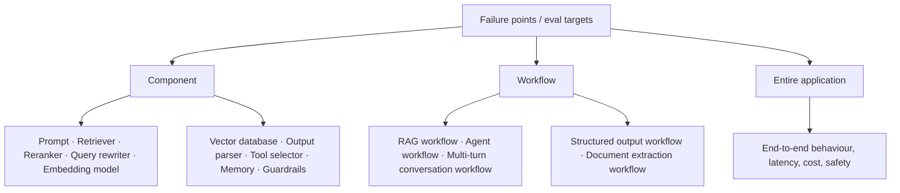
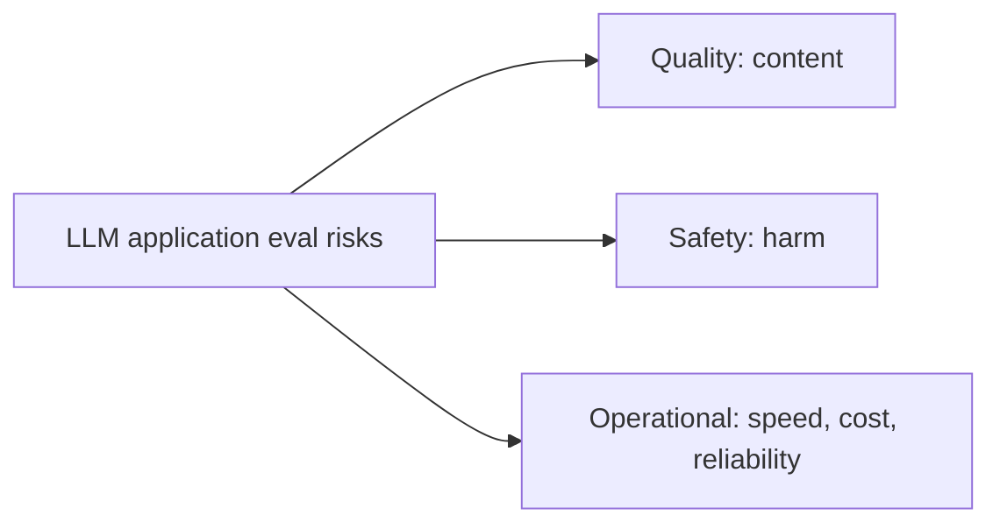
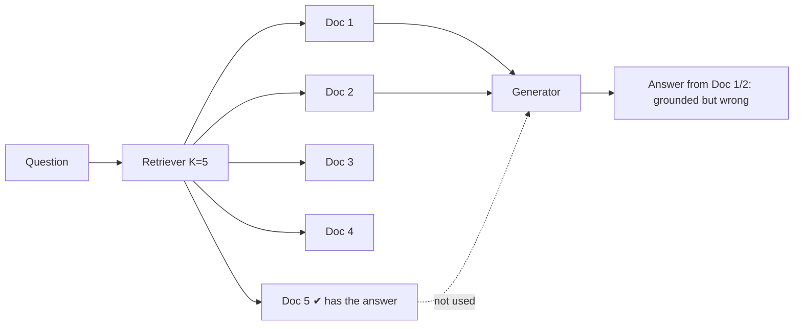
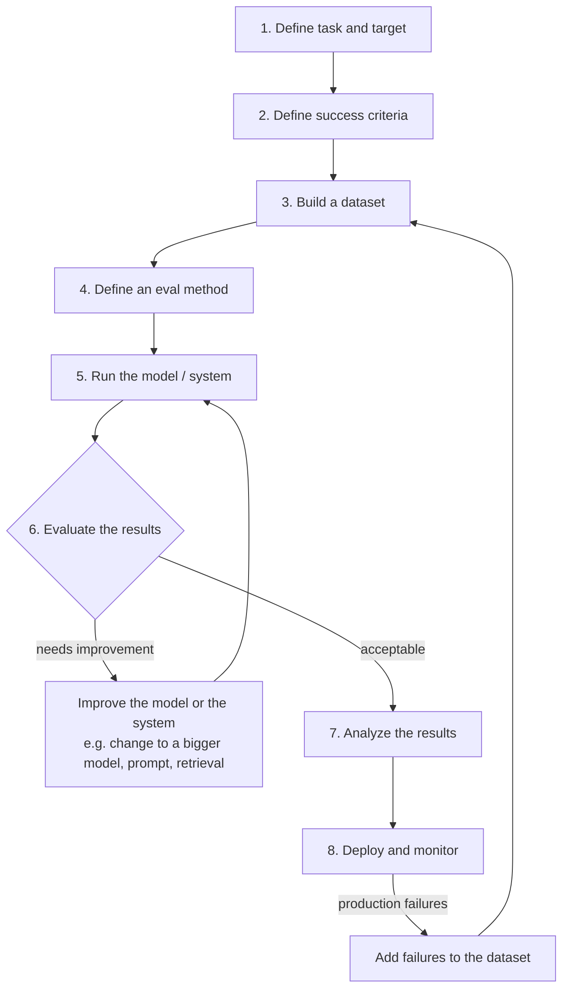
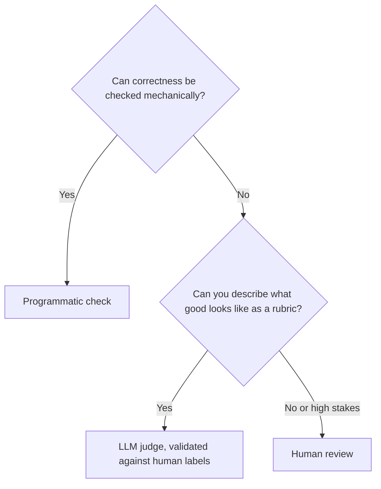
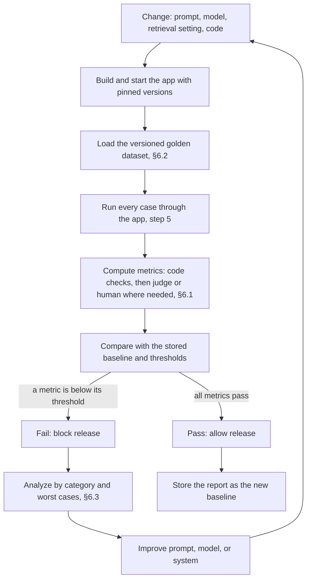
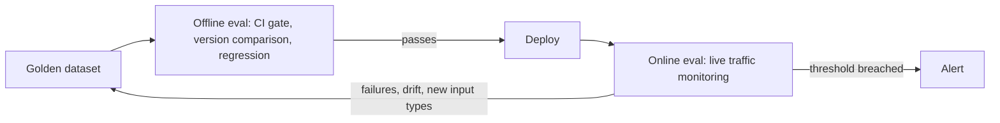

# Enterprise Knowledge Assistant — Evaluation (Evals) Developer Guide

|                 |                                                                                                                                                                                                                                                                                                                                                                                                             |
| --------------- | ----------------------------------------------------------------------------------------------------------------------------------------------------------------------------------------------------------------------------------------------------------------------------------------------------------------------------------------------------------------------------------------------------------- |
| **Document ID** | EKA-EVAL-GUIDE-001                                                                                                                                                                                                                                                                                                                                                                                          |
| **Status**      | Draft for review — explanatory guide, not an approved requirement                                                                                                                                                                                                                                                                                                                                           |
| **Audience**    | Developers, QA, product owners, reviewers                                                                                                                                                                                                                                                                                                                                                                   |
| **Source**      | Evaluation practice for LLM applications, analyzed against the current EKA code and specifications                                                                                                                                                                                                                                                                             |
| **Related**     | [Feature specification 011](../specs/011-evaluation-pipeline/spec.md), [plan](../specs/011-evaluation-pipeline/plan.md), [tasks](../specs/011-evaluation-pipeline/tasks.md), [backend evaluation README](../../enterprise-knowledge-assistant-backend/evaluation/README.md), [foundation spec](../specs/001-project-foundation/spec.md) (AC-13), [DEC-007 / DEC-010](./implementation/product-decisions.md) |

> **How to read this page.** Sections 1–6 explain evals in general (what, why, types, risks, the 8-step process). Sections 7–10 map those ideas to EKA: what already exists, what is missing, and what is proposed. Anything labelled **Proposal** is not approved. Numeric targets quoted here are _proposals from the foundation specification_, not release gates.

## Contents

1. [What is an eval?](#1-what-is-an-eval)
2. [Types of evals: Model evals vs Application evals](#2-types-of-evals)
3. [What an application eval can target](#3-what-an-application-eval-can-target)
4. [Risk categories](#4-risk-categories)
5. [Why component evals are not enough (RAG failure points)](#5-why-component-evals-are-not-enough)
6. [The 8-step eval pipeline](#6-the-8-step-eval-pipeline) — includes eval methods (§6.1) with the kinds of human evaluation (§6.1.2) and an all-types summary (§6.1.3), reference-based vs reference-free evals (§6.1.4), building a golden dataset (§6.2), analyzing results (§6.3), offline versus online evals (§6.4) including the step-by-step offline eval pipeline, and building an online eval pipeline (§6.5)
7. [Where EKA is today](#7-where-eka-is-today)
8. [Mapping EKA to the eval taxonomy](#8-mapping-eka-to-the-eval-taxonomy)
9. [Proposed EKA eval pipeline](#9-proposed-eka-eval-pipeline)
10. [Guardrails specific to EKA](#10-guardrails-specific-to-eka)
11. [Glossary and FAQ](#11-glossary-and-faq)

---

## 1. What is an eval?

An **eval is not just a metric. An eval is the complete testing setup** for an LLM-powered system. It answers six questions:

| #   | Question                           | EKA example                                                                                          |
| --- | ---------------------------------- | ---------------------------------------------------------------------------------------------------- |
| 1   | **What are we evaluating?**        | The `/api/v1/chat/query` answer path (retrieve → evidence check → generate → cite).                  |
| 2   | **What does "good" mean?**         | Grounded in retrieved evidence, valid citations, honest "insufficient evidence", acceptable latency. |
| 3   | **What test cases are we using?**  | A versioned, access-controlled set of questions with expected evidence.                              |
| 4   | **How are we judging the output?** | Code checks, human review, and (proposal) a calibrated LLM judge.                                    |
| 5   | **When are we running it?**        | Before a release, after changing prompt/model/threshold, and on a schedule.                          |
| 6   | **Which tool are we using?**       | The versioned runner in the backend repository (`evaluation/evaluate.mjs`).                          |

**The goal is not just a score.** The goal is to answer practical decisions:

- Can this model be used for this particular task or application?
- Is the system good enough to ship?
- Did prompt v2 improve over prompt v1?
- Is the RAG answer grounded in the retrieved context?
- Is the agent completing the task correctly? _(EKA has no agent workflow in the MVP.)_
- Is the chatbot safe for real users?
- Is the latency under control?

> **Rule of thumb:** if an eval run cannot change a decision (ship / don't ship / keep prompt v1 / switch model), it is a report, not an eval.

---

## 2. Types of evals

There are two types. Both are LLM evals, but they answer different questions and are owned by different people.

### 2.1 Model evals

**Evaluate the model itself — its general capabilities.** Typical capabilities:

| Capability               | Question                                 |
| ------------------------ | ---------------------------------------- |
| Reasoning                | Can it reason?                           |
| Knowledge                | Can it answer knowledge-based questions? |
| Maths                    | Can it solve maths problems?             |
| Coding                   | Can it write code?                       |
| Instruction following    | Can it follow instructions?              |
| Long context             | Can it follow long documents?            |
| Multimodal understanding | Can it understand images?                |
| Tool use                 | Can it use tools?                        |

Model capabilities are generally measured with **public benchmarks**. (well-known examples such as MMLU, GSM8K, and HumanEval are general industry knowledge)

**Who owns it:** frontier model labs. An application engineer **consumes** these results when choosing a model; they do not re-run or build them.

### 2.2 Application evals (the focus for EKA)

**Evaluate the behaviour and performance of an LLM-powered application — at the level of the entire system or of one component inside it.**

In an application eval we do **not** ask "Can the model do this?" We ask **"Does the product work?"**

The first column lists generic questions that apply to any LLM-powered application.

| Generic question (any LLM app)                                  | EKA equivalent                                                                           | Eval dimension              |
| --------------------------------------------------------------- | ---------------------------------------------------------------------------------------- | --------------------------- |
| Did it answer the user's question correctly?                    | Did it answer the user's question correctly from the uploaded documents?                 | Answer correctness          |
| Did it use the provided knowledge or context properly?          | Did it use the retrieved passages and cite them?                                         | Retrieval use, citations    |
| Was the answer faithful to the retrieved or provided context?   | Does every claim trace back to cited evidence?                                           | Faithfulness / groundedness |
| Was it clear and useful for its intended audience?              | Is the answer clear and useful (human usefulness rating)?                                | Usefulness                  |
| Did it avoid making up facts, rules, or policies?               | Did it avoid inventing facts when evidence is missing?                                   | Hallucination / abstention  |
| Did it respond quickly enough?                                  | Is retrieval and end-to-end latency within budget?                                       | Latency                     |
| Did it stay safe?                                               | No leaks across collections, no prompt-injection compliance, no sensitive-data exposure. | Safety                      |

### 2.3 Application's building blocks

An LLM application can be viewed as a hub with these parts (bold = the parts most evals focus on): **User Interface**, Input Handler, **Prompt Layer**, **LLM / Model**, Context / Memory, **Tools / APIs**, **Orchestrator / Workflow**, **Retrieval System**, **Embedding Model**, **Vector Database**, **Guardrails / Safety**, **Output Parser**, **Monitoring / Logging**, **Feedback Loop**.

Each of these can fail independently, and each can be an eval target (Section 3).

---

## 3. What an application eval can target

The "Failure Points / Target" diagram splits targets into three levels:



| Level                  | What you test                                                        | Pro                                         | Con                                            |
| ---------------------- | -------------------------------------------------------------------- | ------------------------------------------- | ---------------------------------------------- |
| **Component**          | One part in isolation (e.g., the retriever against labelled chunks). | Fast, cheap, pinpoints the cause.           | Passing parts can still make a failing system. |
| **Workflow**           | A multi-step path (e.g., the full RAG path or document ingestion).   | Catches hand-off bugs between steps.        | Harder to attribute a failure to one step.     |
| **Entire application** | The product as a user sees it, including latency and safety.         | The only level that answers "does it work?" | Slowest, needs the richest dataset.            |

**Recommended practice:** evaluate all three levels; use component evals to _diagnose_ and application evals to _decide_.

---

## 4. Risk categories

LLM application risk falls into three categories. Keep them separate when designing metrics — a high quality score says nothing about safety.

| Category                | The question                                     | Concerns                                                                                                | Is about…                            |
| ----------------------- | ------------------------------------------------ | ------------------------------------------------------------------------------------------------------- | ------------------------------------ |
| **Application quality** | "Is the answer any good?"                        | Correct, relevant, complete answers that do the job asked.                                              | The **content** of the answer.       |
| **Safety**              | "Could the answer cause harm?"                   | No toxic/dangerous content, no bias, no leaking private data, no being tricked into breaking its rules. | The **harm** the answer could do.    |
| **Operational**         | "Is it fast, cheap, and reliable enough to run?" | Responds quickly, costs acceptable money per answer, does not crash or fail under real traffic.         | The **system producing** the answer. |



### 4.1 Detailed criteria

The last column maps each criterion to EKA.

#### 1. Application quality

**1a. Core generation quality**

| Criterion              | Description                                                           | EKA relevance                                                                                          |
| ---------------------- | --------------------------------------------------------------------- | ------------------------------------------------------------------------------------------------------ |
| Correctness / accuracy | Whether the factual claims in the answer are actually true.           | Applies. Needs a reference answer or gold evidence (spec 011 FR-9).                                    |
| Relevance              | Whether the answer addresses what the user actually asked.            | Applies (FR-8).                                                                                        |
| Completeness           | Whether the answer covers all parts of a multi-part question.         | Applies; add multi-part questions to the dataset.                                                      |
| Instruction following  | Whether the output obeys explicit constraints (format, length, etc.). | Limited: the chat API has no user-set format or length constraints; relevant to prompt-v2 comparisons. |

**1b. RAG-specific quality** — the primary focus for EKA.

| Criterion                   | Description                                                      | EKA relevance                                                                                          |
| --------------------------- | ---------------------------------------------------------------- | ------------------------------------------------------------------------------------------------------ |
| Context relevance           | Whether the retrieved chunks are actually relevant to the query. | Applies (component: retriever).                                                                        |
| Retrieval recall            | Whether all chunks needed to answer were retrieved.              | Applies; the current runner measures it from citations only (gap G1).                                  |
| Groundedness / faithfulness | Whether every claim is supported by the retrieved context.       | Applies; not yet automated (gap G2).                                                                   |
| Citation accuracy           | Whether cited sources genuinely support the claims made.         | Applies. Today only citation field completeness is checked, not whether the source supports the claim. |

**1c. Agent / tool-use quality**

| Criterion             | Description                                                        | EKA relevance                                                                                                                                               |
| --------------------- | ------------------------------------------------------------------ | ----------------------------------------------------------------------------------------------------------------------------------------------------------- |
| Tool selection        | Whether the agent chose the right tool for the task.               | Not applicable in the MVP (no agent or tools).                                                                                                              |
| Parameter correctness | Whether the tool was called with valid, correctly-typed arguments. | Not applicable.                                                                                                                                             |
| Task completion       | Whether the agent actually accomplished the user's goal.           | Not applicable.                                                                                                                                             |
| Error recovery        | Whether it handled tool failures gracefully and retried sensibly.  | Not applicable for agents. The optional web-search fallback (DEC-010 P4) should abstain safely on failure, which falls under operational and safety checks. |

**1d. Multi-turn conversation quality**

| Criterion                  | Description                                                            | EKA relevance                                                      |
| -------------------------- | ---------------------------------------------------------------------- | ------------------------------------------------------------------ |
| Context retention / memory | Whether it remembers relevant facts given earlier in the conversation. | Not applicable: no conversation history in the MVP (DEC-008).      |
| Clarification behavior     | Whether it asks for clarification when the request is ambiguous.       | Not applicable today; EKA answers or states insufficient evidence. |

#### 2. Safety

| Criterion                               | Description                                                                    | EKA relevance                                                                           |
| --------------------------------------- | ------------------------------------------------------------------------------ | --------------------------------------------------------------------------------------- |
| Toxicity                                | Whether the output contains offensive, abusive, or hateful language.           | Applies; include in the safety suite.                                                   |
| Harmful content                         | Whether it provides dangerous instructions (self-harm, weapons, illegal acts). | Applies; include refusal cases.                                                         |
| Bias / fairness                         | Whether outputs are free of unfair treatment or stereotyping across groups.    | Applies; lower priority for a document Q&A assistant.                                   |
| PII leakage                             | Whether it exposes personal/private data.                                      | Applies; also covers cross-collection and unauthorized-source leakage (spec 011 FR-11). |
| Prompt injection / jailbreak resistance | Whether it resists attempts to override its rules or bypass guardrails.        | Applies; includes instructions embedded in uploaded documents (AC-11).                  |

#### 3. Operational

| Criterion            | Description                                                           | EKA relevance                                                                         |
| -------------------- | --------------------------------------------------------------------- | ------------------------------------------------------------------------------------- |
| End-to-end latency   | Total time from user request to final response.                       | Applies; report p50/p95/p99, not only the mean (gap G4).                              |
| Cost per request     | Total token/compute spend to produce one response.                    | Applies; unavailable through the MVP API (gap G5).                                    |
| Token efficiency     | Whether it achieves its result without wasteful token usage.          | Applies; depends on usage data. Context budget is configured (4,000 tokens, DEC-007). |
| Error / failure rate | Fraction of requests that fail, time out, or return malformed output. | Applies (spec 011 FR-10, NFR-3).                                                      |
| Latency under load   | Whether latency stays acceptable at production concurrency.           | Applies, but needs a load test; the current runner sends sequential requests.         |

#### 4.2 Applicability summary for EKA

| Group               | Applies now                                   | Deferred / not in MVP           |
| ------------------- | --------------------------------------------- | ------------------------------- |
| 1a Core generation  | Correctness, relevance, completeness          | Instruction following (limited) |
| 1b RAG-specific     | All four criteria                             | —                               |
| 1c Agent / tool use | —                                             | All four (no agent in the MVP)  |
| 1d Multi-turn       | —                                             | Both (DEC-008)                  |
| 2 Safety            | All five                                      | —                               |
| 3 Operational       | All five (cost and load need new measurement) | —                               |

---

## 5. Why component evals are not enough

A RAG chatbot has two primary failure points.

### 5.1 Retrieval-time failure

> Did the system retrieve the relevant documents or not?

Typical measures: Recall@K, MRR, hit rate, context relevance.

### 5.2 Generation-time failure

> Is the generated answer…
> a) **faithful** to the retrieved context?
> b) **grounded** (supported by evidence, not training memory)?
> c) free of **hallucination** and of **extra content** the question did not ask for?

Typical measures: faithfulness / groundedness, answer relevance, hallucination rate, citation validity.

### 5.3 Both can pass while the system fails

The scenario (restated):

1. Retrieval fetches **K = 5** documents. The document that really contains the answer is **#5 (last)**. Retrieval is "working" — the right document is in the set.
2. The generator answers from document **#1** or **#2**, faithfully to _those_ documents. Generation is "working" — it is grounded in what it was given.
3. The final answer is **wrong**. Each part passed; the **system** failed.



**Conclusion:** you need an eval on the **combination (Retrieval + Generator)** — an end-to-end _answer-correctness_ eval with a reference answer or gold evidence, not just component scores.

### 5.4 There is still one more eval: operations

Even if retrieval, generation, and the combination all pass, the system can **miss its latency threshold**. So a whole-application **latency** eval is also required (and by extension cost and error rate — the operational category).

### 5.5 Summary of the eval set this implies

| Eval                                   | Level                         | Catches                                          |
| -------------------------------------- | ----------------------------- | ------------------------------------------------ |
| Retrieval relevance                    | Component                     | Wrong or missing documents                       |
| Generation faithfulness / groundedness | Component                     | Unsupported claims, hallucination, extra content |
| **Retrieval + generation correctness** | **Workflow / application**    | Right docs retrieved but wrong answer used       |
| **Latency / cost / reliability**       | **Application (operational)** | Correct but too slow or too costly               |
| Safety                                 | Application                   | Leaks, injection, harmful output                 |

### 5.6 How do I know the retriever is working? (Recall@K)

The retriever is working when it **puts the evidence needed to answer the question into the top K results**. The standard measure is **Recall@K**:

$$
\text{Recall@K} = \frac{\text{number of relevant items retrieved in the top } K}{\text{total number of relevant items}}
$$

Here an "item" is a **chunk** and "relevant" means a human has confirmed that chunk contains evidence for the question (the _gold evidence_, stored in `relevantChunkIds`).

**Worked example (K = 5).** A question has 2 relevant chunks, A and B. The retriever returns `[X, A, Y, Z, W]`.

- Relevant items in the top 5: 1 (A). Total relevant: 2.
- Recall@5 = 1 / 2 = **0.5**. Chunk B was missed, so an answer needing both is likely incomplete.

If the retriever had returned both A and B in the top 5, Recall@5 would be 1.0. Average the per-question values over the dataset to get the reported Recall@5.

**How to read the number**

| Result                          | What it suggests                                                                                                          | What to check next                                                                                                     |
| ------------------------------- | ------------------------------------------------------------------------------------------------------------------------- | ---------------------------------------------------------------------------------------------------------------------- |
| Recall@5 high                   | The needed evidence usually reaches the generator.                                                                        | Then look at generation faithfulness and answer correctness (§5.3): a high recall does not guarantee a correct answer. |
| Recall@5 low                    | The generator never sees the evidence, so it cannot answer correctly.                                                     | Chunking, embedding model, similarity threshold, metadata filters, or missing/failed ingestion.                        |
| Recall@5 low but Recall@10 high | The evidence is retrieved but ranked too low.                                                                             | Ranking quality, K, a reranker (not in the MVP).                                                                       |
| Recall high but MRR low         | The evidence is present but not near the top; the generator may favour earlier, less relevant chunks (the §5.3 scenario). | Ranking and context ordering.                                                                                          |

**What Recall@K does not tell you**

- It ignores **noise**: returning 4 irrelevant chunks next to the relevant one still scores 1.0. Pair it with context relevance (are the returned chunks useful?) or precision.
- It ignores **order** within the top K. Use MRR for rank.
- It is only defined for questions that **have relevant items**. Unanswerable questions (empty `relevantChunkIds`) are excluded from Recall and checked through the answer-versus-abstain accuracy instead.
- It is only as good as the **labels**. If the gold chunks are wrong or incomplete, the score is misleading.

**Practical checklist for deciding the retriever is healthy**

1. Use a labelled dataset where each answerable question lists its gold chunk IDs.
2. Compute Recall@K and MRR on the **raw retrieved candidates**, not on the final citations.
3. Report the number of questions used, and slice by category (factual, multi-hop, etc.) so one easy category does not hide a failing one.
4. Compare against a baseline when you change the embedding model, chunk size, K, or threshold; change one thing at a time.
5. Inspect the misses individually: was the gold chunk absent, below the threshold, or ranked below K?
6. Treat any target as **proposed** until the product owner approves it; this guide does not set a Recall@K threshold.

**EKA specifics**

- **Current runner:** it computes `recallAt5` and MRR from the chunk IDs in the **returned citations** (gap G1), so it measures what the answer cited, not what the retriever fetched. A low value can come from the retriever, the similarity threshold (default 0.70, DEC-007), or the generator not citing a retrieved chunk. Until raw candidates are available (spec 011 OI-1), read it as _citation-based recall_.
- **Threshold effect:** chunks below the similarity threshold are dropped before generation, so a threshold set too high lowers recall and produces insufficient-evidence answers. The existing 30-case reports show zero Recall@5 at 0.70 and are not human reviewed, so they are not evidence of retriever quality (DEC-010).
- **Existing diagnostics:** spec 009 logs ranked candidates with scores and whether they met the threshold (no text). These help investigate individual misses today, but they are logs, not an aggregate metric.

---

## 6. The 8-step eval pipeline

This is the automation flow for an eval pipeline.



| Step                           | What you do                                                                                                                                                           | Key outputs                                                     | Common mistakes                                                      |
| ------------------------------ | --------------------------------------------------------------------------------------------------------------------------------------------------------------------- | --------------------------------------------------------------- | -------------------------------------------------------------------- |
| **1. Define task & target**    | State what the app must do and which level you are testing (component / workflow / application).                                                                      | One-paragraph task statement; target list.                      | Evaluating "the chatbot" without naming the failure point.           |
| **2. Define success criteria** | Turn "good" into measurable pass conditions per risk category.                                                                                                        | Metric list with thresholds (marked _proposed_ until approved). | Inventing thresholds with no baseline.                               |
| **3. Build a dataset**         | Collect representative questions, expected evidence/answers, and unanswerable and adversarial cases.                                                                  | Versioned dataset with provenance.                              | Using only easy, synthetic, or leaked questions.                     |
| **4. Define an eval method**   | Choose how each metric is judged: code, human, LLM judge.                                                                                                             | Method per metric, with calibration plan for any LLM judge.     | Trusting an uncalibrated LLM judge.                                  |
| **5. Run the model**           | Execute the system over the dataset with pinned versions.                                                                                                             | Raw per-case results.                                           | Not recording model/config/dataset versions.                         |
| **6. Evaluate the results**    | Score against criteria. If not good enough, **improve the model or the system**, then re-run from step 5 (this may include switching to a larger model). | Pass/fail per metric.                                           | Changing several things at once, so you cannot attribute the change. |
| **7. Analyze the results**     | Slice by category, find failure clusters, inspect worst cases.                                                                                                        | Failure analysis and next actions.                              | Reading only the average.                                            |
| **8. Deploy & monitor**        | Release, watch production signals. **If production failures occur, add them to the dataset and restart from step 3.**                                                 | Monitoring signals; new dataset cases.                          | Never feeding production failures back.                              |

**Two loops to remember**

- **Inner loop (steps 5 → 6 → improve → 5):** fast iteration on prompt/model/system until criteria pass.
- **Outer loop (step 8 → 3):** production failures become permanent regression cases.

### 6.1 Eval methods (detail for step 4)

An **eval method** is the mechanism that decides whether an output is good or not — the actual procedure that takes an output and produces a judgment about it. In the eval pipeline, step 4 chooses the method for each metric.

| #   | Method                           | Who/what produces the verdict | Typical checks                                                                                                                                          | Strengths                                                       | Limits                                                      |
| --- | -------------------------------- | ----------------------------- | ------------------------------------------------------------------------------------------------------------------------------------------------------- | --------------------------------------------------------------- | ----------------------------------------------------------- |
| 1   | **Programmatic / deterministic** | Code                          | Exact match, regex, JSON schema validation, running the output (e.g., execute code or SQL) and comparing results against a rule or known correct answer | Fast, cheap, reproducible                                       | Works only where correctness is mechanically checkable      |
| 2   | **Human**                        | A person                      | Rate, rank, or compare outputs directly                                                                                                                 | Gold standard for nuanced, subjective, or high-stakes judgments | Most expensive and slowest                                  |
| 3   | **Model-graded (LLM-as-judge)**  | A strong LLM                  | Scores or ranks the output against a rubric; used where there is no single right answer but "good" can be described — helpfulness, tone, groundedness   | Scales subjective checks                                        | Needs a clear rubric and validation against human judgments |

**Choosing a method.** Prefer the cheapest method that is trustworthy for the property being measured, and combine them:



**Applied to EKA metrics** (proposal; see [spec 011 FR-12–FR-14](../specs/011-evaluation-pipeline/spec.md)):

| Metric                                                                 | Method                                                                                       |
| ---------------------------------------------------------------------- | -------------------------------------------------------------------------------------------- |
| Recall@K, MRR, hit rate                                                | Programmatic (compare retrieved IDs to gold IDs)                                             |
| Citation field completeness; citation resolves to an authorized source | Programmatic                                                                                 |
| Answer-versus-abstain classification                                   | Programmatic                                                                                 |
| Latency percentiles, error rate, token counts                          | Programmatic                                                                                 |
| Prompt-injection and cross-collection leakage checks                   | Programmatic where a known marker or unauthorized ID can be detected; human review otherwise |
| Groundedness / faithfulness, hallucination, relevance                  | LLM judge (after calibration) with human sampling                                            |
| Answer correctness against a reference answer                          | Programmatic for exact facts; human or judge for free text                                   |
| Usefulness / helpfulness, clarity                                      | Human review (rubric in §6.1.1); LLM judge only after calibration                            |
| Citation accuracy (does the source really support the claim?)          | LLM judge or human review                                                                    |

An LLM judge is a model too, so its verdict must be validated before it influences a decision (§9.5).

#### 6.1.1 Rubrics and the Helpfulness example

Human and LLM-judge methods both need a **rubric**: written descriptions of what each score means, so two reviewers (or a reviewer and a judge) give the same score to the same answer. A Helpfulness rubric is a common example:

| Score | Meaning                                            |
| ----- | ------------------------------------------------------------------- |
| **5** | Fully answers the question, accurate and complete, appropriate tone |
| **3** | Partially helpful — missing something or slightly off               |
| **1** | Unhelpful, wrong, or irrelevant                                     |

This rubric defines only the anchors 5, 3, and 1. Scores 2 and 4 are not defined; the guide treats them as "between the neighbouring anchors" and recommends that reviewers use them only when an answer clearly sits between two anchors (this is an interpretation).

**What "helpful" means for EKA.** A helpful EKA answer lets the user complete their task using their own authorized documents:

| Situation                                   | What a helpful response looks like                                                     |
| ------------------------------------------- | -------------------------------------------------------------------------------------- |
| The documents contain the answer            | A correct, complete answer, in clear language, with citations the user can verify.     |
| Only part of the answer is in the documents | The supported part, with the missing part stated honestly (this is a 3, not a 1).      |
| The documents do not contain the answer     | A clear "insufficient evidence" response with no invented answer (see proposal below). |
| The question is multi-part                  | Every part is addressed (completeness).                                                |
| Retrieved content contains instructions     | The answer ignores them and still answers the question.                                |

**Helpfulness is not the same as groundedness.** An answer can be fluent and useful-sounding yet unsupported, or fully faithful yet not answer the question. Score them separately (groundedness answers "is every claim supported?", helpfulness answers "did it solve the user's question?"), and read them together:

| Helpfulness | Groundedness | Interpretation                                                          |
| ----------- | ------------ | ----------------------------------------------------------------------- |
| High        | High         | Working as intended.                                                    |
| High        | Low          | Dangerous: looks good but is unsupported — the main hallucination risk. |
| Low         | High         | Faithful but off-target — check retrieval and the prompt.               |
| Low         | Low          | Broken — start with retrieval.                                          |

**Terminology.** The rubric says _helpfulness_; the existing runner and dataset schema use the key `humanReview.usefulness` (1–5). This guide treats them as the same dimension and keeps the existing key for compatibility (proposal; see spec 011 FR-14).

**Proposal — unanswerable questions (needs owner approval).** The 5/3/1 anchors assume an answerable question. For a question with no supporting evidence, a correct abstention should arguably score 5 and a confident invented answer 1, so unanswerable cases are not penalized for "not answering". This is a proposal and is not decided.

**How to use the rubric**

1. Reviewers score each answer 1–5 against the rubric and add a one-line reason (no confidential text in shared reports).
2. Have a second reviewer score a sample and record agreement; resolve disagreements by refining the rubric wording.
3. For an LLM judge, give it the same rubric and compare its scores with the human scores on a sample before trusting it (calibration).
4. Report the **score distribution**, not only the mean, and the number of rated answers — a mean of 3.5 can be all 3s and 4s or a mix of 1s and 5s.

#### 6.1.2 The kinds of human evaluation

"Human" is the most general method, and a person can take part in an eval in five different roles. Mixing them up is a common source of confusion, so the guide separates them.

| #   | Role                              | What the human does                                                                                                                                                                                                                                 | When it happens                          | EKA example                                                                                                                     |
| --- | --------------------------------- | --------------------------------------------------------------------------------------------------------------------------------------------------------------------------------------------------------------------------------------------------- | ---------------------------------------- | ------------------------------------------------------------------------------------------------------------------------------- |
| 1   | **Direct grading / rating**       | Reads outputs and scores them against a rubric. The most basic role: the human is the grader.                                                                                                                                                       | Offline, on a sample of runs             | Rating answers 1–5 for groundedness and helpfulness (§6.1.1)                                                                    |
| 2   | **Gold-answer / dataset creator** | Writes or verifies the correct answers (gold SQL, gold document IDs, concept rubrics) and curates the test set so it covers the real question distribution.                                                                                         | Before running (step 3)                  | Confirming the gold chunk IDs for each question (§6.2)                                                                          |
| 3   | **Red teaming**                   | Actively attacks the system to find failures: crafting jailbreaks, prompt injections, adversarial and edge-case inputs, trying to make it produce harmful or wrong output. This is creative adversarial work that automated evals cannot originate. | Offline, before release and periodically | Planting instructions inside an uploaded document; asking for another collection's content; trying to extract the system prompt |
| 4   | **A/B testing**                   | Real users act as graders in production. Their behavior — thumbs-up, task completion, re-asking, escalation — is the verdict on which version is better.                                                                                            | Online, in production                    | Comparing two prompt or retrieval versions by re-ask rate                                                                       |
| 5   | **HITL (human-in-the-loop)**      | A human is placed inside the production flow as a checkpoint, reviewing, approving, editing, or rejecting live outputs before they reach the user. It is triggered on the risky slice: low-confidence, high-stakes, or flagged outputs.             | Online, per request                      | Holding low-evidence answers for review before they are shown                                                                   |

**Offline versus online.** Roles 1–3 improve the system _before_ users see it. Roles 4 and 5 operate _on live traffic_ (see §6.4 for the full offline/online comparison). Only roles 1–3 are feasible for EKA today (see below).

**How each role relates to the other methods.** Roles 1 and 2 produce the labels that calibrate an LLM judge and the reference data that programmatic checks compare against. Red teaming finds failure types the dataset did not anticipate; each confirmed finding should become a regression case (§6 outer loop). A/B testing and HITL measure or control real outcomes, which automated offline evals can only approximate.

**What this means for EKA (proposal, not approved):**

| Role                          | Fit for EKA today | Note                                                                                                                                |
| ----------------------------- | ----------------- | ----------------------------------------------------------------------------------------------------------------------------------- |
| Direct grading / rating       | In scope          | Needs reviewers and the rubric; backlog B06                                                                                         |
| Gold-answer / dataset creator | In scope          | Needs authorized, representative documents; stable labels (OI-9)                                                                    |
| Red teaming                   | In scope          | Mapped to the safety criteria in §4.1; manual first, automate repeatable attacks afterwards                                         |
| A/B testing                   | Not available     | Needs production usage data and feedback capture; DEC-008 defers feedback and spec 009 forbids logging questions (§10 item 6)       |
| HITL                          | Not in the MVP    | Would be a product feature, not only an eval; requires a separate approved decision (confidence signal, reviewer workflow, privacy) |

#### 6.1.3 All eval types at a glance

| Question                       | Answer                                                                                  |
| ------------------------------ | --------------------------------------------------------------------------------------- |
| What is being evaluated?       | Model eval (frontier labs) or **application eval** (EKA focus) — §2                     |
| Which part?                    | Component, workflow, or entire application — §3, §5                                     |
| Which risk?                    | Quality, safety, operational — §4                                                       |
| Who or what gives the verdict? | **Programmatic**, **human**, or **LLM-as-judge** — §6.1                                 |
| If human, in which role?       | Rating, dataset creation, red teaming, A/B testing, HITL — §6.1.2                       |
| Compared against what?         | A reference answer (**reference-based**) or only a rubric (**reference-free**) — §6.1.4 |
| When?                          | **Offline** (before release, fixed dataset) or **online** (production traffic) — §6.4   |

Rule of thumb: use code wherever correctness is mechanical, use an LLM judge where "good" can be described by a rubric, and use humans for the nuanced and high-stakes cases and to validate the other two.

#### 6.1.4 Reference-based versus reference-free evals

This is a second, independent way to classify an eval. §6.1 asks _who gives the verdict_ (code, human, LLM). This section asks _what the output is compared against_.

|                                      | **Reference-based**                                                                                                                   | **Reference-free**                                                                                    |
| ------------------------------------ | ------------------------------------------------------------------------------------------------------------------------------------- | ----------------------------------------------------------------------------------------------------- |
| Definition                           | Each test case has a **reference**: a known-correct answer, or the key things a correct answer must contain, written down in advance. | There is **no predefined correct answer**. The output's quality is judged directly, on its own terms. |
| How it is graded                     | Compare the output against the reference.                                                                                             | Judge against a criterion or rubric.                                                                  |
| What the rubric is                   | (If used) a checklist of required facts for that item.                                                                                | A scale or standard ("what does a good answer look like"), **not** a per-item correct answer.         |
| Needs a golden dataset with answers? | Yes: references must be written and maintained.                                                                                       | No per-item answers; needs a good rubric.                                                             |
| Strength                             | Objective and repeatable; measures correctness.                                                                                       | Works where no single right answer exists; also works on live traffic, where no reference exists.     |
| Limit                                | Costly to build; goes stale when documents change; free text is hard to compare exactly.                                              | More subjective; quality depends on the rubric and judge; cannot prove factual correctness by itself. |

The two axes combine freely. For example, an LLM judge can be reference-based (it compares the answer with a reference answer) or reference-free (it scores helpfulness against a rubric only).

**EKA mapping (proposal, not approved):**

| EKA check                                    | Reference needed?                                                                                                   | Reference                                                  | Method                                                     |
| -------------------------------------------- | ------------------------------------------------------------------------------------------------------------------- | ---------------------------------------------------------- | ---------------------------------------------------------- |
| Recall@K, MRR, hit rate                      | Reference-based                                                                                                     | Gold chunk IDs (§5.6, §6.2)                                | Programmatic                                               |
| Answer correctness                           | Reference-based                                                                                                     | Reference answer or key facts per question                 | Programmatic for exact facts; human or judge for free text |
| Correct abstention on unanswerable questions | Reference-based                                                                                                     | A label "no evidence exists"                               | Programmatic                                               |
| Citation resolves to an authorized source    | Rule-based                                                                                                          | A rule, no per-item answer                                 | Programmatic                                               |
| Groundedness / faithfulness                  | Reference-free in the sense that no gold answer is needed; the _retrieved evidence_ serves as the comparison source | Retrieved passages                                         | LLM judge or human                                         |
| Helpfulness, tone, clarity                   | Reference-free                                                                                                      | Rubric (§6.1.1)                                            | Human or calibrated LLM judge                              |
| Latency, error rate                          | Neither                                                                                                             | Threshold                                                  | Programmatic                                               |
| Production monitoring (step 8)               | Reference-free                                                                                                      | Rubric only, since no gold answer exists for new questions | Sampled judge or human review                              |

**Rule of thumb.** Use reference-based evals where you can afford the reference, because they measure correctness. Use reference-free evals where no single right answer exists or in production. In both cases, failures found by a reference-free check on live traffic should be turned into reference-based regression cases (§6 outer loop) once a human has written the correct answer.

**Note on groundedness.** Groundedness compares the answer to the retrieved evidence, not to a gold answer. Practitioners classify it differently; the placement above is this guide's interpretation.

### 6.2 Building a golden dataset (detail for step 3)

A **golden dataset** (gold set) is a curated set of questions where a human has recorded the **correct evidence** (and, optionally, the correct answer) in advance. Every automated retrieval metric is computed by comparing what the system returned against this ground truth, so the dataset's quality caps the quality of every score.

**Worked example** (a course-assistant corpus; IDs are the labels used in the example):

| Query ID | Question                                                         | Gold doc IDs |
| -------- | ---------------------------------------------------------------- | ------------ |
| q1       | How long is the ML course?                                       | 101          |
| q2       | What are the prerequisites for the ML course and how long is it? | 101, 103     |
| q3       | What is the fee for the Deep Learning course?                    | 202          |
| q4       | Does the ML course cover neural networks?                        | 101, 104     |
| q5       | How do I get a refund if I drop out?                             | 301          |
| q6       | Is there any EMI or installment option for fees?                 | 205, 207     |

Observations worth copying:

- **Single-source and multi-source questions are mixed.** q1 and q3 need one source; q2, q4, and q6 need two. Multi-part or multi-hop questions are what make Recall interesting (partial credit is possible).
- **Questions are written in the user's own words.** q5 says "drop out" while the gold document likely says something else (e.g., "withdrawal"); this tests vocabulary mismatch, not keyword matching.
- **Each question lists every relevant source,** not just one. A missing gold ID makes a correct retrieval look like a miss.

**How to build one for EKA**

| Step                     | Action                                                                                                                                                                                                                    |
| ------------------------ | ------------------------------------------------------------------------------------------------------------------------------------------------------------------------------------------------------------------------- |
| 1. Choose the corpus     | Use an authorized, representative document set; keep confidential content out of the repository (§10).                                                                                                                    |
| 2. Collect questions     | Real or realistic user questions from subject-matter experts, support/FAQ material, and known past failures. Avoid writing questions by copying a sentence from the document, which makes retrieval unrealistically easy. |
| 3. Label the evidence    | For each question a reviewer lists **all** chunk IDs that support the answer (`relevantChunkIds`). EKA labels at **chunk** level, not document level (see below).                                                         |
| 4. Add reference answers | Short expected answer (`referenceAnswer`) so answer correctness can be scored later.                                                                                                                                      |
| 5. Cover the categories  | Single-source, multi-source/multi-part, paraphrased/vocabulary-mismatch, **unanswerable** (empty `relevantChunkIds`), adversarial, and cases where the gold chunk is likely to rank low.                                  |
| 6. Review the labels     | A second reviewer checks a sample; resolve disagreements; record who reviewed and when.                                                                                                                                   |
| 7. Version and freeze    | Give the dataset a version and hash; change it only by adding a new version, so scores stay comparable.                                                                                                                   |
| 8. Grow it               | Add verified production failures as regression cases (pipeline step 8 → 3).                                                                                                                                               |

**Size and balance.** The foundation spec proposes a curated 50-question set as a starting evaluation target (not an approved requirement). Keep enough cases per category that a category score is not decided by one question.

**Document-level vs chunk-level gold.** The example labels whole documents (101, 103…). EKA's runner and schema use **chunk IDs** produced at ingestion. Chunk IDs change when a document is re-chunked, re-embedded, or re-uploaded, so labels can go stale. Mitigation options (open decision, not decided here): store a stable document reference plus a text anchor with each label and re-resolve it to chunk IDs before a run, or re-label after any ingestion change. Until decided, record the chunking and embedding configuration in the dataset version.

**Existing EKA tooling.** The backend already has a dataset builder (`build-dataset.mjs`), a 30-case seed question file, and an optional review-sheet export. These are not a representative, human-reviewed golden set (DEC-010).

### 6.3 Analyzing the evaluation results (detail for step 7)

#### Worked example: Recall@5 per query

Using the six questions above and K = 5:

| Query | Gold IDs | Retrieved top-5         | Found    | Recall@5      |
| ----- | -------- | ----------------------- | -------- | ------------- |
| q1    | 101      | 101, 202, 108, 305, 410 | 101      | 1/1 = **1.0** |
| q2    | 101, 103 | 101, 202, 108, 305, 410 | 101      | 1/2 = **0.5** |
| q3    | 202      | 202, 205, 101, 309, 118 | 202      | 1/1 = **1.0** |
| q4    | 101, 104 | 104, 101, 210, 305, 401 | 101, 104 | 2/2 = **1.0** |
| q5    | 301      | 118, 209, 405, 210, 150 | (none)   | 0/1 = **0.0** |
| q6    | 205, 207 | 205, 101, 308, 209, 410 | 205      | 1/2 = **0.5** |

**Mean Recall@5 = (1.0 + 0.5 + 1.0 + 1.0 + 0.0 + 0.5) ÷ 6 = 4.0 ÷ 6 ≈ 0.67.**

Other metrics computed from the same table (our calculation, using the retrieved order shown):

| Metric                                    | Calculation                                                            | Result |
| ----------------------------------------- | ---------------------------------------------------------------------- | ------ |
| Hit rate@5 (at least one gold item found) | 5 of 6 queries (all but q5)                                            | ≈ 0.83 |
| MRR (first gold item's rank)              | q1 = 1, q2 = 1, q3 = 1, q4 = 1 (104 is rank 1), q5 = 0, q6 = 1 → 5 ÷ 6 | ≈ 0.83 |

#### Reading the table: look past the average

The average of 0.67 hides three different situations. Triage each query:

| Query      | Pattern                                              | Likely cause to investigate                                                                                                                                                                                                            |
| ---------- | ---------------------------------------------------- | -------------------------------------------------------------------------------------------------------------------------------------------------------------------------------------------------------------------------------------- |
| q1, q3, q4 | Full recall                                          | Healthy. Check generation next.                                                                                                                                                                                                        |
| q2, q6     | **Partial recall** — one of two needed sources found | Multi-part questions: the retriever fetched one half. Check chunk size, whether the question needs query decomposition/rewriting, and whether the missing source ranked just below K (try Recall@10). The answer is likely incomplete. |
| q5         | **Total miss** — nothing relevant retrieved          | Vocabulary mismatch ("drop out" vs the document's wording), the gold chunk missing from the index, a failed ingestion, a metadata filter, or the similarity threshold. Often the highest-value case to fix.                            |

Note that **retrieved IDs that are not gold are not automatically wrong** (e.g., 202 in q1). Recall does not penalize them; judge their usefulness with context relevance or precision.

#### Analysis procedure

1. **Per-query table first.** Never report only the mean. Keep the table of gold IDs, retrieved IDs, found, and score.
2. **Classify every miss** into one cause:
   - _Absent:_ the gold chunk is not in the candidates at all (indexing, embedding, wording, chunking, label error).
   - _Below threshold:_ it was a candidate but filtered out by the similarity threshold (EKA default 0.70, DEC-007).
   - _Ranked below K:_ it was found but too low (ranking, K).
   - _Label error:_ the gold label is wrong or stale — fix the dataset, not the system.
3. **Slice by category** (single-source, multi-source, paraphrased, unanswerable, adversarial) so a strong easy category does not hide a weak one.
4. **Combine retrieval and generation** for each query to separate the failure points from §5:

   | Retrieval                        | Answer              | Interpretation                                                                                 |
   | -------------------------------- | ------------------- | ---------------------------------------------------------------------------------------------- |
   | Full recall                      | Correct             | Working end to end.                                                                            |
   | Full recall                      | Wrong or unfaithful | Generation problem (prompt, model, context ordering — the §5.3 scenario).                      |
   | Partial/zero recall              | Wrong or incomplete | Retrieval problem; fix retrieval first.                                                        |
   | Zero recall                      | Correct anyway      | Suspicious: possible model memory instead of evidence (groundedness failure) or a label error. |
   | No relevant items (unanswerable) | Abstains            | Correct behaviour.                                                                             |
   | No relevant items (unanswerable) | Answers confidently | Hallucination/abstention failure.                                                              |

5. **Form one hypothesis, change one thing,** re-run on the same dataset version, and compare to the previous run (the §6 inner loop). Changing chunk size, embedding model, K, and threshold together makes the result unattributable.
6. **Check for regressions,** not only improvements: a change that fixes q5 may lower q1.
7. **Record the decision and limits:** dataset version/hash, configuration and model versions, number of questions per category, what was changed, and known weaknesses of the dataset. With only six questions, one query moves the mean by about 0.17 — treat small-sample differences as signals to inspect, not proof.
8. **Feed failures back:** add each confirmed production failure to the dataset (§6, step 8 → 3).

#### What EKA's report gives you today

The current runner prints aggregate metrics and per-case rows without question or answer text, but they are **citation-based** (§5.6, gap G1). It does not yet list the retrieved IDs, classify misses, or slice by category. Spec 011 adds those (AC-3, AC-14–AC-17). Until then, investigate individual misses with the retrieval diagnostics logs from spec 009 (rank, score, threshold outcome, no text).

### 6.4 Offline versus online evals (when the eval runs)

§6.1 asked who gives the verdict, and §6.1.4 asked what the output is compared against. This section covers the third axis: **when** the eval runs relative to deployment.

#### Offline evals

Run **before deployment**, after the application is built, on a fixed, pre-collected dataset (the golden dataset, §6.2). Benefits:

1. **Pre-release testing (gating):** decide whether a build may ship.
2. **Version comparison:** compare two prompts, models, or retrieval settings on the same data.
3. **Regression testing:** confirm that old failures stay fixed.

Because offline evals are fast, cheap, and repeatable, they can run in a **CI pipeline**. The pipeline compares each metric with a percentage threshold and **fails the build if a result falls below it**. In EKA this is proposal-only until thresholds are approved (spec 011 OI-6, OI-7); evals run report-only until then.

#### The offline eval pipeline (step by step)

The offline pipeline is steps 3–7 of the 8-step process (§6) run on a fixed dataset, wrapped so it can be repeated on every change. Everything it needs is in earlier sections; this shows how they connect.



| #   | Stage                  | What happens                                                                                                                                                     | Output                            | Guide section |
| --- | ---------------------- | ---------------------------------------------------------------------------------------------------------------------------------------------------------------- | --------------------------------- | ------------- |
| 1   | **Trigger**            | A change is made (prompt, model, retrieval settings, ingestion code), or a schedule fires.                                                                       | A run request                     | §9.7          |
| 2   | **Pin versions**       | Fix the model, prompt, configuration, and dataset version so the run is reproducible.                                                                            | Version identifiers in the report | §9.6          |
| 3   | **Load dataset**       | Read the versioned golden dataset and validate its schema; record its hash.                                                                                      | Validated cases                   | §6.2          |
| 4   | **Run**                | Call the application for each case as an authorized user and record answers, citations, and timings.                                                             | Raw results                       | §6 step 5     |
| 5   | **Score**              | Apply each metric by its chosen method: code for Recall@K, MRR, citation checks, and latency; a calibrated LLM judge or humans for groundedness and helpfulness. | Per-case and aggregate scores     | §6.1, §9.3    |
| 6   | **Compare**            | Compare with the **baseline** (the last accepted run) for regressions and with **thresholds** for the pass/fail decision.                                        | Deltas and verdicts               | §6 step 6     |
| 7   | **Gate**               | If any gating metric is below its threshold, fail the pipeline; otherwise pass.                                                                                  | Exit code, build status           | §6.4          |
| 8   | **Analyze**            | Slice by category, read the worst cases, and classify failures (retrieval, generation, abstention).                                                              | Failure notes                     | §6.3          |
| 9   | **Report**             | Write a machine-readable report and a short Markdown summary without question or answer text.                                                                    | Stored report                     | §9.6          |
| 10  | **Improve and repeat** | Change one thing, re-run on the same dataset version, and confirm the fix without new regressions.                                                               | A new baseline once accepted      | §6.3          |

**The three offline jobs map to different comparisons:**

| Job                    | Compared against                                     | Typical question                                   |
| ---------------------- | ---------------------------------------------------- | -------------------------------------------------- |
| **Gating**             | A fixed threshold                                    | Is this build good enough to ship?                 |
| **Version comparison** | Another version's results on the same dataset        | Is prompt B better than prompt A?                  |
| **Regression testing** | The baseline, plus past-failure cases in the dataset | Did this change break something that used to work? |

**Gating example (illustrative only — not approved targets).**

| Metric                                                      | Example rule                                                     | Source of the number                        |
| ----------------------------------------------------------- | ---------------------------------------------------------------- | ------------------------------------------- |
| Valid citations on factual answers                          | Fail if below 95%                                                | Foundation-spec target (proposal)           |
| Supported and relevant answers on the curated set           | Fail if below 80%                                                | Foundation-spec target (proposal)           |
| Retrieval p95 latency                                       | Fail if above 1.5 s                                              | Foundation-spec target (proposal)           |
| Recall@5                                                    | Fail if it drops more than an agreed margin against the baseline | No number proposed; needs an owner decision |
| Safety cases (injection followed, cross-collection leakage) | Fail on any occurrence                                           | Proposal                                    |

Use **both kinds of rules**: an absolute threshold ("at least X") and a regression margin against the baseline ("no more than Y worse"). Avoid gating on a mean over a small dataset: with six questions one query moves the mean by about 0.17 (§6.3), so gate on per-category results and on the minimum sample size too.

**Practical rules for a trustworthy offline pipeline**

1. **Deterministic where possible.** Pin versions and record settings; model output can still vary, so for LLM answers consider repeated runs or tolerance bands rather than a single-run exact gate.
2. **Keep the dataset current.** Offline results are only as relevant as the dataset; refresh it from reviewer-found failures and re-check gold labels after re-chunking (OI-9). This is the defense against drift (see below).
3. **Do not gate on an uncalibrated judge.** An LLM-judge metric can inform a report but should gate only after it agrees with human labels on a sample (§9.5).
4. **Non-confidential data in CI.** CI and scheduled runs use only non-confidential datasets; confidential datasets run locally in an access-controlled place (§10).
5. **Report first, gate later.** Start report-only, observe how stable the metrics are, then approve thresholds and turn on the gate (OI-6, OI-7).

**Where EKA is today.** The runner (`node evaluation/evaluate.mjs`) already does stages 3, 4, 5 (partly), and 9, plus a baseline-versus-CRAG comparison. There is no stored baseline, thresholds, exit-code gate, category slicing, or CI job yet; spec 011 proposes baseline comparison, a gate, and scheduling (FR-23, EV08, EV20; thresholds OI-6, OI-7). See §7 and §9.7.

#### Online evals

Run **after deployment**, on live production traffic, as real users interact with the system.

**Biggest challenge: in production there is no answer key.** Quality has to be _estimated_ (rubrics, judges, user behavior), not compared with a stored correct answer. This makes online evals mostly reference-free (§6.1.4).

**Why offline is not enough after deployment.** Three things a fixed dataset cannot cover:

| Post-deployment problem          | What it means                                                | Examples                                                                                                                                                                                                                                                           |
| -------------------------------- | ------------------------------------------------------------ | --------------------------------------------------------------------------------------------------------------------------------------------------------------------------------------------------------------------------------------------------------------------------------- |
| **Unanticipated inputs**         | Real users ask things nobody put in the dataset.             | Questions mixing Hindi and English; ambiguous half-questions; an angry rant with a real question buried inside; adversarial prompt injection; edge cases never considered                                                                                                         |
| **Emergent / systemic failures** | Problems that only exist at scale, under load, or over time. | A retrieval index silently lagging its source documents; cost per conversation quietly tripling after a prompt change; a p99 latency tail frustrating a slice of users; a subtle bias visible only across thousands of conversations; degradation only under real concurrent load |
| **Drift**                        | The world moves and the offline dataset ages.                | A golden dataset that is no longer relevant to what users ask or what the documents now say — so the offline eval may be **obsolete**                                                                                                                                             |

#### Offline versus online at a glance

|                | **Offline eval** (before deployment) | **Online eval** (after deployment)  |
| -------------- | ------------------------------------ | ----------------------------------- |
| Data           | Fixed, pre-collected dataset         | Live production traffic             |
| Answer key     | Known in advance                     | None — quality must be estimated    |
| Timing         | Runs before shipping                 | Runs continuously, live             |
| Inputs seen    | Only what you anticipated            | The real, messy distribution        |
| Catches        | Known regressions                    | Drift, surprises, emergent bugs     |
| Best for       | Gating, version comparison, CI       | Real-world quality, drift detection |
| Cost and speed | Fast, cheap, repeatable              | Ongoing; needs sampling to afford   |

**They are complementary, not optional.** _Offline gates what ships; online watches what shipped._ A useful way to remember it: **offline evals tell us the correctness of the application; online evals tell us the normality of its current state.** Together they form one loop: production failures found online become new dataset cases (step 8 → 3) that the next offline run protects against.



#### How do you judge correctness online?

With no answer key, correctness is approximated:

- **User feedback** is the main correctness signal (thumbs up/down, escalation, rephrase, drop-off).
- **Evaluators** (rubric-based LLM judges or humans) estimate faithfulness, relevance, and similar properties on sampled traffic.
- **Distribution metrics** can be tracked: the share of conversations in each signal state, or of judge scores in each band, over time. A shift in the distribution (for example the rephrase rate rising after a release) is the online equivalent of a regression. A common question is whether a distribution metric can measure correctness online; it measures **change and normality** reliably and correctness only indirectly, so it should complement, not replace, sampled review.

### 6.5 Building an online eval pipeline (detail for step 8)

#### Step 1 — Logging

Capture a **structured, replayable record of every conversation turn** (a tracing tool such as LangSmith can do this). Recommended contents:

| Group                                                    | Fields                                                                                                                              |
| -------------------------------------------------------- | ----------------------------------------------------------------------------------------------------------------------------------- |
| Identity and threading                                   | `conversation_id`, `turn_id`, `user_id` / `session_id`, timestamp                                                                   |
| Input                                                    | Raw user message, plus any preprocessing (normalized text, detected language or intent)                                             |
| Retrieved context                                        | The chunks/passages retrieved for the turn                                                                                          |
| Output                                                   | Response text, `model_name`, `prompt_version` (needed for A/B testing and for "which version regressed"), tool calls, finish reason |
| Operational telemetry (the _operational-metric family_)  | `latency_ms` (ideally split into retrieval vs generation), `prompt_tokens`, `completion_tokens`, derived cost, error/status codes   |
| Downstream user signals (the _behavioral-metric family_) | Thumbs up/down, escalation to support, drop-off, rephrase, conversion                                                               |

**Engineering properties the logging must have:**

| Property                   | Meaning                                                                                                                                                                              |
| -------------------------- | ------------------------------------------------------------------------------------------------------------------------------------------------------------------------------------ |
| **Non-blocking**           | Logging must never add latency to the response; send to a queue and write in the background.                                                                                         |
| **Durable and queryable**  | Store in a warehouse or observability tool you can run analytical queries against, not scattered text logs.                                                                          |
| **Late-signal attachment** | Signals arrive at different times (thumbs-down in seconds, escalation in an hour, conversion the next day), so records are keyed on `conversation_id` and updated as signals arrive. |
| **PII handling**           | Scrub or tokenize emails, phone numbers, and payment details; apply retention limits and access control.                                                                             |

#### Two kinds of signals

|                | **Captured signals**                                                                                                                                    | **Computed signals**                                                                                                                                                 |
| -------------- | ------------------------------------------------------------------------------------------------------------------------------------------------------- | -------------------------------------------------------------------------------------------------------------------------------------------------------------------- |
| How produced   | Read directly from the trace; no evaluator                                                                                                              | Produced by an evaluator over logged turns                                                                                                                           |
| Examples       | Thumbs up/down, escalation rate, abandonment/drop-off, rephrase rate, conversion, latency (p50/p95/p99), cost per conversation, token usage, error rate | Faithfulness, answer relevance, correctness, hallucination, toxicity, bias and fairness, PII leakage / prompt injection, conciseness, task completion / satisfaction |
| Compute needed | Almost none                                                                                                                                             | Yes — an LLM judge or other evaluator per scored turn                                                                                                                |
| Delivery       | Dashboard                                                                                                                                               | Dashboard, after evaluators run                                                                                                                                      |

**Captured-signal pipeline**

1. **Log** the signals (Step 1 above).
2. **Create the signals** (the examples above) and send them to a **dashboard**; this needs little compute.
3. **Alert** when a signal crosses a threshold you set.

**Computed-signal pipeline**

1. **Log** the turns.
2. **Run evaluators.** A powerful LLM as judge can be costly, so avoid scoring everything: use **random sampling** from the logs, and add a targeted strategy, for example sampling the logs that already show a problem (thumbs-down, rephrase, escalation, errors).
3. **Alert** when a score crosses a threshold.

#### Tracing versus datasets (LangSmith example)

In a tool such as LangSmith there are two things: **tracing** and **datasets**.

| Evaluators run on…                | The pipeline is… |
| --------------------------------- | ---------------- |
| **Traces** (live logged turns)    | **Online**       |
| **Datasets** (fixed example sets) | **Offline**      |

The same evaluator (for example a faithfulness judge) can usually serve both, which keeps offline and online scores comparable. LangSmith is one example tool; this guide does not select a tool for EKA (see §9.7).

#### The self-improving loop

Both pipelines can feed a loop driven by a **threshold matrix**: set a threshold per signal; when online signals or sampled scores cross a threshold, alert, investigate, add the confirmed failures to the golden dataset, change the prompt/model/retrieval, and confirm with an offline run before redeploying. A human stays in the loop for deciding what counts as a failure and what the correct answer is.

---

## 7. Where EKA is today

Verified against the backend repository (`evaluation/evaluate.mjs`, `evaluation/README.md`) and the specification repository.

### 7.1 What exists

| Capability                                                                                                                                      | Status                           |
| ----------------------------------------------------------------------------------------------------------------------------------------------- | -------------------------------- |
| Versioned runner (`node evaluation/evaluate.mjs`) that calls `POST /api/v1/chat/query`                                                          | Implemented                      |
| Dataset JSONL schema: `id`, `question`, `answerable`, `relevantChunkIds`, optional `humanReview`                                                | Implemented                      |
| Dataset SHA-256, model version, and config version recorded in every report                                                                     | Implemented                      |
| Metrics: Recall@5, MRR, citation-field completeness, evidence-classification accuracy, mean end-to-end and retrieval latency, mean human scores | Implemented                      |
| Optional baseline-vs-CRAG paired comparison with deltas                                                                                         | Implemented                      |
| Optional human review sheet export (non-confidential corpora only)                                                                              | Implemented                      |
| Safe retrieval diagnostics (ranks, scores, threshold outcome) in logs only                                                                      | Implemented (spec 009)           |
| Dataset builder and 30-case seed for the EKA documentation corpus                                                                               | Implemented (not human reviewed) |

### 7.2 Known gaps and limitations (observed in the code)

| #   | Gap                                                                                                                        | Why it matters                                                                                                   |
| --- | -------------------------------------------------------------------------------------------------------------------------- | ---------------------------------------------------------------------------------------------------------------- |
| G1  | **"Recall@5" is computed from returned citations, not from the raw retrieved top-K.**                                      | It measures cited evidence, not retriever recall, so it cannot isolate a retriever failure (§5.1).               |
| G2  | **No automated faithfulness / groundedness / hallucination score.** Only optional manual 1–5 ratings, null until reviewed. | Generation-time failure (§5.2) is unmeasured at scale.                                                           |
| G3  | **No answer-correctness metric** (no reference answer in the schema).                                                      | The "right doc retrieved, wrong doc used" failure (§5.3) is invisible.                                           |
| G4  | **Latency is reported as a mean only** — no p50/p95/p99, no retrieval-vs-generation breakdown beyond `retrievalMs`.        | Operational thresholds are normally percentile-based.                                                            |
| G5  | **No cost or token usage** (reported as unavailable).                                                                      | Operational risk is incomplete.                                                                                  |
| G6  | **No safety eval suite** (prompt injection, cross-collection leakage, sensitive data) beyond backend integration tests.    | Safety is a separate risk category (§4).                                                                         |
| G7  | **No production-failure feedback loop.**                                                                                   | Step 8 → 3 of the pipeline is manual.                                                                            |
| G8  | **Runner authenticates with local Basic auth only.**                                                                       | Cannot yet evaluate OIDC-secured deployments.                                                                    |
| G9  | **No automated runs, no threshold gating, no report history/trend.**                                                       | Evals run only when someone remembers.                                                                           |
| G10 | **No representative, access-authorized, human-reviewed dataset.**                                                          | Blocks T18/T19 (backlog B06). The existing 30-case reports are explicitly _not_ representative quality evidence. |

---

## 8. Mapping EKA to the eval taxonomy

### 8.1 Components

| Component (from the diagram) | In EKA today                                                          | Eval relevance                                             |
| ---------------------------- | --------------------------------------------------------------------- | ---------------------------------------------------------- |
| Prompt                       | Evidence/safety chat prompt in the backend                            | **High** — prompt versions must be compared (v1 vs v2).    |
| Retriever                    | pgvector top-K with similarity threshold (default K=5, 0.70, DEC-007) | **High** — Recall@K, MRR on true candidates.               |
| Reranker                     | None in the MVP                                                       | Not applicable now.                                        |
| Query rewriter               | CRAG P3, disabled by default (DEC-010)                                | Evaluate only when CRAG is enabled.                        |
| Embedding model              | Ollama / OpenAI, independently selectable (DEC-002)                   | High — changing it requires re-indexing and re-evaluation. |
| Vector database              | PostgreSQL + pgvector                                                 | Covered through retriever evals and latency.               |
| Output parser                | Citation validation against authorized indexed sources                | High — citation validity.                                  |
| Tool selector                | None                                                                  | Not applicable.                                            |
| Memory                       | None (no conversation history, DEC-008)                               | Not applicable.                                            |
| Guardrails                   | Evidence threshold, injection handling, server-side authorization     | **High** — safety eval.                                    |

### 8.2 Workflows

| Workflow                               | In EKA                                            | Eval relevance                                                   |
| -------------------------------------- | ------------------------------------------------- | ---------------------------------------------------------------- |
| RAG workflow                           | Core chat path                                    | **Primary target.**                                              |
| Document extraction workflow           | PDF/DOCX/TXT/MD extraction → chunking → embedding | Medium — extraction fidelity and chunk quality affect retrieval. |
| CRAG workflow                          | Optional, disabled by default                     | Compare against baseline when enabled.                           |
| Agent / multi-turn / structured-output | Not in the MVP                                    | Out of scope.                                                    |

### 8.3 Entire application

End-to-end answer correctness, latency, error rate, cost, and safety through the public API (and, later, the UI).

### 8.4 Risk-category map

| Risk            | EKA metrics (existing → gap)                                                                                                                                   |
| --------------- | -------------------------------------------------------------------------------------------------------------------------------------------------------------- |
| **Quality**     | Recall@K, MRR, citation completeness, evidence-classification accuracy → **add** faithfulness, hallucination, answer correctness, answer relevance, usefulness |
| **Safety**      | Backend integration tests → **add** injection, cross-collection leakage, sensitive-data and refusal checks as an eval suite                                    |
| **Operational** | Mean latency, mean retrieval latency → **add** p50/p95/p99, error/timeout rate, tokens and cost                                                                |

---

## 9. Proposed EKA eval pipeline

> **Proposal.** Subject to the open decisions in [spec 011](../specs/011-evaluation-pipeline/spec.md#open-items).

### 9.1 Placement

Keep evals **separate from runtime services** but do not build a separate deployed service yet. The runner stays in the backend repository's `evaluation/` area (outside Spring startup and request handling) and exercises the application over its API. Requirements and decisions stay in this specification repository.

```text
backend/evaluation/
  evaluate.mjs            # stable CLI entry point (kept backward compatible)
  lib/
    dataset.mjs           # load + validate + version dataset
    client.mjs            # API client (local auth now, OIDC later)
    metrics/
      retrieval.mjs       # Recall@K, MRR, hit rate
      generation.mjs      # faithfulness, hallucination, relevance
      end-to-end.mjs      # answer correctness
      operational.mjs     # latency percentiles, errors, cost
      safety.mjs          # injection, leakage, abstention
    judges/               # LLM-judge adapters + calibration helpers
    report.mjs            # JSON + Markdown report, comparison
  datasets/               # schema + non-sensitive samples only
  reports/                # generated; git-ignored
  test/                   # unit tests for metrics and loaders
```

### 9.2 Flow mapped to the 8 steps

| Step                | EKA artifact                                                                                                                                                                   |
| ------------------- | ------------------------------------------------------------------------------------------------------------------------------------------------------------------------------ |
| 1. Task & target    | Eval charter in spec 011 (targets: retriever, generator, RAG workflow, whole app).                                                                                             |
| 2. Success criteria | Metric catalogue with **proposed** targets; approval required before any release gate.                                                                                         |
| 3. Dataset          | Versioned JSONL (schema v2, backward compatible with v1) with `category` and `source` provenance.                                                                              |
| 4. Method           | Per-metric method: code / human / calibrated LLM judge.                                                                                                                        |
| 5. Run              | `node evaluation/evaluate.mjs` with pinned model/config/dataset versions.                                                                                                      |
| 6. Evaluate         | Score + comparison against a stored baseline; improve prompt/model/system and re-run.                                                                                          |
| 7. Analyze          | Per-category slices, worst-case list, failure-cluster notes in the report.                                                                                                     |
| 8. Deploy & monitor | Operational metrics from existing logs/metrics; production failures enter the dataset through an approved path (see §10). Online evals are a proposal only (§6.4, §6.5, §9.7). |

### 9.3 Metric catalogue (proposed)

| Group       | Metric                                                                                   | Method                        | Level       |
| ----------- | ---------------------------------------------------------------------------------------- | ----------------------------- | ----------- |
| Retrieval   | Recall@K, MRR, hit rate on **raw retrieved candidates**                                  | Code                          | Component   |
| Retrieval   | Context relevance                                                                        | Human / LLM judge             | Component   |
| Generation  | Faithfulness / groundedness                                                              | LLM judge calibrated to human | Component   |
| Generation  | Hallucination, extra-content rate                                                        | LLM judge + human sample      | Component   |
| Generation  | Citation validity and completeness                                                       | Code                          | Component   |
| Combined    | Answer correctness vs reference answer / gold evidence                                   | Human + judge                 | Workflow    |
| Combined    | Evidence-classification (answer vs abstain) accuracy                                     | Code                          | Workflow    |
| Operational | Latency p50/p95/p99 (retrieval, generation, end-to-end), timeout/error rate, tokens/cost | Code                          | Application |
| Safety      | Prompt-injection resistance, cross-collection leakage, sensitive-data exposure           | Code + human                  | Application |

Targets already proposed in the foundation specification (**not approved**): ≥ 80% supported and relevant answers on a curated 50-question set; ≥ 95% valid citations on factual answers; retrieval p95 ≤ 1.5 s for up to 10,000 chunks on documented local hardware.

### 9.4 Dataset design (proposed schema v2)

Existing v1 fields remain valid. Added optional fields:

| Field                | Purpose                                                                       |
| -------------------- | ----------------------------------------------------------------------------- |
| `referenceAnswer`    | Short expected answer for correctness scoring.                                |
| `category`           | e.g., `factual`, `multi-hop`, `unanswerable`, `adversarial`, `latency-probe`. |
| `source`             | `curated`, `synthetic`, `adversarial`, `production-failure`.                  |
| `expectedBehavior`   | `answer` or `abstain`.                                                        |
| `tags`, `difficulty` | Slicing for analysis.                                                         |

Include deliberately: _gold evidence ranked low in the top-K_ (the §5.3 scenario), unanswerable questions, injection attempts embedded in documents, and questions that must not cross collection boundaries. The dataset stays outside source control when it contains confidential content.

### 9.5 Eval methods and trust

See §6.1 for the definition of each method and how to choose one.

| Method       | Use for                                                                                            | Caveat                                                                                                                                                                             |
| ------------ | -------------------------------------------------------------------------------------------------- | ---------------------------------------------------------------------------------------------------------------------------------------------------------------------------------- |
| Code checks  | Recall, MRR, citation validity, latency, format                                                    | Only objective properties.                                                                                                                                                         |
| Human review | Groundedness, usefulness, correctness ground truth; also dataset creation and red teaming (§6.1.2) | Slow; needs a rubric and reviewer availability. A/B testing and HITL are not available for the MVP.                                                                                |
| LLM judge    | Scaling groundedness/hallucination checks                                                          | Must be **calibrated against human labels** (agreement measured on a sample) before it influences decisions. Content sent to an external judge needs explicit authorization (§10). |

### 9.6 Reporting

Each run writes a machine-readable report and a short Markdown summary containing: dataset hash and version, model and configuration versions, per-metric results with sample sizes, per-category slices, latency percentiles, failures to inspect, comparison against the stored baseline, and known limitations. Reports never contain question or answer text unless the dataset is explicitly non-confidential.

### 9.7 Offline and online evals for EKA (proposal)

| Aspect        | Offline (§6.4)                                                                              | Online (§6.5)                                                               |
| ------------- | ------------------------------------------------------------------------------------------- | --------------------------------------------------------------------------- |
| Status in EKA | Runner exists; pipeline proposed in spec 011                                                | **Not in scope today**; open item OI-12                                     |
| Data          | Golden dataset (backlog B06 still needed)                                                   | Live traffic — blocked by privacy rules below                               |
| Automation    | Manual, then scheduled report-only, then CI gate after thresholds are approved (OI-6, OI-7) | None                                                                        |
| Signals       | All metrics in §9.3                                                                         | Only privacy-safe operational signals (latency, error rate, status, counts) |

**Conflict to resolve before any online eval.** The recommended logging design stores the raw user message, retrieved context, and response text for every turn, plus feedback signals. Approved EKA rules prohibit this for the MVP:

| Recommended logging field or signal                 | Current EKA rule                                                                                        |
| ---------------------------------------------- | ------------------------------------------------------------------------------------------------------- |
| Raw message, response text, retrieved passages | DEC-008 (no conversation or answer storage); specs 005 and 009 (never log questions, passages, prompts) |
| Thumbs up/down, escalation, rephrase           | Feedback APIs deferred (DEC-008; API contract)                                                          |
| `conversation_id`, `user_id`, history          | Conversation history deferred (DEC-008)                                                                 |

This guide does not resolve the conflict. Options and a recommendation are in spec 011 OI-12 and OI-4. What EKA can do now within its rules:

- Track **operational signals** from existing health, log and metric data (latency split into retrieval and generation, error and timeout rates, evidence-classification counts, tokens). No text is involved (spec 011 FR-21).
- Run **offline evals on a schedule** (report-only) to catch drift in model, prompt, or index behavior against a fixed dataset.
- Refresh the golden dataset by hand from reviewer-submitted failures (OI-4), which is the manual form of the step 8 → 3 loop.

If online evals are later approved, the PII, retention, access-control, non-blocking, and external-judge rules in §6.5 and §10 would all apply, and the tool choice (for example a tracing product versus a self-hosted store) would need a decision. Sending logged turns to an external tracing or judge service is itself an external disclosure that needs explicit authorization.

---

## 10. Guardrails specific to EKA

These come from approved project rules and apply to any eval work:

1. **Authorization first.** Evals must run as a real, appropriately scoped user; they must not bypass server-side authorization or read other collections.
2. **Confidential data stays out of the repository and logs.** Datasets with production questions or confidential text live in an access-controlled location (backend evaluation README).
3. **No external sharing without authorization.** Sending document passages or answers to an external judge model needs explicit approval; default to a local provider for confidential data.
4. **Untrusted content.** Treat retrieved and uploaded text as untrusted; adversarial cases test that instructions inside documents are not followed.
5. **No invented results.** Never record scores that were not produced by a run. Synthetic or fixture data is not "representative evaluation".
6. **Production feedback vs privacy.** DEC-008 defers conversation history and feedback, and spec 009 forbids logging questions. The step 8 → 3 loop therefore needs an explicitly approved, privacy-safe mechanism (open decision, spec 011 OI-4 and OI-12; background in §6.4, §6.5, §9.7) — until then, failures are added manually by a reviewer.
7. **Thresholds are proposals** until the product owner approves them; evals report-only until then.

---

## 11. Glossary and FAQ

| Term                            | Meaning                                                                                                                                          |
| ------------------------------- | ------------------------------------------------------------------------------------------------------------------------------------------------ |
| **Eval**                        | The full test setup: target, criteria, dataset, method, schedule, tool.                                                                          |
| **Benchmark**                   | A public test set used for model evals.                                                                                                          |
| **Recall@K**                    | Number of relevant items retrieved in the top K ÷ total number of relevant items (see §5.6).                                                     |
| **MRR**                         | Mean reciprocal rank of the first relevant item.                                                                                                 |
| **Faithfulness / groundedness** | Every claim in the answer is supported by the provided evidence.                                                                                 |
| **Hallucination**               | A claim that the evidence does not support.                                                                                                      |
| **LLM judge**                   | A model that scores another model's output against a rubric.                                                                                     |
| **Gold evidence**               | The chunk(s) a human confirms answer the question.                                                                                               |
| **Golden dataset**              | A curated, versioned set of questions with human-labelled correct evidence (and optionally reference answers); see §6.2.                         |
| **Offline eval**                | An eval run before deployment on a fixed dataset with known answers; used for gating, version comparison, and regression testing (CI); see §6.4. |
| **Online eval**                 | An eval run after deployment on live traffic, where there is no answer key; detects drift, surprises, and emergent failures; see §6.4.           |
| **Drift**                       | Change over time in user inputs, documents, or behavior that makes a fixed offline dataset obsolete.                                             |
| **Captured signal**             | A metric read directly from the trace (thumbs, escalation, latency, cost, errors); see §6.5.                                                     |
| **Computed signal**             | A metric produced by an evaluator (faithfulness, hallucination, toxicity, etc.); see §6.5.                                                       |
| **Trace**                       | The structured record of one conversation turn: input, retrieved context, output, telemetry, and signals.                                        |
| **Reference-based eval**        | An eval where each case has a known-correct answer (or required key facts) to compare against; see §6.1.4.                                       |
| **Reference-free eval**         | An eval with no per-item correct answer; quality is judged against a rubric or criterion; see §6.1.4.                                            |
| **Red teaming**                 | Humans deliberately attacking the system (jailbreaks, prompt injection, edge cases) to find failures; see §6.1.2.                                |
| **A/B testing**                 | Comparing two versions on live traffic, using real user behavior as the verdict; see §6.1.2.                                                     |
| **HITL (human-in-the-loop)**    | A human reviews, approves, edits, or rejects live outputs before users see them, usually only for risky outputs; see §6.1.2.                     |
| **Regression case**             | A past failure kept in the dataset to prevent recurrence.                                                                                        |

**Why not just use model benchmarks?** They tell you what a model _can_ do in general, not whether _your_ product, corpus, prompt, retrieval, and latency budget work together.

**Is an average score enough?** No. Slice by category and read the worst cases; an average hides a failing safety or unanswerable category.

**Can we improve and re-run immediately?** Yes (inner loop), but change one variable at a time and re-run on the same versioned dataset.

**What blocks real results today?** An authorized, representative, human-reviewed dataset (backlog B06). Building the pipeline does not remove that dependency.
