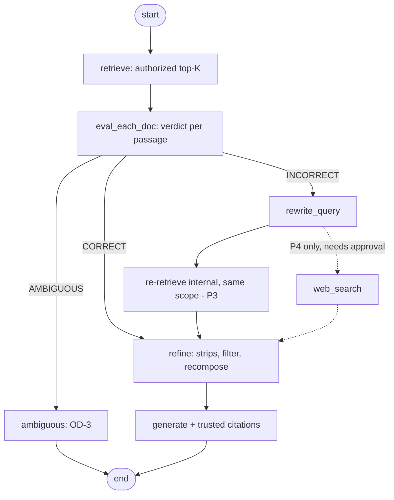

# 005 Corrective RAG (CRAG) — Plan

**Status:** Proposed — post-MVP. Nothing here is implemented or approved.
**Specification:** [spec.md](./spec.md) · **Decision:** DEC-010 (proposed)

## 1. Approach

Extend the existing chat orchestration (001 T15/T16) in the backend; keep authorization, retrieval and citation building unchanged. Add stages behind configuration, default off, so the MVP baseline stays comparable.

## 2. Target flow (proposed)

Dashed path is P4 and is not planned for build until OD-4 is approved. Phase boundaries: P1 evaluator, P2 refine, P3 rewrite + internal re-retrieve, P4 web search.

## 3. Components (backend)

- `RetrievalEvaluator` (P1): input question + authorized passage; output verdict and score. Implementation per OD-2.
- `ActionSelector` (P1): aggregates verdicts to query action using configured thresholds.
- `KnowledgeRefiner` (P2): splits passages into strips, scores, filters, recomposes within the 4000-token budget, preserving chunk IDs for citations.
- `QueryRewriter` (P3): one rewrite per request; output validated (length, no scope parameters).
- `ExternalSearchPort` (P4): interface only; no implementation until approved.
- Existing evidence policy remains the final gate before `generate`.

## 4. API and data

- No change to `POST /api/v1/chat/query` request. Optional response field `correctiveAction` (`NONE | REFINED | REWRITTEN`) only if OD-7 is approved; contract change must be recorded in specs/001 api-contract.md first.
- No new persistence in MVP-compatible form; no question/answer storage (DEC-008). Evaluation runs store verdicts per dataset item only.
- Configuration (defaults off): `crag.enabled`, `crag.evaluator.*`, `crag.thresholds.correct/incorrect`, `crag.max-evaluated-passages`, `crag.max-rewrites`, `crag.timeout`.

## 5. Security

Authorization happens before every stage; rewritten queries re-run through the same scoped retrieval. Evaluator/rewrite prompts treat passages as untrusted data. No external egress without P4 approval, redaction and audit. Failure of any CRAG stage falls back to baseline behaviour.

## 6. Verification

- Compare baseline vs CRAG on the same versioned labelled dataset (001 T18 runner), recording config versions.
- Unit: verdict aggregation, refiner budget and citation mapping, rewrite bounds.
- Adversarial: injection in passages, scope escape via rewrite, evaluator failure.
- Regression: all 001 acceptance criteria with `crag.enabled=false`.

## 7. Sequencing and gates

1. Complete MVP release and baseline evaluation (001 T18/T19 unblocked).
2. Owner reviews evaluation gaps and approves or rejects DEC-010 per phase.
3. Update spec/plan/tasks for approved phases; then implement P1 → P2 → P3. P4 is a separate approval.
