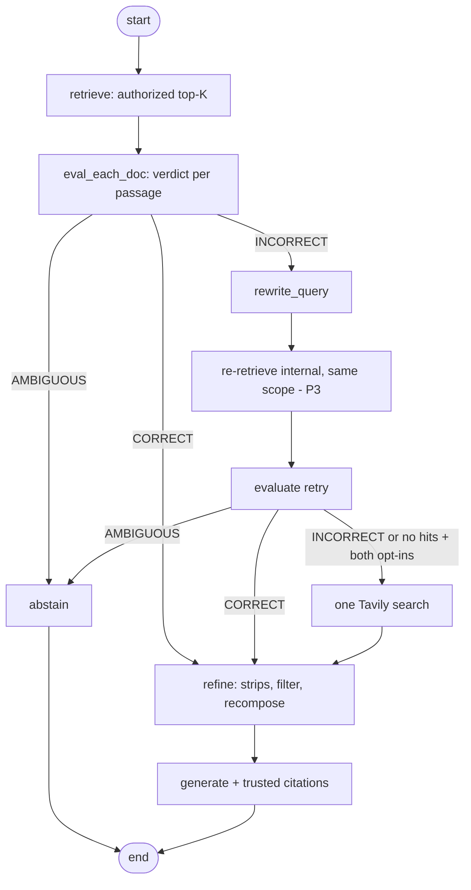

# 005 Corrective RAG (CRAG) — Plan

**Status:** P1–P4 approved for implementation; P4 disabled by default.
**Specification:** [spec.md](./spec.md) · **Decision:** DEC-010 (P1–P4 approved)

## 1. Approach

Extend the existing chat orchestration (001 T15/T16) in the backend. Keep internal retrieval authorization unchanged. Add CRAG behind `eka.crag.enabled=false`; external search additionally requires deployment enablement and request consent.

## 2. Target flow (proposed)

External search is called only after an unsuccessful internal retry and only with both opt-in gates. Initial no-hit and AMBIGUOUS paths abstain without external egress.

## 3. Components (backend)

- `RetrievalEvaluator` (P1): one bounded model call over up to five authorized passages; output verdicts keyed to trusted chunk IDs.
- `ActionSelector` (P1): CORRECT if any passage is CORRECT; otherwise AMBIGUOUS if any passage is AMBIGUOUS; otherwise INCORRECT.
- `KnowledgeRefiner` (P2): split correct passages into source strips, select relevant strip IDs, validate IDs, and pass only exact source text within the existing context budget.
- `QueryRewriter` (P3): at most one bounded, validated rewrite; internal re-retrieval repeats the same server-derived collections and metadata filters.
- `TavilyExternalSearchService` adapter (P4): at most one basic search and five snippets; send only the user's question and fixed options. Do not request raw page content or provider-generated answers.
- Prompt assembly treats search snippets as untrusted content, bounded by the existing context budget. Generate only from external results after an unsuccessful internal retry.
- Citation building adds source type. `INTERNAL` retains current document metadata; `EXTERNAL` contains validated HTTPS URL, title, and snippet without internal document IDs.
- With CRAG enabled, only passages judged CORRECT and selected as exact source strips reach generation; the original similarity threshold remains the baseline fallback gate.

## 4. API and data

- Request adds optional `allowExternalSearch` (false when absent); response citations add source type and external title/URL. Existing internal fields and behavior remain intact.
- Frontend adds an unchecked per-question “Search the public web” option. External citations are labeled and linked safely; they bypass internal document verification.
- No new persistence or question/answer storage (DEC-008). Verdicts/actions are logged with correlation ID and chunk IDs only; the evaluation runner records per-dataset results.
- Configuration: existing CRAG bounds, plus `EKA_WEB_SEARCH_ENABLED=false`, unset `TAVILY_API_KEY`, a provider timeout, and max five results.

## 5. Security

Authorization happens before every internal stage; rewritten queries re-run through the same scoped retrieval. External requests require operator enablement and user consent and send no internal passages or identifiers. Never log/persist questions or provider bodies. Validate HTTPS citations and bound title/snippet lengths. Search failures abstain; failures in P1–P3 retain the existing baseline fallback.

## 6. Verification

- Compare baseline vs CRAG on the same versioned labelled dataset (001 T18 runner), recording config versions.
- Unit: verdict aggregation, refiner budget and citation mapping, rewrite bounds.
- Adversarial: injection in passages, scope escape via rewrite, evaluator failure.
- Regression: all 001 acceptance criteria with `crag.enabled=false`.
- P4: verify gates, one-call maximum, branch eligibility, minimal request payload, timeouts, malformed responses/URLs, and typed citations with a mocked HTTP server.
- Frontend: verify consent defaults off, request flag, visible external labels and safe links; no internal verification request for external sources.

## 7. Sequencing and gates

1. Owner authorized P1–P4 despite the incomplete baseline evaluation; preserve T18/T19 as blocked.
2. Implement and verify P1 → P2 → P3; run baseline-parity tests with CRAG disabled.
3. P4 follows P1–P3 and stays disabled until an operator provides the service key and a user opts in per question.
