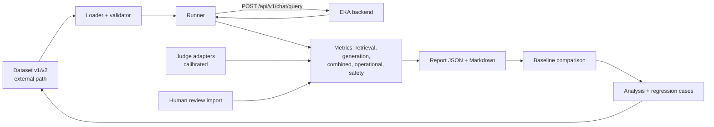

# 011 Evaluation Pipeline — Plan

**Specification:** [spec.md](./spec.md)
**Status:** Draft; implementation is not authorized until the specification is approved.

## Architecture
Keep one evaluation area in the backend repository (`evaluation/`), separate from Spring runtime code. Refactor the current single-file runner into small modules behind the unchanged `evaluate.mjs` entry point (runner language is open item OI-11; keep dataset and report formats language-neutral JSON). The runner calls the public API (and, if OI-1 is approved, an authorized non-production diagnostic response), computes metrics, writes reports, and compares them with a stored baseline. Requirements, decisions, and status stay in this repository. A separately deployed service is deferred.

Mapping to the 8 steps: 1–2 = charter and metric catalogue in the spec; 3 = loader/dataset tooling; 4 = per-metric method registry; 5 = runner; 6 = scoring and comparison with an improve-and-rerun loop; 7 = report analysis; 8 = operational metrics and reviewer-driven regression capture back into step 3.

## Components (proposed paths; confirm before implementation)
| Component | Path (backend repo) | Responsibility |
|---|---|---|
| Entry point | `evaluation/evaluate.mjs` | Backward-compatible CLI |
| Dataset | `evaluation/lib/dataset.mjs`, `evaluation/datasets/` | Validate v1/v2, hash, schema, non-sensitive samples |
| API client | `evaluation/lib/client.mjs` | Local auth now; OIDC bearer later; timeouts and failure budget |
| Retrieval metrics | `evaluation/lib/metrics/retrieval.mjs` | Recall@K (relevant in top K ÷ total relevant), MRR, hit rate; miss classification (absent / below threshold / below K) when raw candidates exist |
| Generation metrics | `evaluation/lib/metrics/generation.mjs` | Faithfulness, hallucination, relevance, citation validity |
| Combined metrics | `evaluation/lib/metrics/end-to-end.mjs` | Answer correctness, abstain accuracy |
| Operational metrics | `evaluation/lib/metrics/operational.mjs` | Percentiles, error/timeout rate, tokens/cost |
| Safety metrics | `evaluation/lib/metrics/safety.mjs` | Injection, leakage, sensitive-data, refusal |
| Judges | `evaluation/lib/judges/` | Pluggable judge adapters and calibration |
| Reporting | `evaluation/lib/report.mjs`, `evaluation/reports/` (git-ignored) | JSON + Markdown, slices, baseline comparison |
| Tests | `evaluation/test/` | Unit tests without model calls |
| Backend diagnostic (conditional, OI-1) | Backend chat/retrieval code | Authorized, non-production retrieved-candidate output |
| Documentation | Backend `evaluation/README.md`; this repository's guide and task records | Procedure, schema, limitations |

## Data model
**Dataset row (v2, superset of v1):** `id`, `question`, `answerable`, `relevantChunkIds`, optional `humanReview`, plus optional `referenceAnswer`, `category`, `source`, `expectedBehavior`, `tags`, `difficulty`. Dataset-level metadata: version, hash, chunking/embedding configuration the labels were created under, reviewer and review date.

**Report:** run metadata (dataset hash/version, model/config/embedding/prompt/runner versions, timestamps); per-metric value, sample size, method, and status (`calibrated`, `advisory`, `unavailable`); per-category slices; per-case rows without text; failures list; baseline comparison; target status (`proposed` until approved); limitations.

## Interfaces
- Existing: `POST /api/v1/chat/query` (answer, citations, `insufficientEvidence`, `retrievalMs`).
- Conditional (OI-1/OI-3): an evaluation/diagnostic extension returning retrieved chunk IDs, ranks, scores, and optionally context, only for an authorized caller in non-deployed profiles. Requires its own approval and API-contract update before implementation.

## Dependencies
- B06 dataset and reviewers for any representative result.
- B04 Keycloak realm for OIDC runner support.
- Local Ollama (or an approved judge provider) for judge metrics.
- Approval of OI-1 through OI-12.

## Security considerations
Authorization is enforced on the server for every evaluated request. Reports omit text by default. Judge prompts treat all content as untrusted data. Datasets and credentials remain external. Diagnostic output (if approved) is off in deployed profiles and never logs content.

## Phased delivery
| Phase | Outcome | Depends on |
|---|---|---|
| P0 | Approve spec, OI-1–OI-12 decisions; record in decisions | Owner |
| P1 | Refactor into modules; v2 loader; tests; no behavior change | P0 |
| P2 | Operational metrics (percentiles, errors) and richer reports/baseline comparison | P1 |
| P3 | Combined correctness and abstain metrics; human-review import | P1, dataset fields |
| P4 | Safety suite (injection, leakage) | P1 |
| P5 | Raw retrieval metrics via approved diagnostic interface | P0 (OI-1) |
| P6 | Judge adapters, calibration, faithfulness/hallucination metrics | P3, OI-2/OI-3 |
| P7 | Regression-case procedure; scheduled report-only run; OIDC support | P1, OI-4–OI-6, B04 |
| P8 | Representative evaluation run and T18/T19 evidence update | B06, P2–P6 |

## Testing strategy
- Unit tests for loader validation, each metric formula, percentile calculation, comparison, and report redaction (no model calls).
- Fixture-based tests for the gold-chunk-ranked-low scenario, unanswerable cases, and failure-budget handling.
- Backend integration tests for any approved diagnostic interface, including authorization, disabled-in-deployed-profile behavior, and no content logging.
- Judge calibration test using a small non-confidential labelled sample.
- Regression: v1 dataset and CLI outputs remain compatible.

## Verification
Map AC-1–AC-13 to test or run evidence; report actual results and skipped checks; do not mark T18/T19 complete without a representative human-reviewed run.
