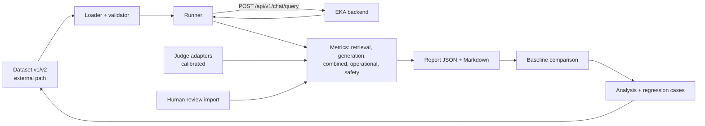

# 011 Evaluation Pipeline — Plan

**Specification:** [spec.md](./spec.md)
**Status:** Draft; implementation is not authorized until the specification is approved.

## Architecture
Keep one evaluation area in the backend repository (`evaluation/`), separate from Spring runtime code. Refactor the current single-file runner into small modules behind the unchanged `evaluate.mjs` entry point (runner language is open item OI-11; keep dataset and report formats language-neutral JSON). The runner calls the public API (and, if OI-1 is approved, an authorized non-production diagnostic response), computes metrics, writes reports, and compares them with a stored baseline. Requirements, decisions, and status stay in this repository. A separately deployed service is deferred.

**Framework direction:** DeepEval is selected for future application evals under DEC-014, pending the EV29 integration pilot and approval of spec 011. Keep the existing Node.js CLI and language-neutral JSON dataset/report contract. Verify TypeScript/JavaScript integration and metric coverage before implementation; add a separate Python component only if the pilot demonstrates that it is needed. Retain EKA-owned deterministic, human, authorization, safety, and operational checks where DeepEval alone does not meet the approved criteria.

Mapping to the 8 steps: 1–2 = charter and metric catalogue in the spec; 3 = loader/dataset tooling; 4 = per-metric method registry; 5 = runner; 6 = scoring and comparison with an improve-and-rerun loop; 7 = report analysis; 8 = operational metrics and reviewer-driven regression capture back into step 3.

## Components (proposed paths; confirm before implementation)
| Component | Path (backend repo) | Responsibility |
|---|---|---|
| Entry point | `evaluation/evaluate.mjs` | Backward-compatible CLI |
| Dataset | `evaluation/lib/dataset.mjs`, `evaluation/datasets/` | Validate v1/v2, hash, schema, non-sensitive samples |
| API client | `evaluation/lib/client.mjs` | Local auth now; OIDC bearer later; timeouts and failure budget |
| Retrieval metrics | `evaluation/lib/metrics/retrieval.mjs` | Recall@K, MRR, hit rate; miss classification and separately labelled human- and judge-based Precision@K on authorized raw candidates when available |
| Generation metrics | `evaluation/lib/metrics/generation.mjs` | Faithfulness, hallucination, relevance, citation validity |
| Combined metrics | `evaluation/lib/metrics/end-to-end.mjs` | Answer correctness, abstain accuracy |
| Operational metrics | `evaluation/lib/metrics/operational.mjs` | Percentiles, error/timeout rate, tokens/cost |
| Safety metrics | `evaluation/lib/metrics/safety.mjs` | Injection, leakage, sensitive-data, refusal |
| Judges | `evaluation/lib/judges/` | Pluggable judge adapters and calibration |
| Reporting | `evaluation/lib/report.mjs`, `evaluation/reports/` (git-ignored) | JSON + Markdown, slices, baseline comparison |
| Tests | `evaluation/test/` | Unit tests without model calls |
| Backend diagnostic (conditional, OI-1) | Backend chat/retrieval code | Authorized, non-production retrieved-candidate output |
| Documentation | Backend `evaluation/README.md`; this repository's guide and task records | Procedure, schema, limitations |

## Data model
**Dataset row (v2, superset of v1):** `id`, `question`, `answerable`, `relevantChunkIds`, optional `humanReview`, plus optional `referenceAnswer`, `category`, `source`, `expectedBehavior`, `tags`, `difficulty`. Dataset-level metadata: version, hash, chunking/embedding configuration the labels were created under, reviewer and review date.

**Retrieval dataset sourcing (proposed, OI-18):** Start B06 with human-authored and authorized LLM-assisted candidates, then independently review source evidence, labels and answerability against the authorized corpus. EV35 pilots DeepEval Synthesizer using non-confidential data and evaluates prepared EKA contexts, provenance, true indexed-chunk mapping, runtime and egress; no new application storage or provider is implied. Keep generated candidates and review records distinct; record label coverage, uncertain negatives, split and origin metadata. A separate held-out set must not be tuned against. Production-log mining is deferred behind OI-4/OI-12 and required privacy/decision approvals; reviewer-submitted cases must also obey existing restrictions. The candidate artifact's schema and the existing runner schema differ; map and validate reviewed labels before conversion.

**Retrieval-noise evaluation (draft):** Use a reviewed question and reference answer with each authorized top-K retrieved chunk in a separate, versioned relevance-judge prompt, as illustrated in [guide §5.6](../../docs/Enterprise_Knowledge_Assistant_Evaluation_Guide_v1.md#judging-retrieved-chunks-against-a-golden-reference-answer). Validate the yes/no verdict and reason; calculate fixed-denominator Precision@K only when all returned chunks have valid verdicts. Record empty and unfilled results, unavailable/excluded cases, counts and method. Aggregate only available cases and expose coverage. Maintain a distinct human-label score only for explicitly judged candidates; relevant-ID lists do not make unlabeled candidates negative. Agree the representation and storage of reviewed positive/negative judgments and their provenance before implementing it; preserve v1 compatibility. Do not retain confidential text or text-bearing reasons in reports/logs.

The judge is advisory until calibrated against human relevance labels. Use an approved provider and only server-authorized evidence; raw-candidate access and any passage-text exposure depend on OI-1/OI-3. DeepEval integration and whether it can meet this exact fixed-K, per-chunk contract remain subject to EV29; do not assume contextual precision has identical semantics.

**Report:** run metadata (dataset hash/version, model/config/embedding/prompt/runner versions, timestamps); per-metric value, sample size, method, and status (`calibrated`, `advisory`, `unavailable`); per-category slices; per-case rows without text; failures list; baseline comparison; target status (`proposed` until approved); limitations.

**Regression matrices (proposed):** Every run emits three distinct matrices—component, workflow/integration, and whole application—with stable suite/target/case/metric identifiers, method, sample size, current and accepted-baseline values, delta, status, and configuration references. Retain every report in an immutable history and include all retained prior reports in the current report's comparison index. Compare numerically only where dataset labels, case and metric definitions, and relevant configuration are compatible; otherwise list the prior run and explain the incompatibility. The latest accepted compatible baseline is used for regression decisions. Older runs support trend/context, not independent gates. Mark missing targets, missing history, unavailable metrics, and cases not run explicitly.

**Matrix status vocabulary (proposed):** `new-failure`, `fixed`, `unchanged-failure`, `metric-regression`, `metric-improvement`, `pass`, `unavailable`, `not-run`, and `incomparable`. Statuses are per stable case/metric/target; run-level status summarizes them without hiding individual failures.

**First baseline and experiment tracking (proposed):** Start with a report-only characterization run on one frozen, authorized dataset and corpus/index snapshot. Record the *effective* settings as observed in the running backend, distinguish approved DEC-007 values from runtime values, and list settings that cannot be observed or controlled. This is a measurement of current behavior, not an optimal setting or automatic release baseline. After owner/reviewer acceptance, use it as the initial comparable baseline. Link each later tuning trial to that run with a stable run ID, hypothesis, changed parameters, controlled settings, all three result matrices, artifact references, and acceptance state.

**Actions + MLflow run flow (owner-selected direction, implementation pending):** GitHub Actions is the orchestrator and MLflow is the experiment tracker. A manually dispatched, scheduled, or approved change-triggered Actions workflow starts EKA with the intended settings and a fixed authorized dataset/corpus/index; runs the evaluation CLI; collects its computed metrics and a redacted JSON report; writes a concise job summary; then records run parameters, metrics, lineage, and safe report references in MLflow. Actions logs are diagnostic only. Begin in report-only mode; enforce the live deployment gate only after its policy is approved and implemented. The reviewer accepts/promotes baselines explicitly. This flow is for offline evaluations and does not implement a production metrics dashboard.

**Live deployment gate (DEC-016; not implemented):** After policy approval, the deployment workflow verifies a trusted evaluation and accepted compatible baseline for the exact candidate artifact and deployment-relevant effective configuration. Check each required threshold and regression rule independently across the approved component, integration and application suites; equal results can pass and no aggregate improvement cancels a required failure. Missing, stale, failed, incomplete, untrusted or incompatible evidence, an unavailable required verifier/tracker, or an artifact/configuration mismatch denies automatic live deployment with a recorded reason. A pass permits the deployment job to proceed but does not replace existing security/release approvals or automatically promote a baseline. Local startup and development are not gated. OI-7 and OI-17 must resolve the policy, evidence trust and bootstrap/emergency/rollback procedures before enforcement; report-only runs are not gate passes.

Before any run, verify the trust boundary for the runner, dataset and provider data egress, MLflow endpoint, artifact store, credentials, permissions, and retention. Use non-confidential data unless controlled access and data handling are approved. Never put secrets or confidential questions, answers, or passages in Actions logs, workflow artifacts, or MLflow. Keep MLflow parameters/metrics and safe artifact references distinct from full content-bearing evaluation inputs.

The parameter manifest should cover, where exposed: chunk size/overlap and chunker version; embedding provider/model/dimensions/batch size and index/table identity; chat provider/model and decoding settings (temperature, top-p, token limits if actually supported); retrieval top-K, similarity threshold, context-token budget and filters; prompt/template version; CRAG/web-search toggles and limits; ingestion concurrency/retry/timeouts; evaluation runner/framework/dependency versions; dataset and corpus hashes/revisions; and runtime/hardware/database versions. Never record secrets. Chunking or embedding changes require a compatible corpus re-ingestion/re-index; evaluate them with labels tied to that index. Change one parameter at a time where practical, and explicitly label multi-parameter experiments and interactions.

**Candidate-provider proposal (not approved):** If OI-14 and provider/data-egress approval permit candidate-model comparison, assess an optional OpenRouter chat route using Spring AI's OpenAI-compatible integration. Verify compatibility against the backend's pinned Spring AI version before implementation. Keep embeddings and their index unchanged; use separately configured backend instances for candidate runs, and record the provider, exact model identifier, and route. This does not amend DEC-002 or authorize production use or confidential-data disclosure.

## Interfaces
- Existing: `POST /api/v1/chat/query` (answer, citations, `insufficientEvidence`, `retrievalMs`).
- Conditional (OI-1/OI-3): an evaluation/diagnostic extension returning retrieved chunk IDs, ranks, scores, and optionally context, only for an authorized caller in non-deployed profiles. Requires its own approval and API-contract update before implementation.

## Dependencies
- B06 dataset and reviewers for any representative result.
- B04 Keycloak realm for OIDC runner support.
- Local Ollama (or an approved judge provider) for judge metrics.
- Approval of OI-1 through OI-18.

## Security considerations
Authorization is enforced on the server for every evaluated request. Reports omit text by default. Judge prompts treat all content as untrusted data. Datasets and credentials remain external. Diagnostic output (if approved) is off in deployed profiles and never logs content.
No request containing confidential questions or retrieved passages may be sent through a proposed hosted candidate provider until the allowed data categories and provider/upstream handling have explicit approval. OpenRouter is not an approved provider under the current DEC-002.

## Phased delivery
| Phase | Outcome | Depends on |
|---|---|---|
| P0 | Approve spec, OI-1–OI-18 decisions (including dataset sourcing, candidate-model scope/provider-egress, dataset interchange, regression-history retention/baseline acceptance, Actions/MLflow data controls and the live gate policy); record in decisions | Owner |
| P1 | Refactor into modules; v2 loader; tests; no behavior change | P0 |
| P2 | Operational metrics (percentiles, errors) and richer reports/baseline comparison | P1 |
| P3 | Combined correctness and abstain metrics; human-review import | P1, dataset fields |
| P4 | Safety suite (injection, leakage) | P1 |
| P5 | Raw retrieval metrics via approved diagnostic interface | P0 (OI-1) |
| P6 | Judge adapters, calibration, faithfulness/hallucination metrics | P3, OI-2/OI-3 |
| P7 | Regression-case procedure; scheduled report-only run; OIDC support | P1, OI-4–OI-6, B04 |
| P8 | Representative evaluation run and T18/T19 evidence update | B06, P2–P6 |
| P9 | Build and verify retained run history and cross-level regression matrices, comparing current results with the accepted baseline and all retained reports | P1, P7, EV30, OI-15 |
| P10 | Produce a reviewed report-only initial characterization baseline, then use GitHub Actions to orchestrate controlled trials and MLflow to record linked run metadata, metrics and redacted report references; complete OI-16 controls before workflow integration | P9, EV31, B06, OI-16 |
| P11 | Implement and verify the protected live deployment gate against approved policy, trusted candidate evidence and an accepted compatible baseline; preserve local workflows | P10, EV32, OI-7, OI-17 |

If P0 approves OpenRouter as a candidate chat route, add and verify its opt-in backend configuration before using it in evaluation; this is a gated follow-on, not part of the current authorized implementation scope. Keep embeddings unchanged.

## Testing strategy
- Unit tests for loader validation, each metric formula, percentile calculation, comparison, and report redaction (no model calls).
- Retrieval-noise fixture tests for fixed K, fewer than K and empty results, partial/malformed/failed judgments, unavailable aggregates, explicit human labels versus unknown candidates, eligibility, method separation, and redaction; test prompt-injection handling and authorization boundaries separately. Calibrate judge verdicts against reviewed labels before any pass/fail use.
- Dataset sourcing review/pilot checks: unreviewed candidates cannot be promoted, source anchors resolve to real indexed chunks without fabricated IDs, unjudged is distinct from irrelevant, corpus and authorized scope support answerability, held-out leakage is checked, and provider/data authorization is recorded.
- EV29 integration pilot: verify the selected DeepEval SDK/runtime against EKA's RAG and whole-application requirements, dataset/report contracts, judge calibration, and data-egress constraints before selecting implementation details.
- Regression-history tests: verify all retained prior reports are represented, compatible deltas are correct, incomparable/missing cells are explicit, status transitions are stable by case ID, and no confidential text enters archived artifacts.
- Experiment-manifest tests: verify complete effective-configuration capture, parent/baseline run linkage, secret redaction, unsupported-setting status, and comparability warnings for dataset/corpus/index changes.
- Actions/MLflow integration tests: verify workflow inputs and trigger policy, effective configuration capture, metric/report publication, run lineage, MLflow failure handling, and absence of secrets/confidential text from logs and artifacts; do not gate on unapproved thresholds.
- Live-gate tests: cover equal and improved results, every required threshold and regression failure, mixed gains/losses, missing or incompatible baseline/evidence, stale evidence, unavailable verifier, uncalibrated judge, artifact/configuration mismatch, no automatic promotion and ungated local startup/evaluation.
- Fixture-based tests for the gold-chunk-ranked-low scenario, unanswerable cases, and failure-budget handling.
- Backend integration tests for any approved diagnostic interface, including authorization, disabled-in-deployed-profile behavior, and no content logging.
- Judge calibration test using a small non-confidential labelled sample.
- Regression: v1 dataset and CLI outputs remain compatible.

## Verification
Map AC-1–AC-42 to test or run evidence; report actual results and skipped checks; do not mark T18/T19 complete without a representative human-reviewed run.
